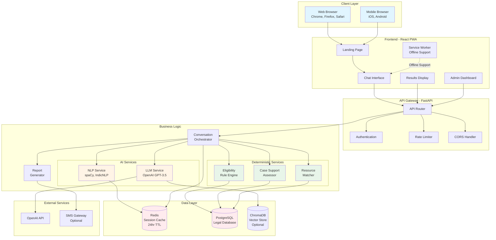
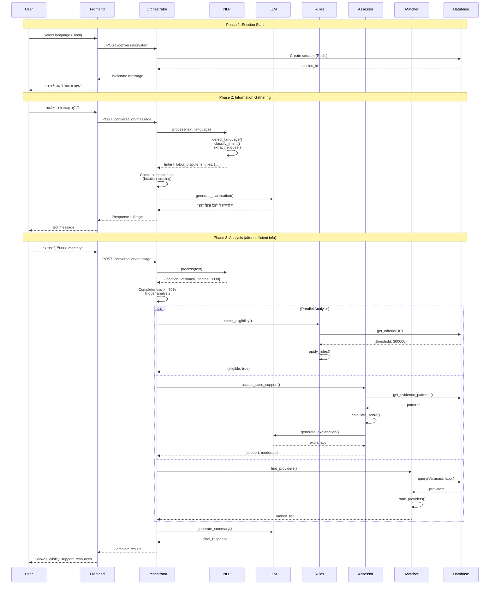
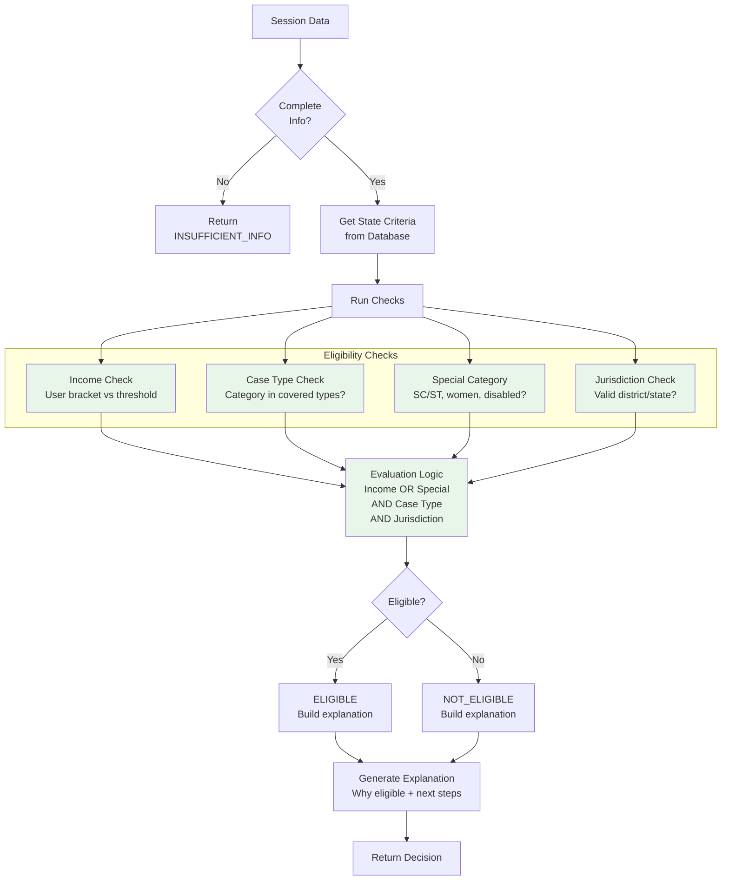
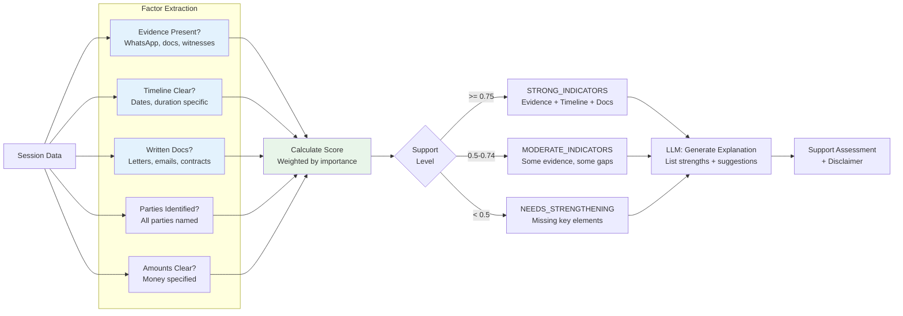
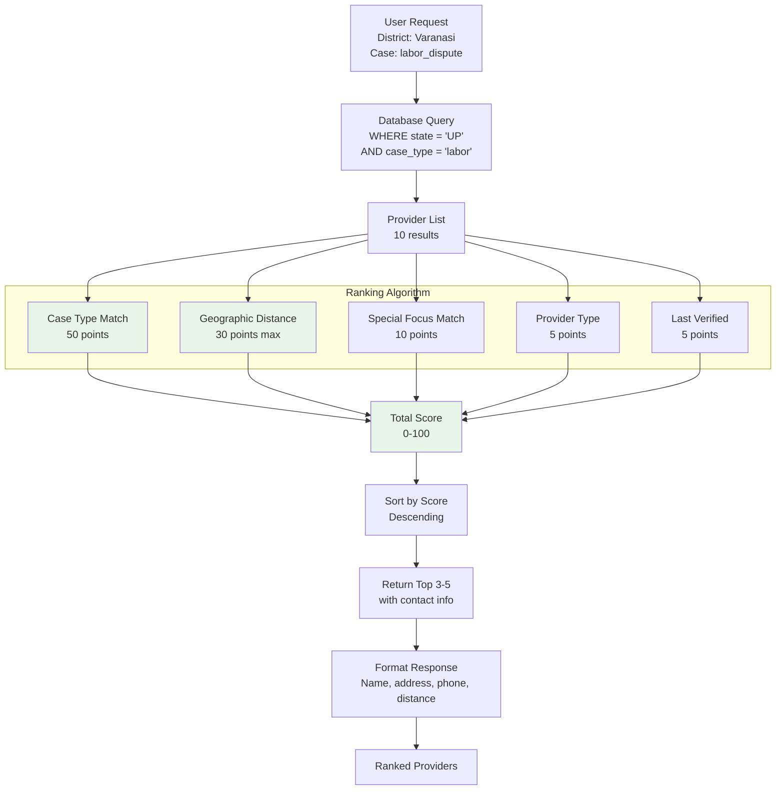
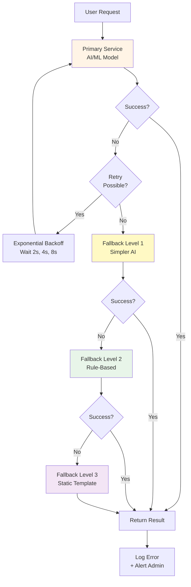
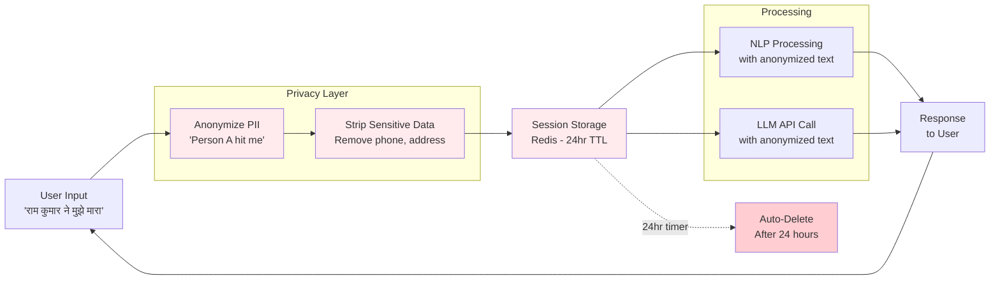
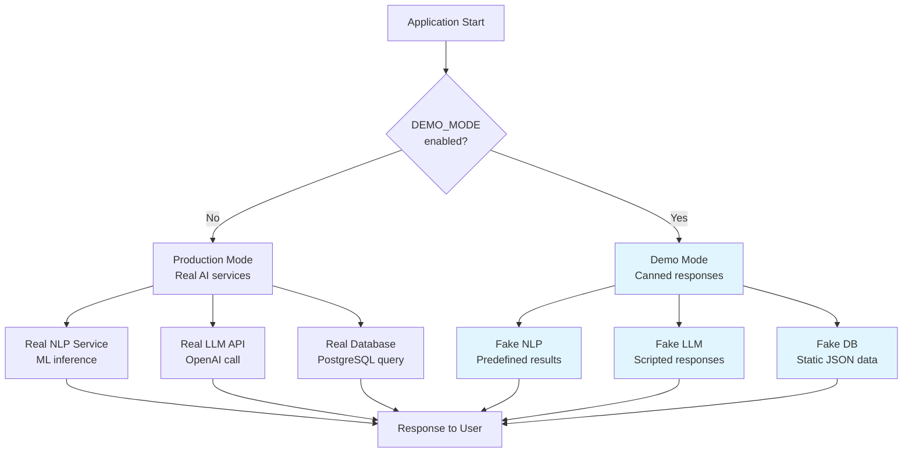

# NYAYASETU - Architecture Diagrams Reference

This document contains all key architectural diagrams for quick reference during development and presentations.

---

## 1. HIGH-LEVEL SYSTEM ARCHITECTURE



**Legend:**
- 🔵 Blue: Client devices
- 🟡 Orange: AI/ML services (non-deterministic)
- 🟢 Green: Rule-based services (deterministic)
- 🔴 Red: Data stores

---

## 2. CONVERSATION FLOW DIAGRAM



---

## 3. NLP PIPELINE

```mermaid
graph LR
    Input[User Text<br/>'मालिक ने तनख्वाह नहीं दी']
    
    subgraph "NLP Pipeline"
        Lang[Language Detection<br/>fastText]
        Prep[Preprocessing<br/>Normalize, Tokenize]
        Intent[Intent Classification<br/>BERT/IndicBERT]
        NER[Named Entity Recognition<br/>spaCy]
        Urgency[Urgency Detection<br/>Keyword + Sentiment]
    end
    
    Output[NLP Result<br/>{language, intent, entities, urgency}]
    
    Input --> Lang
    Lang --> Prep
    Prep --> Intent
    Prep --> NER
    Prep --> Urgency
    
    Intent --> Output
    NER --> Output
    Urgency --> Output
    
    style Lang fill:#fff4e6
    style Intent fill:#fff4e6
    style NER fill:#fff4e6
    style Urgency fill:#fff4e6
```

**Processing Steps:**
1. **Language Detection**: Identify Hindi/English/Tamil (95% confidence)
2. **Preprocessing**: Unicode normalization, transliteration if needed
3. **Intent Classification**: Map to 5 categories (labor, property, family, criminal, consumer)
4. **Entity Extraction**: Extract persons, locations, money, dates
5. **Urgency Detection**: Check for critical keywords (violence, today, threat)

---

## 4. LLM PIPELINE

```mermaid
graph TB
    SessionData[Session Data<br/>{history, extracted_data}]
    
    subgraph "Prompt Construction"
        SystemPrompt[System Prompt<br/>'You are a legal aid assistant']
        UserContext[User Context<br/>Conversation history]
        Task[Task Instruction<br/>'Generate clarification']
        Constraints[Constraints<br/>'No legal advice']
    end
    
    Prompt[Complete Prompt]
    
    subgraph "Safety Layer"
        InputCheck[Input Sanitization<br/>Prevent injection]
        Anonymize[PII Anonymization<br/>Remove names, phone]
    end
    
    subgraph "LLM API"
        OpenAI[OpenAI GPT-3.5-turbo<br/>or Llama 3]
        Generation[Text Generation]
    end
    
    subgraph "Validation"
        OutputCheck[Output Validation<br/>Check prohibited content]
        Fallback{Valid?}
    end
    
    Response[LLM Response<br/>or Template Fallback]
    
    SessionData --> SystemPrompt
    SessionData --> UserContext
    UserContext --> Task
    Task --> Constraints
    Constraints --> Prompt
    
    Prompt --> InputCheck
    InputCheck --> Anonymize
    Anonymize --> OpenAI
    OpenAI --> Generation
    Generation --> OutputCheck
    OutputCheck --> Fallback
    
    Fallback -->|Yes| Response
    Fallback -->|No| TemplateFallback[Template Response]
    TemplateFallback --> Response
    
    style OpenAI fill:#fff4e6
    style InputCheck fill:#ffebee
    style OutputCheck fill:#ffebee
```

---

## 5. ELIGIBILITY RULE ENGINE



**Key Principle**: 100% deterministic. Same input → Same output. Always explainable.

---

## 6. CASE SUPPORT ASSESSMENT



**Important**: This is NOT a prediction. It's a readiness checklist.

---

## 7. RESOURCE MATCHING & RANKING



---

## 8. ERROR HANDLING & FALLBACK HIERARCHY



**Example: LLM Failure**
1. **Primary**: OpenAI API call (timeout 30s)
2. **Retry**: Try again after 2s, 4s
3. **Fallback 1**: Use simpler prompt or local model
4. **Fallback 2**: Keyword-based response
5. **Fallback 3**: Predefined template ("Can you provide more details?")

---

## 9. PRIVACY & DATA FLOW



**Privacy Guarantees:**
1. No names stored (replaced with roles)
2. No phone/address/Aadhaar (stripped before processing)
3. IP addresses hashed (not stored in full)
4. Data deleted after 24 hours (Redis TTL)
5. No tracking cookies

---

## 10. DEMO MODE ARCHITECTURE



**Demo Flow Example:**
```
1. User: "मालिक ने तनख्वाह नहीं दी"
   → Pre-scripted NLP: {intent: labor_dispute}
   → Pre-scripted Bot: "आप किस जिले में रहते हैं?"

2. User: "वाराणसी"
   → Pre-scripted Bot: "आपकी मासिक आय कितनी है?"

3. User: "₹8000"
   → Show pre-generated results: Eligible, Moderate support, 3 providers

Result: Full demo in 2-3 minutes with zero external dependencies.
```

---

## DIAGRAM USAGE GUIDE

### For Development:
- **Diagram 1-2**: Overall system understanding
- **Diagram 3-7**: Component implementation reference
- **Diagram 8**: Error handling implementation

### For Presentation:
- **Diagram 1**: High-level overview (first slide)
- **Diagram 2**: Flow walkthrough (live demo)
- **Diagram 5**: "Why rules, not AI?" explanation
- **Diagram 9**: Privacy architecture

### For Viva:
- **Diagram 5 vs 6**: LLM for conversation, Rules for decisions
- **Diagram 8**: Fallback strategy ("What if AI fails?")
- **Diagram 10**: Demo mode explanation

---

**All diagrams are in Mermaid format and can be rendered in:**
- GitHub/GitLab markdown
- VS Code (with Mermaid preview extension)
- draw.io (import mermaid)
- Online: mermaid.live

