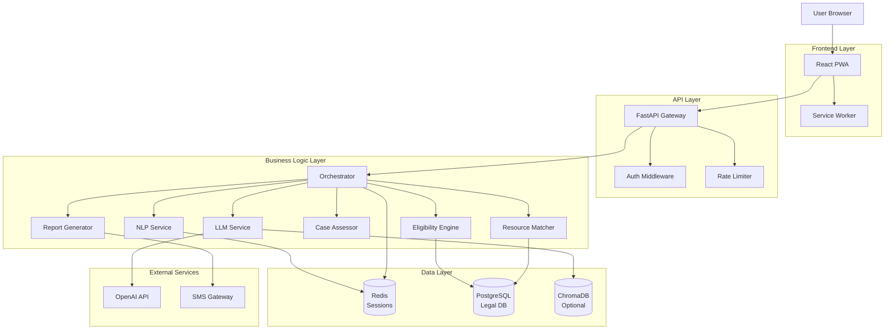

# NYAYASETU - Technical Architecture Summary

## Document Overview

The complete technical architecture is documented across three files:

1. **TECHNICAL_ARCHITECTURE.md** - Core architecture, frontend, backend, NLP, LLM, knowledge retrieval, RAG, eligibility engine
2. **TECHNICAL_ARCHITECTURE_PART2.md** - Case assessment, evidence readiness, urgency detection, resource matching, auth, privacy
3. **TECHNICAL_ARCHITECTURE_PART3.md** - Complete data flow, error handling, AI fallbacks, demo mode, monitoring

---

## Quick Reference Guide

### System Components & Responsibilities

```
┌─────────────────────────────────────────────────────────────┐
│                    REACT FRONTEND                            │
│  - UI rendering, user input, language switching              │
│  - PWA with offline support                                  │
│  - Does NOT: business logic, eligibility rules, LLM calls    │
└──────────────────────┬──────────────────────────────────────┘
                       │ REST API
┌──────────────────────▼──────────────────────────────────────┐
│                  FASTAPI BACKEND                             │
│  - Request routing, orchestration, validation                │
│  - Session management (Redis, 24hr TTL)                      │
│  - Does NOT: direct UI rendering, client-side state          │
└─────┬────────────────────────────────────────────────┬──────┘
      │                                                 │
┌─────▼─────────────┐  ┌────────────┐  ┌─────────────▼──────┐
│   NLP SERVICE     │  │ LLM SERVICE│  │ RULE ENGINE        │
│                   │  │            │  │                    │
│ - Language detect │  │ - Convers. │  │ - Eligibility      │
│ - Intent classify │  │ - Summary  │  │ - Validation       │
│ - Entity extract  │  │ - Explain  │  │ - Criteria match   │
│ - Urgency detect  │  │            │  │                    │
│                   │  │ NOT: legal │  │ NOT: conversation  │
│ NOT: eligibility  │  │    decisions│  │      NLU           │
└───────────────────┘  └────────────┘  └────────────────────┘
```

### Critical Architectural Principles

1. **LLM for Understanding, Rules for Decisions**
   - LLM: Conversation, summarization, explanation generation
   - Rules: Eligibility determination, validation, legal criteria
   - **Why**: Legal decisions must be deterministic and auditable

2. **Privacy by Default**
   - No accounts, no login for citizens
   - Session-based, 24-hour auto-deletion
   - Anonymize PII before external API calls
   - **Why**: Reduce barriers, protect sensitive legal information

3. **Fail-Safe Design**
   - Every AI component has deterministic fallback
   - Template-based responses when LLM fails
   - Keyword matching when NLP fails
   - Degraded service > no service
   - **Why**: Service continuity is critical for access to justice

4. **Explainability First**
   - Every eligibility decision shows reasoning
   - Case support assessment explains factors
   - UI surfaces "why", not just "what"
   - **Why**: Legal systems require transparency and trust

---

## Data Flow Summary

### User Message → Final Recommendation (10 Steps)

```
1. User sends message in Hindi
   ↓
2. NLP Service:
   - Detects language: Hindi (95% confidence)
   - Classifies intent: labor_dispute (89% confidence)
   - Extracts entities: {employer, 3 months, unpaid}
   - Detects urgency: medium
   ↓
3. Orchestrator updates session:
   - Stores extracted data
   - Checks completeness: 30% (missing location, income, evidence)
   ↓
4. LLM generates clarification:
   - "मुझे समझ आया। आप किस जिले में रहते हैं?"
   ↓
5. [Repeat 1-4 until completeness >= 70%]
   ↓
6. Eligibility Engine (Deterministic Rules):
   - Gets UP criteria: ₹3L threshold
   - Checks income: below_2_lakh → eligible ✓
   - Checks case type: labor_dispute in covered ✓
   - Result: ELIGIBLE
   ↓
7. Case Assessor (Hybrid):
   - Extracts factors: evidence present, timeline clear, docs partial
   - Calculates score: 0.7 → MODERATE support
   - LLM generates explanation in Hindi
   ↓
8. Resource Matcher:
   - Queries DB: Varanasi + labor_dispute
   - Ranks by: case type match (50 pts), distance (30 pts), type (5 pts)
   - Returns top 3 providers
   ↓
9. LLM Summary Generation:
   - Synthesizes eligibility + assessment + resources
   - Generates encouraging, actionable message in Hindi
   ↓
10. Response to User:
    - Eligibility: योग्य ✓
    - Support: मध्यम (with strengths + suggestions)
    - Resources: 3 nearest providers with contact info
```

---

## Key Technical Decisions & Justification

### 1. Why Hybrid AI (LLM + Rules)?

**Decision**: Use LLM for conversation, rules for eligibility

**Alternatives Considered**:
- Pure LLM: Let GPT decide eligibility
- Pure Rules: No AI at all

**Why Chosen**:
- LLM excels at natural language understanding (unstructured → structured)
- Legal eligibility is rule-based (income thresholds, case types) → needs determinism
- Hybrid gives us conversational UX + auditable decisions

**Trade-offs**:
- More complex architecture
- Two inference steps (NLP + LLM)
- BUT: Legally defensible, explainable, accurate

### 2. Why Session-Based (No Accounts)?

**Decision**: Anonymous sessions with 24hr TTL, no user accounts

**Alternatives Considered**:
- User accounts with login
- Persistent history

**Why Chosen**:
- Privacy: Legal matters are sensitive
- Access: No barrier (illiterate users can't create accounts)
- Compliance: Less data = less liability

**Trade-offs**:
- No user history across sessions
- Can't track outcomes
- BUT: Acceptable for discovery tool, not case management

### 3. Why PostgreSQL + Redis?

**Decision**: PostgreSQL for legal data, Redis for sessions

**Alternatives Considered**:
- MongoDB (NoSQL)
- Only PostgreSQL (no cache)

**Why Chosen**:
- Legal data is structured (providers, criteria, evidence patterns)
- Redis TTL perfect for 24hr session expiry
- PostgreSQL JSONB handles semi-structured extracted data

**Trade-offs**:
- Two databases to manage
- BUT: Each optimized for its use case

### 4. Why RAG Optional for MVP?

**Decision**: Skip vector search for MVP, add later if needed

**Alternatives Considered**:
- Build RAG upfront

**Why Chosen**:
- Eligibility criteria are simple rules, not complex documents
- LLM can explain from structured data (no need for semantic search yet)
- Reduces complexity and dependencies

**Trade-offs**:
- Less grounding for LLM responses
- May need to add for complex cases
- BUT: Faster to MVP, can iterate

### 5. Why OpenAI API (not self-hosted)?

**Decision**: Use OpenAI GPT-3.5-turbo for MVP

**Alternatives Considered**:
- Self-hosted Llama 3
- Anthropic Claude

**Why Chosen**:
- Fast integration (API > fine-tuning)
- High quality for conversational tasks
- Cost acceptable for demo/pilot ($100-150/month for 1000 users)

**Trade-offs**:
- Data sent to external API (mitigated by anonymization)
- Recurring cost
- BUT: Can switch to self-hosted for production

---

## Component Interaction Diagram



---

## Error Handling Strategy

### Failure Modes & Responses

| Failure | Severity | Fallback | User Impact |
|---------|----------|----------|-------------|
| **LLM API timeout** | Medium | Template-based clarification | Slightly robotic response |
| **LLM API rate limit** | High | Wait + retry message | 30-60s delay |
| **NLP model error** | Medium | Keyword matching | Lower accuracy intent |
| **Database down** | Critical | Cached static providers | Generic state-level resources |
| **Redis cache down** | Critical | In-memory session (single instance) | No session persistence |
| **Eligibility rule missing** | Low | Conservative "may qualify" | Manual review recommended |

### Fallback Hierarchy

```
Primary: AI/ML Service
    ↓ (fails)
Fallback 1: Simpler AI (keyword matching)
    ↓ (fails)
Fallback 2: Template/Static (predefined responses)
    ↓ (fails)
Fallback 3: Degraded Service (show generic contact info)
    ↓ (fails)
System: Show maintenance page + emergency contact
```

---

## Security & Privacy Checklist

### Privacy Controls
- [x] No PII storage (names, phone, address)
- [x] 24-hour data retention max
- [x] Anonymize before sending to LLM API
- [x] No cookies/tracking beyond session
- [x] Privacy policy in plain language
- [x] IP address hashing (not storing full IP)
- [x] Session-based, no accounts

### Security Measures
- [x] HTTPS only
- [x] Input validation (SQL injection prevention)
- [x] Rate limiting (10 req/min per IP)
- [x] Prompt injection prevention
- [x] CORS policies
- [x] Environment variables for secrets
- [x] LLM output validation (no legal advice)

---

## Demo Mode (for Final-Year Presentation)

### Why Demo Mode?

- **Predictability**: No external API failures during demo
- **Speed**: Instant responses (no network latency)
- **Cost**: No OpenAI charges during practice runs
- **Showcase**: Pre-scripted flow showing all features

### How It Works

```python
# Toggle in config
DEMO_MODE = True

# If demo mode:
- Use canned responses (no LLM API)
- Use predefined NLP results (no ML inference)
- Show pre-populated results (eligibility, resources)
- But: Same UI, same flow, same architecture

# Demo flow:
1. User: "मालिक ने तनख्वाह नहीं दी"
   → Bot: [predetermined response]
2. User: "वाराणसी"
   → Bot: [predetermined response]
3. User: "₹8000"
   → Bot: [predetermined response]
4. Results: [show pre-generated analysis]
```

---

## MVP Scope (6-8 Weeks)

### Must-Have Features
1. ✅ Conversational interface (text-based)
2. ✅ 2 languages (English + Hindi)
3. ✅ 5 case categories (labor, property, family, criminal, consumer)
4. ✅ Rule-based eligibility (2-3 states: UP, Maharashtra)
5. ✅ Case support assessment (3-level: strong/moderate/weak)
6. ✅ Resource matching (20-30 providers in DB)
7. ✅ PDF report generation
8. ✅ Admin dashboard (basic analytics)

### Nice-to-Have (if time permits)
- Voice input (speech-to-text)
- 5 languages (add Tamil, Telugu, Bengali)
- Urgency detection with crisis helplines
- Geo-location for distance calculation
- PWA offline support
- Demo mode

### Out of Scope (Future Work)
- WhatsApp integration
- RAG with legal documents
- Self-hosted LLM
- Document upload (OCR)
- Case tracking
- Integration with legal aid providers

---

## Viva Preparation: Key Questions & Answers

### Q: "Why not let the LLM decide eligibility?"

**Answer**: 
"Legal eligibility is based on explicit government criteria—income thresholds, case types covered. These are deterministic rules, not subjective judgments. Using an LLM would introduce:
1. **Non-determinism**: Same input could yield different outputs
2. **Hallucination risk**: LLM might invent criteria
3. **Auditability problem**: Can't explain why it decided
4. **Legal liability**: Wrong eligibility could deny someone justice

Our approach: LLM understands the user's situation (unstructured text → structured data), then a deterministic rule engine applies verified legal criteria. Best of both worlds."

### Q: "How do you prevent the LLM from giving legal advice?"

**Answer**:
"Three layers of protection:
1. **System Prompt**: Explicitly forbids advice, defines role as 'triage assistant'
2. **Output Validation**: Check responses for prohibited terms ('will win', 'definitely', 'I recommend filing')
3. **Output Structure**: Force structured outputs (eligibility = yes/no, support = indicators only, not predictions)
4. **Disclaimer**: Every response includes 'This is not legal advice'

If validation fails, we use template fallback. [Show code example]"

### Q: "Your case support assessment—isn't that a prediction?"

**Answer**:
"No. We assess **information readiness**, not case outcomes. We check:
- Is evidence present? (WhatsApp messages: yes)
- Is timeline clear? (3 months: yes)
- Is documentation available? (Appointment letter: no)

This is a **checklist**, not a prediction. We frame it as 'preliminary indicators' and suggest improvements ('Get appointment letter'). It's like checking if you have all ingredients before cooking—not predicting if the meal will be delicious."

### Q: "Privacy—you say no storage, but LLM APIs log requests?"

**Answer**:
"Excellent point. We mitigate this:
1. **Anonymize before sending**: Replace names with 'Person A', 'Employer B'
2. **Strip PII**: Remove phone numbers, addresses, Aadhaar before API call
3. **OpenAI's policy**: They don't train on API data (as per their TOS)
4. **Future-proof**: For production, we'd switch to self-hosted Llama—then zero external data sharing

[Show anonymization code]. Our privacy policy transparently mentions 'AI processing partner' and what data is sent."

### Q: "What if your NLP model fails?"

**Answer**:
"Every AI component has a deterministic fallback. If NLP fails:
1. **Try**: ML-based intent classification
2. **Fallback**: Keyword matching (if 'तनख्वाह' in text → labor_dispute)
3. **Worst case**: Ask user to select category from list

[Show code]. Same for LLM—if API fails, we use predefined templates. Degraded service is better than no service."

---

## File Structure Overview

```
nyaysetu/
├── PRODUCT_SPECIFICATION.md       # What we're building (problem, users, features)
├── TECHNICAL_ARCHITECTURE.md      # How we're building it (Part 1)
├── TECHNICAL_ARCHITECTURE_PART2.md # How we're building it (Part 2)
├── TECHNICAL_ARCHITECTURE_PART3.md # How we're building it (Part 3)
├── ARCHITECTURE_SUMMARY.md        # This file - Quick reference
│
├── backend/
│   ├── app/
│   │   ├── main.py
│   │   ├── api/v1/
│   │   ├── core/              # NLP, LLM, Rules, Orchestrator
│   │   ├── models/
│   │   ├── schemas/
│   │   └── db/
│   ├── tests/
│   ├── requirements.txt
│   └── Dockerfile
│
├── frontend/
│   ├── src/
│   │   ├── components/
│   │   ├── pages/
│   │   ├── services/
│   │   ├── hooks/
│   │   └── App.tsx
│   ├── public/
│   ├── package.json
│   └── Dockerfile
│
├── docker-compose.yml
└── README.md
```

---

## Next Steps

1. **Review all architecture documents** (3 parts + product spec)
2. **Challenge any design decision** you're unsure about
3. **Ask for clarification** on any component
4. **Decide on MVP scope** (what to build in 6-8 weeks)
5. **Confirm technology choices** (OpenAI vs Llama, Docker vs native, etc.)
6. **Start implementation** (see Week-by-Week plan in Part 3)

---

## Quick Command Reference

### Start Development Environment
```bash
# Clone repo
git clone <repo> && cd nyaysetu

# Start services (FastAPI, PostgreSQL, Redis)
docker-compose up -d

# Initialize database
docker-compose exec backend python -m app.db.init_db

# Start frontend (separate terminal)
cd frontend && npm install && npm start
```

### Run Tests
```bash
# Backend tests
docker-compose exec backend pytest

# Frontend tests
cd frontend && npm test
```

### Demo Mode
```bash
# Enable demo mode
export DEMO_MODE=true
docker-compose up

# Or in .env file
DEMO_MODE=true
```

---

**This architecture is ready for implementation. Let's build NYAYASETU! 🚀**
