# NYAYASETU Database Schema Design

**Version:** 1.0  
**Date:** September 1, 2026  
**Database:** PostgreSQL 14+ (SQLite compatible for development)

---

## TABLE OF CONTENTS

1. [Schema Overview](#1-schema-overview)
2. [Entity Relationship Diagram](#2-entity-relationship-diagram)
3. [Table Definitions](#3-table-definitions)
4. [Enumerations](#4-enumerations)
5. [Indexes](#5-indexes)
6. [Constraints & Rules](#6-constraints--rules)
7. [Data Privacy Strategy](#7-data-privacy-strategy)
8. [Audit & Soft Delete](#8-audit--soft-delete)
9. [Seed Data Structure](#9-seed-data-structure)
10. [SQL Schema](#10-sql-schema)
11. [ORM Models](#11-orm-models)
12. [Example Records](#12-example-records)

---

## 1. SCHEMA OVERVIEW

### Design Principles

1. **Privacy-First**: Minimal PII storage, 24-hour TTL for citizen data
2. **Auditability**: All legal decisions tracked with reasoning
3. **Verifiability**: Legal information includes source and verification status
4. **Flexibility**: JSONB for semi-structured data (conversation context, extracted facts)
5. **Performance**: Strategic indexing for common queries
6. **Compatibility**: Works with PostgreSQL (production) and SQLite (development)

### Schema Organization

```
┌─────────────────────────────────────────────────────────────┐
│                    CITIZEN INTERACTION LAYER                 │
│  (Temporary - 24hr TTL)                                      │
│  - sessions                                                  │
│  - conversation_messages                                     │
│  - assessments                                              │
│  - extracted_facts                                          │
│  - assessment_resources                                     │
│  - action_items                                             │
│  - documents (metadata only)                                │
└─────────────────────────────────────────────────────────────┘

┌─────────────────────────────────────────────────────────────┐
│                    LEGAL KNOWLEDGE LAYER                     │
│  (Permanent - Verified Data)                                │
│  - legal_issues                                             │
│  - legal_rules                                              │
│  - eligibility_rules                                        │
│  - evidence_patterns                                        │
│  - legal_resources                                          │
└─────────────────────────────────────────────────────────────┘

┌─────────────────────────────────────────────────────────────┐
│                    ADMIN & AUDIT LAYER                       │
│  - admin_users                                              │
│  - audit_logs                                               │
│  - analytics_snapshots (aggregated only)                    │
└─────────────────────────────────────────────────────────────┘
```

---

## 2. ENTITY RELATIONSHIP DIAGRAM

```mermaid
erDiagram
    %% CITIZEN INTERACTION LAYER (24hr TTL)
    
    sessions ||--o{ conversation_messages : has
    sessions ||--o| assessments : generates
    sessions ||--o{ extracted_facts : contains
    sessions ||--o{ documents : uploads
    
    assessments ||--o{ assessment_resources : recommends
    assessments ||--o{ action_items : suggests
    assessments }o--|| legal_issues : categorized_as
    assessments }o--o| eligibility_rules : evaluated_by
    
    extracted_facts }o--o| legal_issues : relates_to
    
    assessment_resources }o--|| legal_resources : references
    
    %% LEGAL KNOWLEDGE LAYER (Permanent)
    
    legal_issues ||--o{ legal_rules : governed_by
    legal_issues ||--o{ eligibility_rules : has_eligibility
    legal_issues ||--o{ evidence_patterns : requires_evidence
    
    legal_resources ||--o{ legal_issues : handles
    legal_resources }o--|| admin_users : verified_by
    
    eligibility_rules }o--|| admin_users : created_by
    
    %% ADMIN & AUDIT LAYER
    
    admin_users ||--o{ audit_logs : performs
    
    audit_logs }o--o| sessions : references
    audit_logs }o--o| assessments : tracks
    audit_logs }o--o| legal_resources : logs_changes
    
    %% Entity Definitions
    
    sessions {
        uuid id PK
        varchar session_type
        varchar language
        jsonb metadata
        timestamp created_at
        timestamp expires_at
        varchar status
        boolean is_deleted
    }
    
    conversation_messages {
        uuid id PK
        uuid session_id FK
        varchar role
        text content
        text anonymized_content
        jsonb entities_extracted
        jsonb nlp_metadata
        timestamp created_at
    }
    
    assessments {
        uuid id PK
        uuid session_id FK
        uuid legal_issue_id FK
        varchar eligibility_status
        jsonb eligibility_reasoning
        varchar support_level
        jsonb support_factors
        varchar urgency_level
        jsonb urgency_signals
        jsonb recommendations
        timestamp assessed_at
        varchar assessment_version
    }
    
    extracted_facts {
        uuid id PK
        uuid session_id FK
        uuid legal_issue_id FK
        varchar fact_type
        varchar fact_key
        jsonb fact_value
        float confidence
        varchar extraction_method
        timestamp extracted_at
    }
    
    documents {
        uuid id PK
        uuid session_id FK
        varchar filename
        varchar file_type
        integer file_size_bytes
        varchar storage_key
        varchar document_category
        jsonb ocr_result
        timestamp uploaded_at
        timestamp expires_at
    }
    
    legal_issues {
        uuid id PK
        varchar name
        varchar display_name_en
        varchar display_name_hi
        text description
        uuid parent_issue_id FK
        jsonb keywords
        jsonb typical_entities
        boolean is_urgent
        boolean covered_by_legal_aid
        varchar status
        timestamp created_at
        timestamp updated_at
    }
    
    legal_rules {
        uuid id PK
        uuid legal_issue_id FK
        varchar rule_type
        varchar title
        text description
        jsonb rule_data
        varchar source_document
        date effective_from
        date effective_to
        boolean is_active
        timestamp created_at
    }
    
    eligibility_rules {
        uuid id PK
        varchar state
        uuid legal_issue_id FK
        integer income_threshold_annual
        jsonb special_categories
        jsonb covered_subcategories
        jsonb exclusions
        varchar source_document
        varchar source_url
        date effective_from
        date effective_to
        date last_verified_date
        uuid verified_by FK
        boolean is_active
        timestamp created_at
        timestamp updated_at
    }
    
    evidence_patterns {
        uuid id PK
        uuid legal_issue_id FK
        varchar evidence_type
        varchar display_name_en
        varchar display_name_hi
        text description
        varchar importance_level
        jsonb alternative_evidence
        jsonb verification_tips
        timestamp created_at
    }
    
    legal_resources {
        uuid id PK
        varchar name
        varchar resource_type
        text address
        varchar district
        varchar state
        varchar country
        decimal latitude
        decimal longitude
        varchar phone
        varchar email
        varchar website
        jsonb office_hours
        jsonb languages_supported
        jsonb case_types_handled
        jsonb special_focus
        text description
        boolean walk_in_allowed
        boolean appointment_required
        boolean is_active
        date last_verified_date
        uuid verified_by FK
        jsonb verification_notes
        timestamp created_at
        timestamp updated_at
    }
    
    assessment_resources {
        uuid id PK
        uuid assessment_id FK
        uuid legal_resource_id FK
        integer rank_position
        float relevance_score
        jsonb match_reasons
        float distance_km
        timestamp recommended_at
    }
    
    action_items {
        uuid id PK
        uuid assessment_id FK
        varchar action_type
        varchar title_en
        varchar title_hi
        text description_en
        text description_hi
        varchar priority
        integer sequence_order
        boolean is_completed
        timestamp created_at
    }
    
    admin_users {
        uuid id PK
        varchar username
        varchar email
        varchar password_hash
        varchar role
        varchar full_name
        boolean is_active
        timestamp last_login
        timestamp created_at
        timestamp updated_at
    }
    
    audit_logs {
        uuid id PK
        uuid admin_user_id FK
        varchar action_type
        varchar entity_type
        uuid entity_id
        jsonb old_values
        jsonb new_values
        text reason
        varchar ip_address
        varchar user_agent
        timestamp performed_at
    }
```



---

## 3. TABLE DEFINITIONS

### 3.1 CITIZEN INTERACTION LAYER

#### Table: `sessions`

**Purpose**: Track user sessions (anonymous, 24-hour TTL)

| Field | Type | Required | Description | Constraints |
|-------|------|----------|-------------|-------------|
| `id` | UUID | Yes | Primary key | PK, Default: gen_random_uuid() |
| `session_type` | VARCHAR(50) | Yes | Session type | citizen, facilitator |
| `language` | VARCHAR(10) | Yes | User's language | en, hi, ta, te, bn |
| `metadata` | JSONB | No | Anonymized metadata | {ip_hash, user_agent, referrer} |
| `created_at` | TIMESTAMP | Yes | Creation timestamp | Default: NOW() |
| `expires_at` | TIMESTAMP | Yes | Auto-delete timestamp | Default: NOW() + 24 hours |
| `status` | VARCHAR(50) | Yes | Session status | active, completed, expired, abandoned |
| `is_deleted` | BOOLEAN | Yes | Soft delete flag | Default: false |

**Indexes**:
- Primary: `id`
- Index: `expires_at` (for cleanup job)
- Index: `status, created_at` (for analytics)

---

#### Table: `conversation_messages`

**Purpose**: Store conversation history (linked to session)

| Field | Type | Required | Description | Constraints |
|-------|------|----------|-------------|-------------|
| `id` | UUID | Yes | Primary key | PK |
| `session_id` | UUID | Yes | Foreign key to sessions | FK → sessions.id ON DELETE CASCADE |
| `role` | VARCHAR(20) | Yes | Message sender | user, assistant, system |
| `content` | TEXT | Yes | Original message | Max 5000 chars |
| `anonymized_content` | TEXT | No | PII-anonymized version | For LLM processing |
| `entities_extracted` | JSONB | No | Extracted entities | {persons, locations, dates, money} |
| `nlp_metadata` | JSONB | No | NLP processing results | {intent, confidence, language} |
| `created_at` | TIMESTAMP | Yes | Timestamp | Default: NOW() |

**Indexes**:
- Primary: `id`
- Index: `session_id, created_at` (for message retrieval)

**Privacy Note**: PII stripped before storage. Names become "Person A", phone numbers removed.

---

#### Table: `assessments`

**Purpose**: Store legal aid eligibility and case support assessments

| Field | Type | Required | Description | Constraints |
|-------|------|----------|-------------|-------------|
| `id` | UUID | Yes | Primary key | PK |
| `session_id` | UUID | Yes | Foreign key to sessions | FK → sessions.id ON DELETE CASCADE |
| `legal_issue_id` | UUID | Yes | Categorized legal issue | FK → legal_issues.id |
| `eligibility_status` | VARCHAR(50) | Yes | Eligibility result | eligible, not_eligible, partial, insufficient_info |
| `eligibility_reasoning` | JSONB | Yes | Why this result | {criteria_met: {}, explanation: {}} |
| `support_level` | VARCHAR(50) | No | Case support indicator | strong, moderate, needs_strengthening |
| `support_factors` | JSONB | No | Factors analyzed | {evidence, timeline, documentation} |
| `urgency_level` | VARCHAR(50) | Yes | Urgency detected | critical, high, medium, low |
| `urgency_signals` | JSONB | No | Why urgent | [keywords, entities] |
| `recommendations` | JSONB | No | Generated recommendations | {next_steps: [], documents_to_collect: []} |
| `assessed_at` | TIMESTAMP | Yes | Assessment timestamp | Default: NOW() |
| `assessment_version` | VARCHAR(20) | Yes | Algorithm version | For tracking changes |

**Indexes**:
- Primary: `id`
- Index: `session_id` (one assessment per session typically)
- Index: `legal_issue_id, eligibility_status` (for analytics)
- Index: `assessed_at` (for time-based queries)

---

#### Table: `extracted_facts`

**Purpose**: Store structured information extracted from conversation

| Field | Type | Required | Description | Constraints |
|-------|------|----------|-------------|-------------|
| `id` | UUID | Yes | Primary key | PK |
| `session_id` | UUID | Yes | Foreign key to sessions | FK → sessions.id ON DELETE CASCADE |
| `legal_issue_id` | UUID | No | Related legal issue | FK → legal_issues.id |
| `fact_type` | VARCHAR(100) | Yes | Type of fact | location, income, timeline, evidence, party, amount |
| `fact_key` | VARCHAR(100) | Yes | Fact identifier | district, monthly_income, start_date |
| `fact_value` | JSONB | Yes | Fact value | Structured data |
| `confidence` | DECIMAL(3,2) | Yes | Extraction confidence | 0.00 to 1.00 |
| `extraction_method` | VARCHAR(50) | Yes | How extracted | nlp, llm, user_selection, inferred |
| `extracted_at` | TIMESTAMP | Yes | Timestamp | Default: NOW() |

**Examples**:
```json
{
  "fact_type": "location",
  "fact_key": "district",
  "fact_value": {"district": "varanasi", "state": "uttar_pradesh"},
  "confidence": 0.95,
  "extraction_method": "nlp"
}

{
  "fact_type": "income",
  "fact_key": "monthly_income",
  "fact_value": {"amount": 8000, "currency": "INR", "bracket": "below_3_lakh"},
  "confidence": 0.80,
  "extraction_method": "user_selection"
}

{
  "fact_type": "evidence",
  "fact_key": "whatsapp_messages",
  "fact_value": {"present": true, "description": "Messages with employer"},
  "confidence": 1.00,
  "extraction_method": "user_confirmation"
}
```

**Indexes**:
- Primary: `id`
- Index: `session_id, fact_type` (for fact retrieval)
- Index: `legal_issue_id` (for category-specific facts)

---

#### Table: `documents`

**Purpose**: Store metadata for user-uploaded documents (NOT file content)

| Field | Type | Required | Description | Constraints |
|-------|------|----------|-------------|-------------|
| `id` | UUID | Yes | Primary key | PK |
| `session_id` | UUID | Yes | Foreign key to sessions | FK → sessions.id ON DELETE CASCADE |
| `filename` | VARCHAR(255) | Yes | Original filename | Sanitized |
| `file_type` | VARCHAR(50) | Yes | MIME type | application/pdf, image/jpeg |
| `file_size_bytes` | INTEGER | Yes | File size | Max 10MB |
| `storage_key` | VARCHAR(255) | Yes | S3/storage path | Encrypted path |
| `document_category` | VARCHAR(100) | No | Document type | appointment_letter, bank_statement, etc |
| `ocr_result` | JSONB | No | Extracted text | If OCR performed |
| `uploaded_at` | TIMESTAMP | Yes | Upload timestamp | Default: NOW() |
| `expires_at` | TIMESTAMP | Yes | Auto-delete timestamp | uploaded_at + 24 hours |

**Storage Strategy**: Files stored in S3/MinIO with 24-hour lifecycle policy. Database stores only metadata.

**Indexes**:
- Primary: `id`
- Index: `session_id` (for session documents)
- Index: `expires_at` (for cleanup)

---

#### Table: `assessment_resources`

**Purpose**: Link assessments to recommended legal resources

| Field | Type | Required | Description | Constraints |
|-------|------|----------|-------------|-------------|
| `id` | UUID | Yes | Primary key | PK |
| `assessment_id` | UUID | Yes | Foreign key to assessments | FK → assessments.id ON DELETE CASCADE |
| `legal_resource_id` | UUID | Yes | Recommended resource | FK → legal_resources.id |
| `rank_position` | INTEGER | Yes | Ranking (1, 2, 3...) | Sorted display order |
| `relevance_score` | DECIMAL(5,2) | Yes | Matching score | 0-100 |
| `match_reasons` | JSONB | Yes | Why recommended | {case_type_match, distance, special_focus} |
| `distance_km` | DECIMAL(6,2) | No | Distance from user | If geolocation available |
| `recommended_at` | TIMESTAMP | Yes | Timestamp | Default: NOW() |

**Indexes**:
- Primary: `id`
- Index: `assessment_id, rank_position` (for ordered retrieval)
- Index: `legal_resource_id` (for resource usage tracking)

---

#### Table: `action_items`

**Purpose**: Store suggested next steps for citizen

| Field | Type | Required | Description | Constraints |
|-------|------|----------|-------------|-------------|
| `id` | UUID | Yes | Primary key | PK |
| `assessment_id` | UUID | Yes | Foreign key to assessments | FK → assessments.id ON DELETE CASCADE |
| `action_type` | VARCHAR(50) | Yes | Action category | document_collection, provider_visit, information_gathering |
| `title_en` | VARCHAR(255) | Yes | Action title (English) | |
| `title_hi` | VARCHAR(255) | No | Action title (Hindi) | |
| `description_en` | TEXT | Yes | Detailed description | |
| `description_hi` | TEXT | No | Hindi description | |
| `priority` | VARCHAR(20) | Yes | Priority level | critical, high, medium, low |
| `sequence_order` | INTEGER | Yes | Display order | 1, 2, 3... |
| `is_completed` | BOOLEAN | Yes | Completion status | Default: false |
| `created_at` | TIMESTAMP | Yes | Timestamp | Default: NOW() |

**Example Actions**:
```json
{
  "action_type": "document_collection",
  "title_en": "Obtain appointment letter",
  "title_hi": "नियुक्ति पत्र प्राप्त करें",
  "description_en": "Request a copy of your appointment letter from employer",
  "priority": "high",
  "sequence_order": 1
}
```

**Indexes**:
- Primary: `id`
- Index: `assessment_id, sequence_order` (for ordered retrieval)

---

### 3.2 LEGAL KNOWLEDGE LAYER

#### Table: `legal_issues`

**Purpose**: Taxonomy of legal categories and sub-categories

| Field | Type | Required | Description | Constraints |
|-------|------|----------|-------------|-------------|
| `id` | UUID | Yes | Primary key | PK |
| `name` | VARCHAR(100) | Yes | Internal name | Unique, snake_case |
| `display_name_en` | VARCHAR(150) | Yes | English display name | |
| `display_name_hi` | VARCHAR(150) | No | Hindi display name | |
| `description` | TEXT | No | Detailed description | |
| `parent_issue_id` | UUID | No | Parent category | FK → legal_issues.id (self-reference) |
| `keywords` | JSONB | No | Keywords for matching | ["wage", "salary", "तनख्वाह"] |
| `typical_entities` | JSONB | No | Expected entities | ["employer", "salary", "duration"] |
| `is_urgent` | BOOLEAN | Yes | Inherently urgent? | Default: false |
| `covered_by_legal_aid` | BOOLEAN | Yes | Legal aid available | Default: true |
| `status` | VARCHAR(20) | Yes | Status | active, deprecated |
| `created_at` | TIMESTAMP | Yes | Creation timestamp | Default: NOW() |
| `updated_at` | TIMESTAMP | Yes | Last update | Default: NOW() |

**Hierarchy Example**:
```
labor_dispute (parent)
  ├─ wage_theft (child)
  ├─ wrongful_termination (child)
  └─ workplace_harassment (child)

family_law (parent)
  ├─ divorce (child)
  ├─ child_custody (child)
  └─ domestic_violence (child)
```

**Indexes**:
- Primary: `id`
- Unique: `name`
- Index: `parent_issue_id` (for hierarchy queries)
- GIN Index: `keywords` (for keyword search)
- Index: `covered_by_legal_aid, status` (for active categories)

---

#### Table: `legal_rules`

**Purpose**: Store legal provisions, statutes, precedents (informational only)

| Field | Type | Required | Description | Constraints |
|-------|------|----------|-------------|-------------|
| `id` | UUID | Yes | Primary key | PK |
| `legal_issue_id` | UUID | Yes | Related issue | FK → legal_issues.id |
| `rule_type` | VARCHAR(50) | Yes | Type of rule | statute, regulation, precedent, guideline |
| `title` | VARCHAR(255) | Yes | Rule title | "Payment of Wages Act 1936" |
| `description` | TEXT | Yes | Plain language summary | |
| `rule_data` | JSONB | No | Structured rule details | {section: "5", penalty: "..."} |
| `source_document` | VARCHAR(255) | No | Source reference | "Act No. 4 of 1936" |
| `effective_from` | DATE | Yes | Effective start date | |
| `effective_to` | DATE | No | End date (if repealed) | |
| `is_active` | BOOLEAN | Yes | Currently active | Default: true |
| `created_at` | TIMESTAMP | Yes | Creation timestamp | Default: NOW() |

**Note**: This is for context only. System does NOT use this to make legal decisions.

**Indexes**:
- Primary: `id`
- Index: `legal_issue_id, is_active`
- Index: `effective_from, effective_to` (for date-based queries)

---

#### Table: `eligibility_rules`

**Purpose**: Government legal aid eligibility criteria (THIS DETERMINES ELIGIBILITY)

| Field | Type | Required | Description | Constraints |
|-------|------|----------|-------------|-------------|
| `id` | UUID | Yes | Primary key | PK |
| `state` | VARCHAR(100) | Yes | Indian state | uttar_pradesh, maharashtra, etc |
| `legal_issue_id` | UUID | No | Specific category | FK → legal_issues.id (NULL = all categories) |
| `income_threshold_annual` | INTEGER | Yes | Annual income limit | In INR |
| `special_categories` | JSONB | Yes | Auto-eligible categories | {"sc_st": true, "women": true, "senior_citizen": 60} |
| `covered_subcategories` | JSONB | No | Specific subcategories | If not all under parent |
| `exclusions` | JSONB | No | Excluded subcategories | ["commercial_litigation"] |
| `source_document` | VARCHAR(500) | Yes | Official notification | URL or reference |
| `source_url` | VARCHAR(500) | No | Online source | Government website |
| `effective_from` | DATE | Yes | Start date | |
| `effective_to` | DATE | No | End date | NULL = current |
| `last_verified_date` | DATE | Yes | Last manual verification | |
| `verified_by` | UUID | Yes | Admin who verified | FK → admin_users.id |
| `is_active` | BOOLEAN | Yes | Currently applicable | Default: true |
| `created_at` | TIMESTAMP | Yes | Creation timestamp | Default: NOW() |
| `updated_at` | TIMESTAMP | Yes | Last update | Default: NOW() |

**Critical**: This is the source of truth for eligibility. Must be manually verified and updated.

**Indexes**:
- Primary: `id`
- Index: `state, is_active` (for state-specific lookup)
- Index: `effective_from, effective_to` (for date validity)
- Index: `last_verified_date` (for stale data alerts)

**Constraint**: Only one active rule per (state, legal_issue_id) at a time.

---

#### Table: `evidence_patterns`

**Purpose**: Typical evidence needed for each legal category

| Field | Type | Required | Description | Constraints |
|-------|------|----------|-------------|-------------|
| `id` | UUID | Yes | Primary key | PK |
| `legal_issue_id` | UUID | Yes | Related issue | FK → legal_issues.id |
| `evidence_type` | VARCHAR(100) | Yes | Evidence identifier | appointment_letter, bank_statement |
| `display_name_en` | VARCHAR(150) | Yes | English name | "Employment Appointment Letter" |
| `display_name_hi` | VARCHAR(150) | No | Hindi name | "नियुक्ति पत्र" |
| `description` | TEXT | Yes | What it is | Detailed explanation |
| `importance_level` | VARCHAR(20) | Yes | How critical | critical, important, helpful |
| `alternative_evidence` | JSONB | No | Substitutes | ["email_confirmation", "oral_employment"] |
| `verification_tips` | JSONB | No | How to obtain/verify | Tips for citizens |
| `created_at` | TIMESTAMP | Yes | Timestamp | Default: NOW() |

**Indexes**:
- Primary: `id`
- Index: `legal_issue_id, importance_level` (for category evidence)

---

#### Table: `legal_resources`

**Purpose**: Legal aid providers, NGOs, pro-bono lawyers

| Field | Type | Required | Description | Constraints |
|-------|------|----------|-------------|-------------|
| `id` | UUID | Yes | Primary key | PK |
| `name` | VARCHAR(255) | Yes | Organization name | |
| `resource_type` | VARCHAR(50) | Yes | Provider type | state_lsa, district_lsa, ngo, pro_bono_panel |
| `address` | TEXT | Yes | Full address | |
| `district` | VARCHAR(100) | Yes | District | For filtering |
| `state` | VARCHAR(100) | Yes | State | |
| `country` | VARCHAR(50) | Yes | Country | Default: 'india' |
| `latitude` | DECIMAL(10,8) | No | Latitude | For distance calc |
| `longitude` | DECIMAL(11,8) | No | Longitude | |
| `phone` | VARCHAR(50) | No | Contact phone | |
| `email` | VARCHAR(255) | No | Contact email | |
| `website` | VARCHAR(500) | No | Website URL | |
| `office_hours` | JSONB | No | Operating hours | {"monday": "10:00-17:00", ...} |
| `languages_supported` | JSONB | Yes | Languages | ["hindi", "english", "bhojpuri"] |
| `case_types_handled` | JSONB | Yes | Legal categories | ["labor", "family", "property"] |
| `special_focus` | JSONB | No | Special populations | ["women", "sc_st", "disabled"] |
| `description` | TEXT | No | Additional info | Services offered |
| `walk_in_allowed` | BOOLEAN | Yes | Walk-in accepted | Default: true |
| `appointment_required` | BOOLEAN | Yes | Appointment needed | Default: false |
| `is_active` | BOOLEAN | Yes | Currently operating | Default: true |
| `last_verified_date` | DATE | Yes | Last verification | |
| `verified_by` | UUID | Yes | Admin who verified | FK → admin_users.id |
| `verification_notes` | JSONB | No | Verification details | Contact attempt logs |
| `created_at` | TIMESTAMP | Yes | Creation timestamp | Default: NOW() |
| `updated_at` | TIMESTAMP | Yes | Last update | Default: NOW() |

**Indexes**:
- Primary: `id`
- Index: `district, state, is_active` (primary search query)
- GIN Index: `case_types_handled` (for category matching)
- GIST Index: `(latitude, longitude)` (for geospatial queries)
- Full-text Index: `name, description` (for text search)
- Index: `last_verified_date` (for stale data)

---

### 3.3 ADMIN & AUDIT LAYER

#### Table: `admin_users`

**Purpose**: System administrators

| Field | Type | Required | Description | Constraints |
|-------|------|----------|-------------|-------------|
| `id` | UUID | Yes | Primary key | PK |
| `username` | VARCHAR(50) | Yes | Login username | Unique |
| `email` | VARCHAR(255) | Yes | Email address | Unique |
| `password_hash` | VARCHAR(255) | Yes | Hashed password | bcrypt |
| `role` | VARCHAR(50) | Yes | Admin role | super_admin, admin, viewer |
| `full_name` | VARCHAR(150) | No | Display name | |
| `is_active` | BOOLEAN | Yes | Account status | Default: true |
| `last_login` | TIMESTAMP | No | Last login time | |
| `created_at` | TIMESTAMP | Yes | Account creation | Default: NOW() |
| `updated_at` | TIMESTAMP | Yes | Last update | Default: NOW() |

**Indexes**:
- Primary: `id`
- Unique: `username`
- Unique: `email`
- Index: `is_active`

---

#### Table: `audit_logs`

**Purpose**: Track all admin actions for accountability

| Field | Type | Required | Description | Constraints |
|-------|------|----------|-------------|-------------|
| `id` | UUID | Yes | Primary key | PK |
| `admin_user_id` | UUID | No | Who performed action | FK → admin_users.id (NULL if system) |
| `action_type` | VARCHAR(50) | Yes | Action performed | create, update, delete, verify, login |
| `entity_type` | VARCHAR(100) | Yes | Entity affected | legal_resource, eligibility_rule, session |
| `entity_id` | UUID | No | Entity ID | |
| `old_values` | JSONB | No | Before state | For updates |
| `new_values` | JSONB | No | After state | |
| `reason` | TEXT | No | Why action taken | Admin notes |
| `ip_address` | VARCHAR(45) | No | Source IP | IPv4/IPv6 |
| `user_agent` | TEXT | No | Browser info | |
| `performed_at` | TIMESTAMP | Yes | Action timestamp | Default: NOW() |

**Indexes**:
- Primary: `id`
- Index: `admin_user_id, performed_at` (admin activity log)
- Index: `entity_type, entity_id` (entity history)
- Index: `performed_at` (chronological queries)
- Index: `action_type` (action filtering)

**Retention**: Keep indefinitely for audit compliance.

---

#### Table: `analytics_snapshots`

**Purpose**: Store aggregated analytics (no PII)

| Field | Type | Required | Description | Constraints |
|-------|------|----------|-------------|-------------|
| `id` | UUID | Yes | Primary key | PK |
| `snapshot_date` | DATE | Yes | Date of snapshot | |
| `metric_type` | VARCHAR(100) | Yes | Metric category | sessions, eligibility, resources |
| `aggregation_level` | VARCHAR(50) | Yes | Granularity | daily, weekly, monthly |
| `dimensions` | JSONB | Yes | Breakdown dimensions | {state, district, category} |
| `metrics` | JSONB | Yes | Aggregated values | {count, avg, min, max} |
| `created_at` | TIMESTAMP | Yes | Creation timestamp | Default: NOW() |

**Example**:
```json
{
  "snapshot_date": "2026-09-01",
  "metric_type": "eligibility_checks",
  "aggregation_level": "daily",
  "dimensions": {
    "state": "uttar_pradesh",
    "district": "varanasi",
    "legal_issue": "labor_dispute"
  },
  "metrics": {
    "total_assessments": 45,
    "eligible_count": 38,
    "not_eligible_count": 7,
    "avg_session_duration_seconds": 245
  }
}
```

**Privacy**: NO individual session data, only aggregates.

**Indexes**:
- Primary: `id`
- Unique: `snapshot_date, metric_type, aggregation_level, dimensions` (prevent duplicates)
- Index: `snapshot_date, metric_type`

---


## 4. ENUMERATIONS

### 4.1 Session Enums

```sql
-- Session Type
CREATE TYPE session_type_enum AS ENUM (
    'citizen',
    'facilitator'
);

-- Session Status
CREATE TYPE session_status_enum AS ENUM (
    'active',
    'completed',
    'expired',
    'abandoned'
);

-- Message Role
CREATE TYPE message_role_enum AS ENUM (
    'user',
    'assistant',
    'system'
);
```

### 4.2 Assessment Enums

```sql
-- Eligibility Status
CREATE TYPE eligibility_status_enum AS ENUM (
    'eligible',
    'not_eligible',
    'partial',
    'insufficient_info'
);

-- Support Level
CREATE TYPE support_level_enum AS ENUM (
    'strong',
    'moderate',
    'needs_strengthening'
);

-- Urgency Level
CREATE TYPE urgency_level_enum AS ENUM (
    'critical',
    'high',
    'medium',
    'low'
);
```

### 4.3 Legal Knowledge Enums

```sql
-- Resource Type
CREATE TYPE resource_type_enum AS ENUM (
    'state_lsa',
    'district_lsa',
    'ngo',
    'pro_bono_panel',
    'legal_clinic'
);

-- Importance Level
CREATE TYPE importance_level_enum AS ENUM (
    'critical',
    'important',
    'helpful'
);

-- Rule Type
CREATE TYPE rule_type_enum AS ENUM (
    'statute',
    'regulation',
    'precedent',
    'guideline'
);
```

### 4.4 Admin Enums

```sql
-- Admin Role
CREATE TYPE admin_role_enum AS ENUM (
    'super_admin',
    'admin',
    'viewer'
);

-- Action Type
CREATE TYPE action_type_enum AS ENUM (
    'create',
    'update',
    'delete',
    'verify',
    'login',
    'logout',
    'export'
);
```

### 4.5 SQLite Compatibility

For SQLite (development), use CHECK constraints instead of enums:

```sql
-- Example: Session Status
ALTER TABLE sessions ADD CONSTRAINT check_session_status 
    CHECK (status IN ('active', 'completed', 'expired', 'abandoned'));
```

---

## 5. INDEXES

### 5.1 Performance Indexes

```sql
-- Sessions: Cleanup and analytics
CREATE INDEX idx_sessions_expires_at ON sessions (expires_at) WHERE is_deleted = false;
CREATE INDEX idx_sessions_created_at_status ON sessions (created_at, status);

-- Conversation Messages: Retrieval
CREATE INDEX idx_messages_session_created ON conversation_messages (session_id, created_at);

-- Assessments: Lookups
CREATE INDEX idx_assessments_session ON assessments (session_id);
CREATE INDEX idx_assessments_issue_eligibility ON assessments (legal_issue_id, eligibility_status);
CREATE INDEX idx_assessments_created ON assessments (assessed_at DESC);

-- Extracted Facts: Session queries
CREATE INDEX idx_facts_session_type ON extracted_facts (session_id, fact_type);
CREATE INDEX idx_facts_issue ON extracted_facts (legal_issue_id) WHERE legal_issue_id IS NOT NULL;

-- Legal Issues: Hierarchy and search
CREATE INDEX idx_issues_parent ON legal_issues (parent_issue_id) WHERE parent_issue_id IS NOT NULL;
CREATE INDEX idx_issues_name ON legal_issues (name);
CREATE INDEX idx_issues_active ON legal_issues (covered_by_legal_aid, status);

-- Eligibility Rules: State lookup (CRITICAL FOR PERFORMANCE)
CREATE INDEX idx_eligibility_state_active ON eligibility_rules (state, is_active) WHERE is_active = true;
CREATE INDEX idx_eligibility_dates ON eligibility_rules (effective_from, effective_to);
CREATE INDEX idx_eligibility_verified ON eligibility_rules (last_verified_date);

-- Legal Resources: Primary search queries
CREATE INDEX idx_resources_location_active ON legal_resources (district, state, is_active) WHERE is_active = true;
CREATE INDEX idx_resources_verified ON legal_resources (last_verified_date);

-- Assessment Resources: Retrieval
CREATE INDEX idx_assess_resources_assessment ON assessment_resources (assessment_id, rank_position);
CREATE INDEX idx_assess_resources_resource ON assessment_resources (legal_resource_id);

-- Action Items: Retrieval
CREATE INDEX idx_action_items_assessment ON action_items (assessment_id, sequence_order);

-- Audit Logs: Activity queries
CREATE INDEX idx_audit_admin_time ON audit_logs (admin_user_id, performed_at DESC);
CREATE INDEX idx_audit_entity ON audit_logs (entity_type, entity_id);
CREATE INDEX idx_audit_time ON audit_logs (performed_at DESC);

-- Analytics: Snapshot queries
CREATE INDEX idx_analytics_date_type ON analytics_snapshots (snapshot_date, metric_type);
```

### 5.2 Full-Text Search Indexes (PostgreSQL)

```sql
-- Legal Issues: Keyword search
CREATE INDEX idx_issues_keywords_gin ON legal_issues USING GIN (keywords);

-- Legal Resources: Case type matching
CREATE INDEX idx_resources_case_types_gin ON legal_resources USING GIN (case_types_handled);

-- Legal Resources: Text search
CREATE INDEX idx_resources_fulltext ON legal_resources USING GIN (
    to_tsvector('english', name || ' ' || COALESCE(description, ''))
);
```

### 5.3 Geospatial Indexes (PostgreSQL)

```sql
-- Legal Resources: Distance calculations
CREATE INDEX idx_resources_location_gist ON legal_resources 
    USING GIST (ll_to_earth(latitude, longitude))
    WHERE latitude IS NOT NULL AND longitude IS NOT NULL;
```

---

## 6. CONSTRAINTS & RULES

### 6.1 Data Integrity Constraints

```sql
-- Sessions: Expires after created
ALTER TABLE sessions ADD CONSTRAINT check_expires_after_created
    CHECK (expires_at > created_at);

-- Assessments: Valid eligibility status
ALTER TABLE assessments ADD CONSTRAINT check_eligibility_status
    CHECK (eligibility_status IN ('eligible', 'not_eligible', 'partial', 'insufficient_info'));

-- Extracted Facts: Confidence range
ALTER TABLE extracted_facts ADD CONSTRAINT check_confidence_range
    CHECK (confidence >= 0.0 AND confidence <= 1.0);

-- Eligibility Rules: Income threshold positive
ALTER TABLE eligibility_rules ADD CONSTRAINT check_income_positive
    CHECK (income_threshold_annual > 0);

-- Eligibility Rules: Effective dates
ALTER TABLE eligibility_rules ADD CONSTRAINT check_effective_dates
    CHECK (effective_to IS NULL OR effective_to >= effective_from);

-- Legal Resources: Valid coordinates
ALTER TABLE legal_resources ADD CONSTRAINT check_latitude
    CHECK (latitude IS NULL OR (latitude >= -90 AND latitude <= 90));
ALTER TABLE legal_resources ADD CONSTRAINT check_longitude
    CHECK (longitude IS NULL OR (longitude >= -180 AND longitude <= 180));

-- Assessment Resources: Valid rank
ALTER TABLE assessment_resources ADD CONSTRAINT check_rank_positive
    CHECK (rank_position > 0);

-- Assessment Resources: Valid score
ALTER TABLE assessment_resources ADD CONSTRAINT check_relevance_score
    CHECK (relevance_score >= 0 AND relevance_score <= 100);

-- Action Items: Valid sequence
ALTER TABLE action_items ADD CONSTRAINT check_sequence_positive
    CHECK (sequence_order > 0);
```

### 6.2 Unique Constraints

```sql
-- Legal Issues: Unique name
ALTER TABLE legal_issues ADD CONSTRAINT unique_issue_name UNIQUE (name);

-- Eligibility Rules: One active rule per state + category
CREATE UNIQUE INDEX unique_active_eligibility_per_state_category 
    ON eligibility_rules (state, COALESCE(legal_issue_id, '00000000-0000-0000-0000-000000000000'::uuid))
    WHERE is_active = true;

-- Admin Users: Unique username and email
ALTER TABLE admin_users ADD CONSTRAINT unique_admin_username UNIQUE (username);
ALTER TABLE admin_users ADD CONSTRAINT unique_admin_email UNIQUE (email);

-- Analytics Snapshots: Prevent duplicates
CREATE UNIQUE INDEX unique_analytics_snapshot
    ON analytics_snapshots (snapshot_date, metric_type, aggregation_level, dimensions);
```

### 6.3 Trigger Rules

```sql
-- Auto-update timestamps
CREATE OR REPLACE FUNCTION update_updated_at_column()
RETURNS TRIGGER AS $$
BEGIN
    NEW.updated_at = NOW();
    RETURN NEW;
END;
$$ language 'plpgsql';

-- Apply to tables with updated_at
CREATE TRIGGER update_legal_issues_updated_at BEFORE UPDATE ON legal_issues
    FOR EACH ROW EXECUTE FUNCTION update_updated_at_column();

CREATE TRIGGER update_eligibility_rules_updated_at BEFORE UPDATE ON eligibility_rules
    FOR EACH ROW EXECUTE FUNCTION update_updated_at_column();

CREATE TRIGGER update_legal_resources_updated_at BEFORE UPDATE ON legal_resources
    FOR EACH ROW EXECUTE FUNCTION update_updated_at_column();

CREATE TRIGGER update_admin_users_updated_at BEFORE UPDATE ON admin_users
    FOR EACH ROW EXECUTE FUNCTION update_updated_at_column();
```

---

## 7. DATA PRIVACY STRATEGY

### 7.1 PII Handling

**What is NOT stored**:
- Full names (replaced with roles: "Person A", "Employer")
- Phone numbers (stripped before storage)
- Exact addresses (only district level)
- Aadhaar/PAN numbers
- Email addresses
- Photos of faces

**What IS stored (anonymized)**:
- District/State (for resource matching)
- Income bracket (not exact amount)
- Case category
- Evidence types (not content)
- Conversation (anonymized)

**Anonymization Flow**:
```
User Input → Anonymization Service → Database
"राम कुमार ने मुझे मारा" → "Person A hit me" → Stored
"+91-9876543210" → [REMOVED] → Not stored
"123 Main St, Varanasi" → {district: "varanasi"} → Only district stored
```

### 7.2 TTL (Time-To-Live) Strategy

```sql
-- Automatic deletion after 24 hours
-- PostgreSQL: Use pg_cron or application-level cleanup job

-- Cleanup Job Pseudocode:
DELETE FROM sessions 
WHERE expires_at < NOW() AND is_deleted = false;

-- Cascade deletes:
-- sessions → conversation_messages (CASCADE)
-- sessions → assessments (CASCADE)
-- assessments → assessment_resources (CASCADE)
-- assessments → action_items (CASCADE)
-- sessions → extracted_facts (CASCADE)
-- sessions → documents (CASCADE)
```

**Implementation Options**:
1. **PostgreSQL pg_cron**: Schedule cleanup job
2. **Application Service**: Celery/background task runs hourly
3. **Redis TTL**: Session data in Redis, auto-expires

### 7.3 Data Masking for Admin Views

```sql
-- Admin dashboard sees aggregated data only
-- Example view:
CREATE VIEW admin_session_summary AS
SELECT 
    DATE(created_at) as session_date,
    language,
    status,
    COUNT(*) as session_count,
    AVG(EXTRACT(EPOCH FROM (expires_at - created_at))) as avg_duration_seconds
FROM sessions
WHERE is_deleted = false
GROUP BY DATE(created_at), language, status;

-- NO access to:
-- - conversation_messages.content
-- - extracted_facts.fact_value (if contains PII)
-- - Individual session details
```

---

## 8. AUDIT & SOFT DELETE

### 8.1 Soft Delete Strategy

**Why Soft Delete?**
- Allow data recovery if accidentally deleted
- Maintain referential integrity
- Audit trail preservation

**Tables with Soft Delete**:
- `sessions` (is_deleted flag)
- `legal_issues` (status = 'deprecated')
- `legal_resources` (is_active = false)
- `eligibility_rules` (is_active = false)
- `admin_users` (is_active = false)

**Implementation**:
```sql
-- Instead of DELETE
UPDATE sessions SET is_deleted = true WHERE id = ?;

-- Queries exclude soft-deleted
SELECT * FROM sessions WHERE is_deleted = false;

-- Indexes support this
CREATE INDEX idx_sessions_active ON sessions (id) WHERE is_deleted = false;
```

### 8.2 Audit Trail

**What is Audited**:
- All admin actions (audit_logs table)
- Legal resource modifications (who verified, when)
- Eligibility rule changes (version history in audit_logs.old_values/new_values)
- Admin login/logout

**Audit Log Example**:
```sql
INSERT INTO audit_logs (
    admin_user_id,
    action_type,
    entity_type,
    entity_id,
    old_values,
    new_values,
    reason,
    ip_address
) VALUES (
    '550e8400-e29b-41d4-a716-446655440000', -- admin user
    'update',
    'legal_resource',
    'a1b2c3d4-e5f6-7890-1234-567890abcdef',
    '{"phone": "+91-542-2501234"}',
    '{"phone": "+91-542-2501999"}',
    'Phone number updated after verification call',
    '192.168.1.1'
);
```

### 8.3 Version History

For critical tables (eligibility_rules), maintain version history:

```sql
-- Option 1: Using audit_logs table
-- Store old_values on every update

-- Option 2: Dedicated history table
CREATE TABLE eligibility_rules_history (
    id UUID PRIMARY KEY,
    rule_id UUID REFERENCES eligibility_rules(id),
    field_changed VARCHAR(100),
    old_value TEXT,
    new_value TEXT,
    changed_by UUID REFERENCES admin_users(id),
    changed_at TIMESTAMP DEFAULT NOW()
);
```

---

## 9. SEED DATA STRUCTURE

### 9.1 Legal Issues (Seed Data)

```sql
-- Parent Categories
INSERT INTO legal_issues (id, name, display_name_en, display_name_hi, is_urgent, covered_by_legal_aid, status) VALUES
('11111111-1111-1111-1111-111111111111', 'labor_dispute', 'Labor Dispute', 'श्रम विवाद', false, true, 'active'),
('22222222-2222-2222-2222-222222222222', 'family_law', 'Family Law', 'पारिवारिक कानून', false, true, 'active'),
('33333333-3333-3333-3333-333333333333', 'property_dispute', 'Property Dispute', 'संपत्ति विवाद', false, true, 'active'),
('44444444-4444-4444-4444-444444444444', 'criminal_law', 'Criminal Law', 'आपराधिक कानून', true, true, 'active'),
('55555555-5555-5555-5555-555555555555', 'consumer_dispute', 'Consumer Dispute', 'उपभोक्ता विवाद', false, true, 'active');

-- Sub-categories (labor_dispute children)
INSERT INTO legal_issues (id, name, display_name_en, display_name_hi, parent_issue_id, keywords, typical_entities, is_urgent, covered_by_legal_aid, status) VALUES
('11111111-1111-1111-1111-111111111112', 'wage_theft', 'Wage Theft', 'वेतन चोरी', '11111111-1111-1111-1111-111111111111', 
 '["wage", "salary", "तनख्वाह", "वेतन", "unpaid", "payment"]', 
 '["employer", "salary", "duration", "amount"]', false, true, 'active'),

('11111111-1111-1111-1111-111111111113', 'wrongful_termination', 'Wrongful Termination', 'अनुचित बर्खास्तगी', '11111111-1111-1111-1111-111111111111',
 '["fired", "terminated", "बर्खास्त", "निकाला", "dismissed"]',
 '["employer", "termination_date", "reason"]', false, true, 'active');

-- Add more subcategories similarly...
```

### 9.2 Eligibility Rules (Seed Data)

```sql
-- Uttar Pradesh
INSERT INTO eligibility_rules (
    id, state, legal_issue_id, income_threshold_annual, 
    special_categories, covered_subcategories, exclusions,
    source_document, source_url,
    effective_from, last_verified_date, verified_by, is_active
) VALUES (
    'e1111111-1111-1111-1111-111111111111',
    'uttar_pradesh',
    NULL, -- Applies to all categories
    300000, -- ₹3 lakh
    '{"sc_st": true, "women": true, "senior_citizen": 60, "disabled": true, "minor": true}',
    NULL, -- All subcategories covered
    '["commercial_litigation", "corporate_disputes"]',
    'UP Legal Services Authority Notification 2024',
    'https://upslsa.up.gov.in/eligibility',
    '2024-01-01',
    '2026-08-15',
    '550e8400-e29b-41d4-a716-446655440000', -- Admin user ID
    true
);

-- Maharashtra
INSERT INTO eligibility_rules (
    id, state, legal_issue_id, income_threshold_annual,
    special_categories, covered_subcategories, exclusions,
    source_document, effective_from, last_verified_date, verified_by, is_active
) VALUES (
    'e2222222-2222-2222-2222-222222222222',
    'maharashtra',
    NULL,
    500000, -- ₹5 lakh
    '{"sc_st": true, "women": true, "senior_citizen": 65, "disabled": true, "minor": true}',
    NULL,
    '[]',
    'Maharashtra State Legal Services Authority Rules 2023',
    '2023-04-01',
    '2026-07-20',
    '550e8400-e29b-41d4-a716-446655440000',
    true
);
```

### 9.3 Evidence Patterns (Seed Data)

```sql
-- For wage_theft
INSERT INTO evidence_patterns (
    id, legal_issue_id, evidence_type, 
    display_name_en, display_name_hi, description, importance_level
) VALUES
('p1111111-1111-1111-1111-111111111111', '11111111-1111-1111-1111-111111111112', 
 'appointment_letter', 'Appointment Letter', 'नियुक्ति पत्र',
 'Employment appointment letter or offer letter', 'critical'),

('p1111111-1111-1111-1111-111111111112', '11111111-1111-1111-1111-111111111112',
 'salary_slips', 'Salary Slips', 'वेतन पर्ची',
 'Monthly salary slips or bank statements showing salary deposits', 'critical'),

('p1111111-1111-1111-1111-111111111113', '11111111-1111-1111-1111-111111111112',
 'whatsapp_messages', 'WhatsApp Messages', 'WhatsApp संदेश',
 'Messages with employer about salary', 'important');
```

### 9.4 Legal Resources (Seed Data)

```sql
-- State LSA - Uttar Pradesh
INSERT INTO legal_resources (
    id, name, resource_type, address, district, state, country,
    latitude, longitude, phone, email, website,
    office_hours, languages_supported, case_types_handled, special_focus,
    walk_in_allowed, appointment_required, is_active,
    last_verified_date, verified_by
) VALUES (
    'r1111111-1111-1111-1111-111111111111',
    'Uttar Pradesh State Legal Services Authority',
    'state_lsa',
    'High Court Building, Lucknow, UP 226001',
    'lucknow', 'uttar_pradesh', 'india',
    26.8467, 80.9462,
    '+91-522-2239520',
    'upslsa@up.gov.in',
    'https://upslsa.up.gov.in',
    '{"monday": "10:00-17:00", "tuesday": "10:00-17:00", "wednesday": "10:00-17:00", "thursday": "10:00-17:00", "friday": "10:00-17:00", "saturday": "10:00-13:00", "sunday": "Closed"}',
    '["hindi", "english", "urdu"]',
    '["labor_dispute", "family_law", "property_dispute", "criminal_law", "consumer_dispute"]',
    '["women", "sc_st", "disabled", "senior_citizens"]',
    true, false, true,
    '2026-08-15',
    '550e8400-e29b-41d4-a716-446655440000'
);

-- District LSA - Varanasi
INSERT INTO legal_resources (
    id, name, resource_type, address, district, state, country,
    latitude, longitude, phone,
    office_hours, languages_supported, case_types_handled, special_focus,
    walk_in_allowed, appointment_required, is_active,
    last_verified_date, verified_by
) VALUES (
    'r2222222-2222-2222-2222-222222222222',
    'District Legal Services Authority, Varanasi',
    'district_lsa',
    'District Court Complex, Varanasi, UP 221001',
    'varanasi', 'uttar_pradesh', 'india',
    25.3176, 82.9739,
    '+91-542-2501234',
    '{"monday": "10:00-17:00", "tuesday": "10:00-17:00", "wednesday": "10:00-17:00", "thursday": "10:00-17:00", "friday": "10:00-17:00", "saturday": "Closed", "sunday": "Closed"}',
    '["hindi", "bhojpuri", "english"]',
    '["labor_dispute", "family_law", "property_dispute", "criminal_law"]',
    '["all"]',
    true, false, true,
    '2026-08-01',
    '550e8400-e29b-41d4-a716-446655440000'
);
```

### 9.5 Admin User (Seed Data)

```sql
-- Default admin (password: admin123 - CHANGE IN PRODUCTION)
INSERT INTO admin_users (
    id, username, email, password_hash, role, full_name, is_active
) VALUES (
    '550e8400-e29b-41d4-a716-446655440000',
    'admin',
    'admin@nyayasetu.org',
    '$2b$12$LQv3c1yqBWVHxkd0LHAkCOYz6TtxMQJqhN8/LewY5jtYfEG7QwZvK', -- bcrypt hash of "admin123"
    'super_admin',
    'System Administrator',
    true
);
```

---


## 10. SQL SCHEMA

### 10.1 Complete PostgreSQL Schema

```sql
-- ============================================================
-- NYAYASETU Database Schema - PostgreSQL
-- Version: 1.0
-- ============================================================

-- Enable UUID extension
CREATE EXTENSION IF NOT EXISTS "uuid-ossp";
CREATE EXTENSION IF NOT EXISTS "pgcrypto";
CREATE EXTENSION IF NOT EXISTS "cube"; -- For geospatial
CREATE EXTENSION IF NOT EXISTS "earthdistance"; -- For distance calculations

-- ============================================================
-- ENUMERATIONS
-- ============================================================

CREATE TYPE session_type_enum AS ENUM ('citizen', 'facilitator');
CREATE TYPE session_status_enum AS ENUM ('active', 'completed', 'expired', 'abandoned');
CREATE TYPE message_role_enum AS ENUM ('user', 'assistant', 'system');
CREATE TYPE eligibility_status_enum AS ENUM ('eligible', 'not_eligible', 'partial', 'insufficient_info');
CREATE TYPE support_level_enum AS ENUM ('strong', 'moderate', 'needs_strengthening');
CREATE TYPE urgency_level_enum AS ENUM ('critical', 'high', 'medium', 'low');
CREATE TYPE resource_type_enum AS ENUM ('state_lsa', 'district_lsa', 'ngo', 'pro_bono_panel', 'legal_clinic');
CREATE TYPE importance_level_enum AS ENUM ('critical', 'important', 'helpful');
CREATE TYPE rule_type_enum AS ENUM ('statute', 'regulation', 'precedent', 'guideline');
CREATE TYPE admin_role_enum AS ENUM ('super_admin', 'admin', 'viewer');
CREATE TYPE action_type_enum AS ENUM ('create', 'update', 'delete', 'verify', 'login', 'logout', 'export');

-- ============================================================
-- ADMIN & AUDIT LAYER
-- ============================================================

CREATE TABLE admin_users (
    id UUID PRIMARY KEY DEFAULT gen_random_uuid(),
    username VARCHAR(50) NOT NULL UNIQUE,
    email VARCHAR(255) NOT NULL UNIQUE,
    password_hash VARCHAR(255) NOT NULL,
    role admin_role_enum NOT NULL DEFAULT 'viewer',
    full_name VARCHAR(150),
    is_active BOOLEAN NOT NULL DEFAULT true,
    last_login TIMESTAMP,
    created_at TIMESTAMP NOT NULL DEFAULT NOW(),
    updated_at TIMESTAMP NOT NULL DEFAULT NOW()
);

CREATE TABLE audit_logs (
    id UUID PRIMARY KEY DEFAULT gen_random_uuid(),
    admin_user_id UUID REFERENCES admin_users(id),
    action_type action_type_enum NOT NULL,
    entity_type VARCHAR(100) NOT NULL,
    entity_id UUID,
    old_values JSONB,
    new_values JSONB,
    reason TEXT,
    ip_address VARCHAR(45),
    user_agent TEXT,
    performed_at TIMESTAMP NOT NULL DEFAULT NOW()
);

-- ============================================================
-- LEGAL KNOWLEDGE LAYER
-- ============================================================

CREATE TABLE legal_issues (
    id UUID PRIMARY KEY DEFAULT gen_random_uuid(),
    name VARCHAR(100) NOT NULL UNIQUE,
    display_name_en VARCHAR(150) NOT NULL,
    display_name_hi VARCHAR(150),
    description TEXT,
    parent_issue_id UUID REFERENCES legal_issues(id),
    keywords JSONB,
    typical_entities JSONB,
    is_urgent BOOLEAN NOT NULL DEFAULT false,
    covered_by_legal_aid BOOLEAN NOT NULL DEFAULT true,
    status VARCHAR(20) NOT NULL DEFAULT 'active' CHECK (status IN ('active', 'deprecated')),
    created_at TIMESTAMP NOT NULL DEFAULT NOW(),
    updated_at TIMESTAMP NOT NULL DEFAULT NOW()
);

CREATE TABLE legal_rules (
    id UUID PRIMARY KEY DEFAULT gen_random_uuid(),
    legal_issue_id UUID NOT NULL REFERENCES legal_issues(id),
    rule_type rule_type_enum NOT NULL,
    title VARCHAR(255) NOT NULL,
    description TEXT NOT NULL,
    rule_data JSONB,
    source_document VARCHAR(255),
    effective_from DATE NOT NULL,
    effective_to DATE,
    is_active BOOLEAN NOT NULL DEFAULT true,
    created_at TIMESTAMP NOT NULL DEFAULT NOW()
);

CREATE TABLE eligibility_rules (
    id UUID PRIMARY KEY DEFAULT gen_random_uuid(),
    state VARCHAR(100) NOT NULL,
    legal_issue_id UUID REFERENCES legal_issues(id),
    income_threshold_annual INTEGER NOT NULL CHECK (income_threshold_annual > 0),
    special_categories JSONB NOT NULL,
    covered_subcategories JSONB,
    exclusions JSONB,
    source_document VARCHAR(500) NOT NULL,
    source_url VARCHAR(500),
    effective_from DATE NOT NULL,
    effective_to DATE,
    last_verified_date DATE NOT NULL,
    verified_by UUID NOT NULL REFERENCES admin_users(id),
    is_active BOOLEAN NOT NULL DEFAULT true,
    created_at TIMESTAMP NOT NULL DEFAULT NOW(),
    updated_at TIMESTAMP NOT NULL DEFAULT NOW(),
    CONSTRAINT check_effective_dates CHECK (effective_to IS NULL OR effective_to >= effective_from)
);

CREATE TABLE evidence_patterns (
    id UUID PRIMARY KEY DEFAULT gen_random_uuid(),
    legal_issue_id UUID NOT NULL REFERENCES legal_issues(id),
    evidence_type VARCHAR(100) NOT NULL,
    display_name_en VARCHAR(150) NOT NULL,
    display_name_hi VARCHAR(150),
    description TEXT NOT NULL,
    importance_level importance_level_enum NOT NULL,
    alternative_evidence JSONB,
    verification_tips JSONB,
    created_at TIMESTAMP NOT NULL DEFAULT NOW()
);

CREATE TABLE legal_resources (
    id UUID PRIMARY KEY DEFAULT gen_random_uuid(),
    name VARCHAR(255) NOT NULL,
    resource_type resource_type_enum NOT NULL,
    address TEXT NOT NULL,
    district VARCHAR(100) NOT NULL,
    state VARCHAR(100) NOT NULL,
    country VARCHAR(50) NOT NULL DEFAULT 'india',
    latitude DECIMAL(10,8) CHECK (latitude IS NULL OR (latitude >= -90 AND latitude <= 90)),
    longitude DECIMAL(11,8) CHECK (longitude IS NULL OR (longitude >= -180 AND longitude <= 180)),
    phone VARCHAR(50),
    email VARCHAR(255),
    website VARCHAR(500),
    office_hours JSONB,
    languages_supported JSONB NOT NULL,
    case_types_handled JSONB NOT NULL,
    special_focus JSONB,
    description TEXT,
    walk_in_allowed BOOLEAN NOT NULL DEFAULT true,
    appointment_required BOOLEAN NOT NULL DEFAULT false,
    is_active BOOLEAN NOT NULL DEFAULT true,
    last_verified_date DATE NOT NULL,
    verified_by UUID NOT NULL REFERENCES admin_users(id),
    verification_notes JSONB,
    created_at TIMESTAMP NOT NULL DEFAULT NOW(),
    updated_at TIMESTAMP NOT NULL DEFAULT NOW()
);

-- ============================================================
-- CITIZEN INTERACTION LAYER (24hr TTL)
-- ============================================================

CREATE TABLE sessions (
    id UUID PRIMARY KEY DEFAULT gen_random_uuid(),
    session_type session_type_enum NOT NULL,
    language VARCHAR(10) NOT NULL,
    metadata JSONB,
    created_at TIMESTAMP NOT NULL DEFAULT NOW(),
    expires_at TIMESTAMP NOT NULL DEFAULT (NOW() + INTERVAL '24 hours'),
    status session_status_enum NOT NULL DEFAULT 'active',
    is_deleted BOOLEAN NOT NULL DEFAULT false,
    CONSTRAINT check_expires_after_created CHECK (expires_at > created_at)
);

CREATE TABLE conversation_messages (
    id UUID PRIMARY KEY DEFAULT gen_random_uuid(),
    session_id UUID NOT NULL REFERENCES sessions(id) ON DELETE CASCADE,
    role message_role_enum NOT NULL,
    content TEXT NOT NULL CHECK (LENGTH(content) <= 5000),
    anonymized_content TEXT,
    entities_extracted JSONB,
    nlp_metadata JSONB,
    created_at TIMESTAMP NOT NULL DEFAULT NOW()
);

CREATE TABLE assessments (
    id UUID PRIMARY KEY DEFAULT gen_random_uuid(),
    session_id UUID NOT NULL REFERENCES sessions(id) ON DELETE CASCADE,
    legal_issue_id UUID NOT NULL REFERENCES legal_issues(id),
    eligibility_status eligibility_status_enum NOT NULL,
    eligibility_reasoning JSONB NOT NULL,
    support_level support_level_enum,
    support_factors JSONB,
    urgency_level urgency_level_enum NOT NULL,
    urgency_signals JSONB,
    recommendations JSONB,
    assessed_at TIMESTAMP NOT NULL DEFAULT NOW(),
    assessment_version VARCHAR(20) NOT NULL
);

CREATE TABLE extracted_facts (
    id UUID PRIMARY KEY DEFAULT gen_random_uuid(),
    session_id UUID NOT NULL REFERENCES sessions(id) ON DELETE CASCADE,
    legal_issue_id UUID REFERENCES legal_issues(id),
    fact_type VARCHAR(100) NOT NULL,
    fact_key VARCHAR(100) NOT NULL,
    fact_value JSONB NOT NULL,
    confidence DECIMAL(3,2) NOT NULL CHECK (confidence >= 0.0 AND confidence <= 1.0),
    extraction_method VARCHAR(50) NOT NULL,
    extracted_at TIMESTAMP NOT NULL DEFAULT NOW()
);

CREATE TABLE documents (
    id UUID PRIMARY KEY DEFAULT gen_random_uuid(),
    session_id UUID NOT NULL REFERENCES sessions(id) ON DELETE CASCADE,
    filename VARCHAR(255) NOT NULL,
    file_type VARCHAR(50) NOT NULL,
    file_size_bytes INTEGER NOT NULL,
    storage_key VARCHAR(255) NOT NULL,
    document_category VARCHAR(100),
    ocr_result JSONB,
    uploaded_at TIMESTAMP NOT NULL DEFAULT NOW(),
    expires_at TIMESTAMP NOT NULL DEFAULT (NOW() + INTERVAL '24 hours')
);

CREATE TABLE assessment_resources (
    id UUID PRIMARY KEY DEFAULT gen_random_uuid(),
    assessment_id UUID NOT NULL REFERENCES assessments(id) ON DELETE CASCADE,
    legal_resource_id UUID NOT NULL REFERENCES legal_resources(id),
    rank_position INTEGER NOT NULL CHECK (rank_position > 0),
    relevance_score DECIMAL(5,2) NOT NULL CHECK (relevance_score >= 0 AND relevance_score <= 100),
    match_reasons JSONB NOT NULL,
    distance_km DECIMAL(6,2),
    recommended_at TIMESTAMP NOT NULL DEFAULT NOW()
);

CREATE TABLE action_items (
    id UUID PRIMARY KEY DEFAULT gen_random_uuid(),
    assessment_id UUID NOT NULL REFERENCES assessments(id) ON DELETE CASCADE,
    action_type VARCHAR(50) NOT NULL,
    title_en VARCHAR(255) NOT NULL,
    title_hi VARCHAR(255),
    description_en TEXT NOT NULL,
    description_hi TEXT,
    priority VARCHAR(20) NOT NULL CHECK (priority IN ('critical', 'high', 'medium', 'low')),
    sequence_order INTEGER NOT NULL CHECK (sequence_order > 0),
    is_completed BOOLEAN NOT NULL DEFAULT false,
    created_at TIMESTAMP NOT NULL DEFAULT NOW()
);

-- ============================================================
-- ANALYTICS LAYER
-- ============================================================

CREATE TABLE analytics_snapshots (
    id UUID PRIMARY KEY DEFAULT gen_random_uuid(),
    snapshot_date DATE NOT NULL,
    metric_type VARCHAR(100) NOT NULL,
    aggregation_level VARCHAR(50) NOT NULL,
    dimensions JSONB NOT NULL,
    metrics JSONB NOT NULL,
    created_at TIMESTAMP NOT NULL DEFAULT NOW()
);

-- ============================================================
-- INDEXES
-- ============================================================

-- Admin Users
CREATE INDEX idx_admin_users_active ON admin_users (is_active);

-- Audit Logs
CREATE INDEX idx_audit_admin_time ON audit_logs (admin_user_id, performed_at DESC);
CREATE INDEX idx_audit_entity ON audit_logs (entity_type, entity_id);
CREATE INDEX idx_audit_time ON audit_logs (performed_at DESC);

-- Legal Issues
CREATE INDEX idx_issues_parent ON legal_issues (parent_issue_id) WHERE parent_issue_id IS NOT NULL;
CREATE INDEX idx_issues_name ON legal_issues (name);
CREATE INDEX idx_issues_active ON legal_issues (covered_by_legal_aid, status);
CREATE INDEX idx_issues_keywords_gin ON legal_issues USING GIN (keywords);

-- Eligibility Rules (CRITICAL)
CREATE INDEX idx_eligibility_state_active ON eligibility_rules (state, is_active) WHERE is_active = true;
CREATE INDEX idx_eligibility_dates ON eligibility_rules (effective_from, effective_to);
CREATE INDEX idx_eligibility_verified ON eligibility_rules (last_verified_date);
CREATE UNIQUE INDEX unique_active_eligibility_per_state_category 
    ON eligibility_rules (state, COALESCE(legal_issue_id, '00000000-0000-0000-0000-000000000000'::uuid))
    WHERE is_active = true;

-- Legal Resources
CREATE INDEX idx_resources_location_active ON legal_resources (district, state, is_active) WHERE is_active = true;
CREATE INDEX idx_resources_verified ON legal_resources (last_verified_date);
CREATE INDEX idx_resources_case_types_gin ON legal_resources USING GIN (case_types_handled);
CREATE INDEX idx_resources_fulltext ON legal_resources USING GIN (
    to_tsvector('english', name || ' ' || COALESCE(description, ''))
);
-- Geospatial index
CREATE INDEX idx_resources_location_gist ON legal_resources 
    USING GIST (ll_to_earth(latitude, longitude))
    WHERE latitude IS NOT NULL AND longitude IS NOT NULL;

-- Sessions
CREATE INDEX idx_sessions_expires_at ON sessions (expires_at) WHERE is_deleted = false;
CREATE INDEX idx_sessions_created_at_status ON sessions (created_at, status);

-- Conversation Messages
CREATE INDEX idx_messages_session_created ON conversation_messages (session_id, created_at);

-- Assessments
CREATE INDEX idx_assessments_session ON assessments (session_id);
CREATE INDEX idx_assessments_issue_eligibility ON assessments (legal_issue_id, eligibility_status);
CREATE INDEX idx_assessments_created ON assessments (assessed_at DESC);

-- Extracted Facts
CREATE INDEX idx_facts_session_type ON extracted_facts (session_id, fact_type);
CREATE INDEX idx_facts_issue ON extracted_facts (legal_issue_id) WHERE legal_issue_id IS NOT NULL;

-- Assessment Resources
CREATE INDEX idx_assess_resources_assessment ON assessment_resources (assessment_id, rank_position);
CREATE INDEX idx_assess_resources_resource ON assessment_resources (legal_resource_id);

-- Action Items
CREATE INDEX idx_action_items_assessment ON action_items (assessment_id, sequence_order);

-- Analytics
CREATE INDEX idx_analytics_date_type ON analytics_snapshots (snapshot_date, metric_type);
CREATE UNIQUE INDEX unique_analytics_snapshot
    ON analytics_snapshots (snapshot_date, metric_type, aggregation_level, dimensions);

-- ============================================================
-- TRIGGERS
-- ============================================================

CREATE OR REPLACE FUNCTION update_updated_at_column()
RETURNS TRIGGER AS $$
BEGIN
    NEW.updated_at = NOW();
    RETURN NEW;
END;
$$ language 'plpgsql';

CREATE TRIGGER update_legal_issues_updated_at BEFORE UPDATE ON legal_issues
    FOR EACH ROW EXECUTE FUNCTION update_updated_at_column();

CREATE TRIGGER update_eligibility_rules_updated_at BEFORE UPDATE ON eligibility_rules
    FOR EACH ROW EXECUTE FUNCTION update_updated_at_column();

CREATE TRIGGER update_legal_resources_updated_at BEFORE UPDATE ON legal_resources
    FOR EACH ROW EXECUTE FUNCTION update_updated_at_column();

CREATE TRIGGER update_admin_users_updated_at BEFORE UPDATE ON admin_users
    FOR EACH ROW EXECUTE FUNCTION update_updated_at_column();

-- ============================================================
-- VIEWS (for Admin Dashboard)
-- ============================================================

CREATE VIEW admin_session_summary AS
SELECT 
    DATE(created_at) as session_date,
    language,
    status,
    COUNT(*) as session_count,
    AVG(EXTRACT(EPOCH FROM (expires_at - created_at))) as avg_duration_seconds
FROM sessions
WHERE is_deleted = false
GROUP BY DATE(created_at), language, status;

CREATE VIEW admin_eligibility_summary AS
SELECT 
    DATE(a.assessed_at) as assessment_date,
    li.name as legal_issue,
    a.eligibility_status,
    COUNT(*) as count
FROM assessments a
JOIN legal_issues li ON a.legal_issue_id = li.id
GROUP BY DATE(a.assessed_at), li.name, a.eligibility_status;

-- ============================================================
-- COMMENTS (for documentation)
-- ============================================================

COMMENT ON TABLE sessions IS 'User sessions with 24-hour TTL. Anonymized, no PII.';
COMMENT ON TABLE eligibility_rules IS 'SOURCE OF TRUTH for eligibility. Manually verified.';
COMMENT ON TABLE audit_logs IS 'All admin actions logged for accountability.';
COMMENT ON COLUMN sessions.expires_at IS 'Auto-delete after 24 hours. Run cleanup job.';
COMMENT ON COLUMN conversation_messages.anonymized_content IS 'PII-stripped version for LLM processing.';
COMMENT ON COLUMN assessments.support_level IS 'NOT a prediction. Readiness assessment only.';
```

### 10.2 SQLite Schema (Development)

```sql
-- ============================================================
-- NYAYASETU Database Schema - SQLite (Development)
-- Version: 1.0
-- Differences from PostgreSQL:
-- - No ENUM types (use CHECK constraints)
-- - No UUID extension (use TEXT for UUIDs, generate in app)
-- - No advanced indexes (GIN, GIST)
-- - Simplified geospatial (no earthdistance)
-- ============================================================

-- ============================================================
-- ADMIN & AUDIT LAYER
-- ============================================================

CREATE TABLE admin_users (
    id TEXT PRIMARY KEY,
    username TEXT NOT NULL UNIQUE,
    email TEXT NOT NULL UNIQUE,
    password_hash TEXT NOT NULL,
    role TEXT NOT NULL DEFAULT 'viewer' CHECK (role IN ('super_admin', 'admin', 'viewer')),
    full_name TEXT,
    is_active INTEGER NOT NULL DEFAULT 1,
    last_login TEXT,
    created_at TEXT NOT NULL DEFAULT (datetime('now')),
    updated_at TEXT NOT NULL DEFAULT (datetime('now'))
);

CREATE TABLE audit_logs (
    id TEXT PRIMARY KEY,
    admin_user_id TEXT REFERENCES admin_users(id),
    action_type TEXT NOT NULL CHECK (action_type IN ('create', 'update', 'delete', 'verify', 'login', 'logout', 'export')),
    entity_type TEXT NOT NULL,
    entity_id TEXT,
    old_values TEXT, -- JSON as TEXT
    new_values TEXT, -- JSON as TEXT
    reason TEXT,
    ip_address TEXT,
    user_agent TEXT,
    performed_at TEXT NOT NULL DEFAULT (datetime('now'))
);

-- ============================================================
-- LEGAL KNOWLEDGE LAYER
-- ============================================================

CREATE TABLE legal_issues (
    id TEXT PRIMARY KEY,
    name TEXT NOT NULL UNIQUE,
    display_name_en TEXT NOT NULL,
    display_name_hi TEXT,
    description TEXT,
    parent_issue_id TEXT REFERENCES legal_issues(id),
    keywords TEXT, -- JSON as TEXT
    typical_entities TEXT, -- JSON as TEXT
    is_urgent INTEGER NOT NULL DEFAULT 0,
    covered_by_legal_aid INTEGER NOT NULL DEFAULT 1,
    status TEXT NOT NULL DEFAULT 'active' CHECK (status IN ('active', 'deprecated')),
    created_at TEXT NOT NULL DEFAULT (datetime('now')),
    updated_at TEXT NOT NULL DEFAULT (datetime('now'))
);

CREATE TABLE legal_rules (
    id TEXT PRIMARY KEY,
    legal_issue_id TEXT NOT NULL REFERENCES legal_issues(id),
    rule_type TEXT NOT NULL CHECK (rule_type IN ('statute', 'regulation', 'precedent', 'guideline')),
    title TEXT NOT NULL,
    description TEXT NOT NULL,
    rule_data TEXT, -- JSON as TEXT
    source_document TEXT,
    effective_from TEXT NOT NULL,
    effective_to TEXT,
    is_active INTEGER NOT NULL DEFAULT 1,
    created_at TEXT NOT NULL DEFAULT (datetime('now'))
);

CREATE TABLE eligibility_rules (
    id TEXT PRIMARY KEY,
    state TEXT NOT NULL,
    legal_issue_id TEXT REFERENCES legal_issues(id),
    income_threshold_annual INTEGER NOT NULL CHECK (income_threshold_annual > 0),
    special_categories TEXT NOT NULL, -- JSON as TEXT
    covered_subcategories TEXT, -- JSON as TEXT
    exclusions TEXT, -- JSON as TEXT
    source_document TEXT NOT NULL,
    source_url TEXT,
    effective_from TEXT NOT NULL,
    effective_to TEXT,
    last_verified_date TEXT NOT NULL,
    verified_by TEXT NOT NULL REFERENCES admin_users(id),
    is_active INTEGER NOT NULL DEFAULT 1,
    created_at TEXT NOT NULL DEFAULT (datetime('now')),
    updated_at TEXT NOT NULL DEFAULT (datetime('now'))
);

CREATE TABLE evidence_patterns (
    id TEXT PRIMARY KEY,
    legal_issue_id TEXT NOT NULL REFERENCES legal_issues(id),
    evidence_type TEXT NOT NULL,
    display_name_en TEXT NOT NULL,
    display_name_hi TEXT,
    description TEXT NOT NULL,
    importance_level TEXT NOT NULL CHECK (importance_level IN ('critical', 'important', 'helpful')),
    alternative_evidence TEXT, -- JSON as TEXT
    verification_tips TEXT, -- JSON as TEXT
    created_at TEXT NOT NULL DEFAULT (datetime('now'))
);

CREATE TABLE legal_resources (
    id TEXT PRIMARY KEY,
    name TEXT NOT NULL,
    resource_type TEXT NOT NULL CHECK (resource_type IN ('state_lsa', 'district_lsa', 'ngo', 'pro_bono_panel', 'legal_clinic')),
    address TEXT NOT NULL,
    district TEXT NOT NULL,
    state TEXT NOT NULL,
    country TEXT NOT NULL DEFAULT 'india',
    latitude REAL CHECK (latitude IS NULL OR (latitude >= -90 AND latitude <= 90)),
    longitude REAL CHECK (longitude IS NULL OR (longitude >= -180 AND longitude <= 180)),
    phone TEXT,
    email TEXT,
    website TEXT,
    office_hours TEXT, -- JSON as TEXT
    languages_supported TEXT NOT NULL, -- JSON as TEXT
    case_types_handled TEXT NOT NULL, -- JSON as TEXT
    special_focus TEXT, -- JSON as TEXT
    description TEXT,
    walk_in_allowed INTEGER NOT NULL DEFAULT 1,
    appointment_required INTEGER NOT NULL DEFAULT 0,
    is_active INTEGER NOT NULL DEFAULT 1,
    last_verified_date TEXT NOT NULL,
    verified_by TEXT NOT NULL REFERENCES admin_users(id),
    verification_notes TEXT, -- JSON as TEXT
    created_at TEXT NOT NULL DEFAULT (datetime('now')),
    updated_at TEXT NOT NULL DEFAULT (datetime('now'))
);

-- ============================================================
-- CITIZEN INTERACTION LAYER (24hr TTL)
-- ============================================================

CREATE TABLE sessions (
    id TEXT PRIMARY KEY,
    session_type TEXT NOT NULL CHECK (session_type IN ('citizen', 'facilitator')),
    language TEXT NOT NULL,
    metadata TEXT, -- JSON as TEXT
    created_at TEXT NOT NULL DEFAULT (datetime('now')),
    expires_at TEXT NOT NULL,
    status TEXT NOT NULL DEFAULT 'active' CHECK (status IN ('active', 'completed', 'expired', 'abandoned')),
    is_deleted INTEGER NOT NULL DEFAULT 0
);

CREATE TABLE conversation_messages (
    id TEXT PRIMARY KEY,
    session_id TEXT NOT NULL REFERENCES sessions(id) ON DELETE CASCADE,
    role TEXT NOT NULL CHECK (role IN ('user', 'assistant', 'system')),
    content TEXT NOT NULL,
    anonymized_content TEXT,
    entities_extracted TEXT, -- JSON as TEXT
    nlp_metadata TEXT, -- JSON as TEXT
    created_at TEXT NOT NULL DEFAULT (datetime('now'))
);

CREATE TABLE assessments (
    id TEXT PRIMARY KEY,
    session_id TEXT NOT NULL REFERENCES sessions(id) ON DELETE CASCADE,
    legal_issue_id TEXT NOT NULL REFERENCES legal_issues(id),
    eligibility_status TEXT NOT NULL CHECK (eligibility_status IN ('eligible', 'not_eligible', 'partial', 'insufficient_info')),
    eligibility_reasoning TEXT NOT NULL, -- JSON as TEXT
    support_level TEXT CHECK (support_level IN ('strong', 'moderate', 'needs_strengthening')),
    support_factors TEXT, -- JSON as TEXT
    urgency_level TEXT NOT NULL CHECK (urgency_level IN ('critical', 'high', 'medium', 'low')),
    urgency_signals TEXT, -- JSON as TEXT
    recommendations TEXT, -- JSON as TEXT
    assessed_at TEXT NOT NULL DEFAULT (datetime('now')),
    assessment_version TEXT NOT NULL
);

CREATE TABLE extracted_facts (
    id TEXT PRIMARY KEY,
    session_id TEXT NOT NULL REFERENCES sessions(id) ON DELETE CASCADE,
    legal_issue_id TEXT REFERENCES legal_issues(id),
    fact_type TEXT NOT NULL,
    fact_key TEXT NOT NULL,
    fact_value TEXT NOT NULL, -- JSON as TEXT
    confidence REAL NOT NULL CHECK (confidence >= 0.0 AND confidence <= 1.0),
    extraction_method TEXT NOT NULL,
    extracted_at TEXT NOT NULL DEFAULT (datetime('now'))
);

CREATE TABLE documents (
    id TEXT PRIMARY KEY,
    session_id TEXT NOT NULL REFERENCES sessions(id) ON DELETE CASCADE,
    filename TEXT NOT NULL,
    file_type TEXT NOT NULL,
    file_size_bytes INTEGER NOT NULL,
    storage_key TEXT NOT NULL,
    document_category TEXT,
    ocr_result TEXT, -- JSON as TEXT
    uploaded_at TEXT NOT NULL DEFAULT (datetime('now')),
    expires_at TEXT NOT NULL
);

CREATE TABLE assessment_resources (
    id TEXT PRIMARY KEY,
    assessment_id TEXT NOT NULL REFERENCES assessments(id) ON DELETE CASCADE,
    legal_resource_id TEXT NOT NULL REFERENCES legal_resources(id),
    rank_position INTEGER NOT NULL CHECK (rank_position > 0),
    relevance_score REAL NOT NULL CHECK (relevance_score >= 0 AND relevance_score <= 100),
    match_reasons TEXT NOT NULL, -- JSON as TEXT
    distance_km REAL,
    recommended_at TEXT NOT NULL DEFAULT (datetime('now'))
);

CREATE TABLE action_items (
    id TEXT PRIMARY KEY,
    assessment_id TEXT NOT NULL REFERENCES assessments(id) ON DELETE CASCADE,
    action_type TEXT NOT NULL,
    title_en TEXT NOT NULL,
    title_hi TEXT,
    description_en TEXT NOT NULL,
    description_hi TEXT,
    priority TEXT NOT NULL CHECK (priority IN ('critical', 'high', 'medium', 'low')),
    sequence_order INTEGER NOT NULL CHECK (sequence_order > 0),
    is_completed INTEGER NOT NULL DEFAULT 0,
    created_at TEXT NOT NULL DEFAULT (datetime('now'))
);

-- ============================================================
-- ANALYTICS LAYER
-- ============================================================

CREATE TABLE analytics_snapshots (
    id TEXT PRIMARY KEY,
    snapshot_date TEXT NOT NULL,
    metric_type TEXT NOT NULL,
    aggregation_level TEXT NOT NULL,
    dimensions TEXT NOT NULL, -- JSON as TEXT
    metrics TEXT NOT NULL, -- JSON as TEXT
    created_at TEXT NOT NULL DEFAULT (datetime('now'))
);

-- ============================================================
-- INDEXES (Simplified for SQLite)
-- ============================================================

CREATE INDEX idx_admin_users_active ON admin_users (is_active);
CREATE INDEX idx_audit_admin_time ON audit_logs (admin_user_id, performed_at);
CREATE INDEX idx_audit_entity ON audit_logs (entity_type, entity_id);
CREATE INDEX idx_issues_parent ON legal_issues (parent_issue_id);
CREATE INDEX idx_issues_name ON legal_issues (name);
CREATE INDEX idx_eligibility_state_active ON eligibility_rules (state, is_active);
CREATE INDEX idx_resources_location_active ON legal_resources (district, state, is_active);
CREATE INDEX idx_sessions_expires_at ON sessions (expires_at);
CREATE INDEX idx_messages_session_created ON conversation_messages (session_id, created_at);
CREATE INDEX idx_assessments_session ON assessments (session_id);
CREATE INDEX idx_facts_session_type ON extracted_facts (session_id, fact_type);
CREATE INDEX idx_assess_resources_assessment ON assessment_resources (assessment_id, rank_position);
CREATE INDEX idx_action_items_assessment ON action_items (assessment_id, sequence_order);
```

---

## 11. ORM MODELS

### 11.1 SQLAlchemy Models (Python)

```python
# models/database.py

from sqlalchemy import (
    Column, String, Integer, Boolean, DateTime, Date,
    Text, ForeignKey, DECIMAL, JSON, CheckConstraint, UniqueConstraint
)
from sqlalchemy.dialects.postgresql import UUID, ENUM
from sqlalchemy.ext.declarative import declarative_base
from sqlalchemy.orm import relationship
from sqlalchemy.sql import func
import uuid

Base = declarative_base()

# ============================================================
# ADMIN & AUDIT LAYER
# ============================================================

class AdminUser(Base):
    __tablename__ = 'admin_users'
    
    id = Column(UUID(as_uuid=True), primary_key=True, default=uuid.uuid4)
    username = Column(String(50), nullable=False, unique=True)
    email = Column(String(255), nullable=False, unique=True)
    password_hash = Column(String(255), nullable=False)
    role = Column(ENUM('super_admin', 'admin', 'viewer', name='admin_role_enum'), nullable=False, default='viewer')
    full_name = Column(String(150))
    is_active = Column(Boolean, nullable=False, default=True)
    last_login = Column(DateTime(timezone=True))
    created_at = Column(DateTime(timezone=True), nullable=False, server_default=func.now())
    updated_at = Column(DateTime(timezone=True), nullable=False, server_default=func.now(), onupdate=func.now())
    
    # Relationships
    verified_eligibility_rules = relationship('EligibilityRule', back_populates='verifier')
    verified_legal_resources = relationship('LegalResource', back_populates='verifier')
    audit_logs = relationship('AuditLog', back_populates='admin_user')

class AuditLog(Base):
    __tablename__ = 'audit_logs'
    
    id = Column(UUID(as_uuid=True), primary_key=True, default=uuid.uuid4)
    admin_user_id = Column(UUID(as_uuid=True), ForeignKey('admin_users.id'))
    action_type = Column(ENUM('create', 'update', 'delete', 'verify', 'login', 'logout', 'export', name='action_type_enum'), nullable=False)
    entity_type = Column(String(100), nullable=False)
    entity_id = Column(UUID(as_uuid=True))
    old_values = Column(JSON)
    new_values = Column(JSON)
    reason = Column(Text)
    ip_address = Column(String(45))
    user_agent = Column(Text)
    performed_at = Column(DateTime(timezone=True), nullable=False, server_default=func.now())
    
    # Relationships
    admin_user = relationship('AdminUser', back_populates='audit_logs')

# ============================================================
# LEGAL KNOWLEDGE LAYER
# ============================================================

class LegalIssue(Base):
    __tablename__ = 'legal_issues'
    
    id = Column(UUID(as_uuid=True), primary_key=True, default=uuid.uuid4)
    name = Column(String(100), nullable=False, unique=True)
    display_name_en = Column(String(150), nullable=False)
    display_name_hi = Column(String(150))
    description = Column(Text)
    parent_issue_id = Column(UUID(as_uuid=True), ForeignKey('legal_issues.id'))
    keywords = Column(JSON)
    typical_entities = Column(JSON)
    is_urgent = Column(Boolean, nullable=False, default=False)
    covered_by_legal_aid = Column(Boolean, nullable=False, default=True)
    status = Column(String(20), nullable=False, default='active')
    created_at = Column(DateTime(timezone=True), nullable=False, server_default=func.now())
    updated_at = Column(DateTime(timezone=True), nullable=False, server_default=func.now(), onupdate=func.now())
    
    __table_args__ = (
        CheckConstraint("status IN ('active', 'deprecated')", name='check_issue_status'),
    )
    
    # Relationships
    parent = relationship('LegalIssue', remote_side=[id], backref='children')
    assessments = relationship('Assessment', back_populates='legal_issue')
    eligibility_rules = relationship('EligibilityRule', back_populates='legal_issue')
    evidence_patterns = relationship('EvidencePattern', back_populates='legal_issue')

class EligibilityRule(Base):
    __tablename__ = 'eligibility_rules'
    
    id = Column(UUID(as_uuid=True), primary_key=True, default=uuid.uuid4)
    state = Column(String(100), nullable=False)
    legal_issue_id = Column(UUID(as_uuid=True), ForeignKey('legal_issues.id'))
    income_threshold_annual = Column(Integer, nullable=False)
    special_categories = Column(JSON, nullable=False)
    covered_subcategories = Column(JSON)
    exclusions = Column(JSON)
    source_document = Column(String(500), nullable=False)
    source_url = Column(String(500))
    effective_from = Column(Date, nullable=False)
    effective_to = Column(Date)
    last_verified_date = Column(Date, nullable=False)
    verified_by = Column(UUID(as_uuid=True), ForeignKey('admin_users.id'), nullable=False)
    is_active = Column(Boolean, nullable=False, default=True)
    created_at = Column(DateTime(timezone=True), nullable=False, server_default=func.now())
    updated_at = Column(DateTime(timezone=True), nullable=False, server_default=func.now(), onupdate=func.now())
    
    __table_args__ = (
        CheckConstraint('income_threshold_annual > 0', name='check_income_positive'),
        CheckConstraint('effective_to IS NULL OR effective_to >= effective_from', name='check_effective_dates'),
    )
    
    # Relationships
    legal_issue = relationship('LegalIssue', back_populates='eligibility_rules')
    verifier = relationship('AdminUser', back_populates='verified_eligibility_rules')

class LegalResource(Base):
    __tablename__ = 'legal_resources'
    
    id = Column(UUID(as_uuid=True), primary_key=True, default=uuid.uuid4)
    name = Column(String(255), nullable=False)
    resource_type = Column(ENUM('state_lsa', 'district_lsa', 'ngo', 'pro_bono_panel', 'legal_clinic', name='resource_type_enum'), nullable=False)
    address = Column(Text, nullable=False)
    district = Column(String(100), nullable=False)
    state = Column(String(100), nullable=False)
    country = Column(String(50), nullable=False, default='india')
    latitude = Column(DECIMAL(10,8))
    longitude = Column(DECIMAL(11,8))
    phone = Column(String(50))
    email = Column(String(255))
    website = Column(String(500))
    office_hours = Column(JSON)
    languages_supported = Column(JSON, nullable=False)
    case_types_handled = Column(JSON, nullable=False)
    special_focus = Column(JSON)
    description = Column(Text)
    walk_in_allowed = Column(Boolean, nullable=False, default=True)
    appointment_required = Column(Boolean, nullable=False, default=False)
    is_active = Column(Boolean, nullable=False, default=True)
    last_verified_date = Column(Date, nullable=False)
    verified_by = Column(UUID(as_uuid=True), ForeignKey('admin_users.id'), nullable=False)
    verification_notes = Column(JSON)
    created_at = Column(DateTime(timezone=True), nullable=False, server_default=func.now())
    updated_at = Column(DateTime(timezone=True), nullable=False, server_default=func.now(), onupdate=func.now())
    
    __table_args__ = (
        CheckConstraint('latitude IS NULL OR (latitude >= -90 AND latitude <= 90)', name='check_latitude'),
        CheckConstraint('longitude IS NULL OR (longitude >= -180 AND longitude <= 180)', name='check_longitude'),
    )
    
    # Relationships
    verifier = relationship('AdminUser', back_populates='verified_legal_resources')
    assessment_resources = relationship('AssessmentResource', back_populates='legal_resource')

# ============================================================
# CITIZEN INTERACTION LAYER
# ============================================================

class Session(Base):
    __tablename__ = 'sessions'
    
    id = Column(UUID(as_uuid=True), primary_key=True, default=uuid.uuid4)
    session_type = Column(ENUM('citizen', 'facilitator', name='session_type_enum'), nullable=False)
    language = Column(String(10), nullable=False)
    metadata = Column(JSON)
    created_at = Column(DateTime(timezone=True), nullable=False, server_default=func.now())
    expires_at = Column(DateTime(timezone=True), nullable=False, server_default=func.now() + func.interval('24 hours'))
    status = Column(ENUM('active', 'completed', 'expired', 'abandoned', name='session_status_enum'), nullable=False, default='active')
    is_deleted = Column(Boolean, nullable=False, default=False)
    
    __table_args__ = (
        CheckConstraint('expires_at > created_at', name='check_expires_after_created'),
    )
    
    # Relationships
    messages = relationship('ConversationMessage', back_populates='session', cascade='all, delete-orphan')
    assessments = relationship('Assessment', back_populates='session', cascade='all, delete-orphan')
    extracted_facts = relationship('ExtractedFact', back_populates='session', cascade='all, delete-orphan')
    documents = relationship('Document', back_populates='session', cascade='all, delete-orphan')

class Assessment(Base):
    __tablename__ = 'assessments'
    
    id = Column(UUID(as_uuid=True), primary_key=True, default=uuid.uuid4)
    session_id = Column(UUID(as_uuid=True), ForeignKey('sessions.id', ondelete='CASCADE'), nullable=False)
    legal_issue_id = Column(UUID(as_uuid=True), ForeignKey('legal_issues.id'), nullable=False)
    eligibility_status = Column(ENUM('eligible', 'not_eligible', 'partial', 'insufficient_info', name='eligibility_status_enum'), nullable=False)
    eligibility_reasoning = Column(JSON, nullable=False)
    support_level = Column(ENUM('strong', 'moderate', 'needs_strengthening', name='support_level_enum'))
    support_factors = Column(JSON)
    urgency_level = Column(ENUM('critical', 'high', 'medium', 'low', name='urgency_level_enum'), nullable=False)
    urgency_signals = Column(JSON)
    recommendations = Column(JSON)
    assessed_at = Column(DateTime(timezone=True), nullable=False, server_default=func.now())
    assessment_version = Column(String(20), nullable=False)
    
    # Relationships
    session = relationship('Session', back_populates='assessments')
    legal_issue = relationship('LegalIssue', back_populates='assessments')
    assessment_resources = relationship('AssessmentResource', back_populates='assessment', cascade='all, delete-orphan')
    action_items = relationship('ActionItem', back_populates='assessment', cascade='all, delete-orphan')

# ... Additional models for ConversationMessage, ExtractedFact, Document, 
# AssessmentResource, ActionItem, EvidencePattern, AnalyticsSnapshot
# (Following the same pattern as above)
```

---

