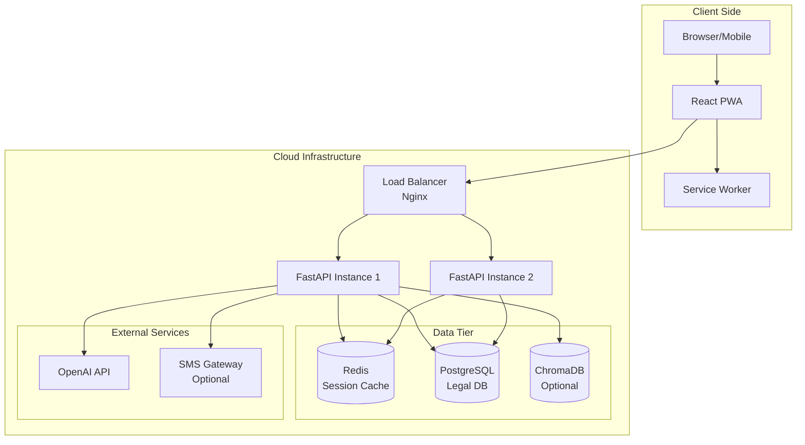
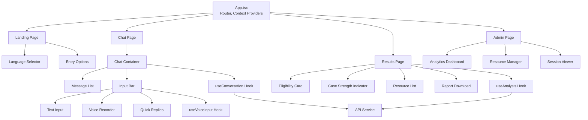
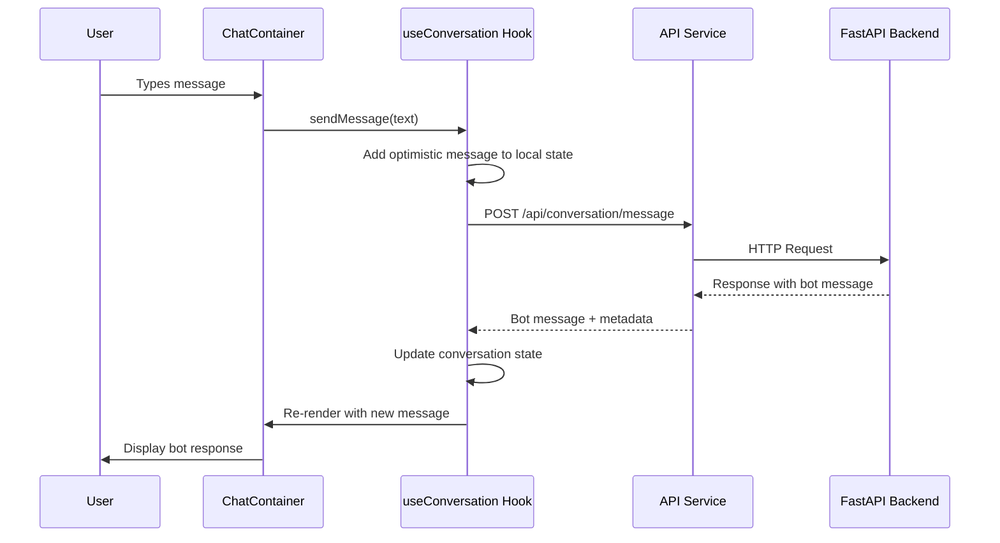
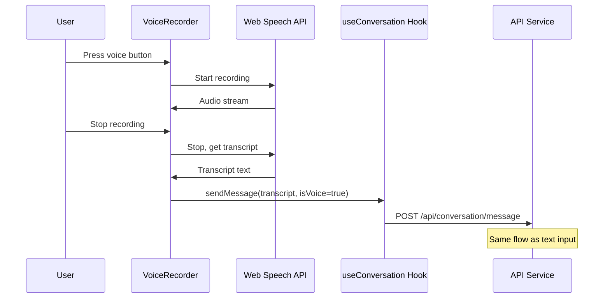
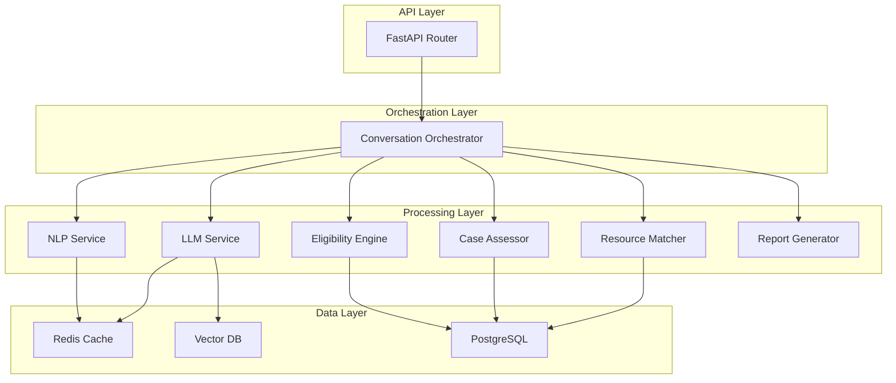
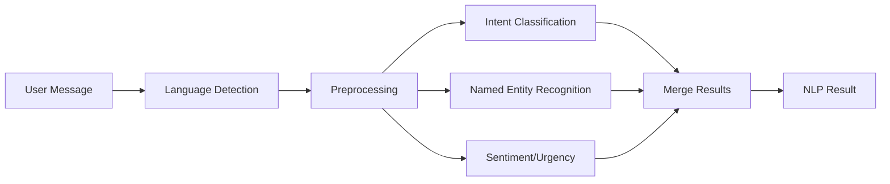
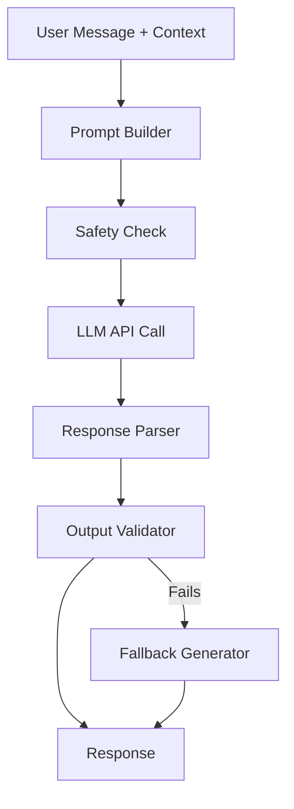
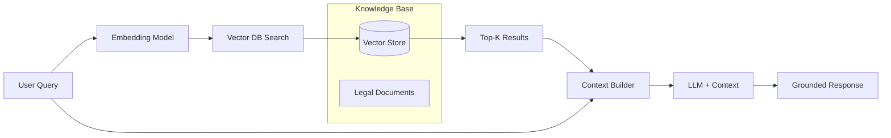
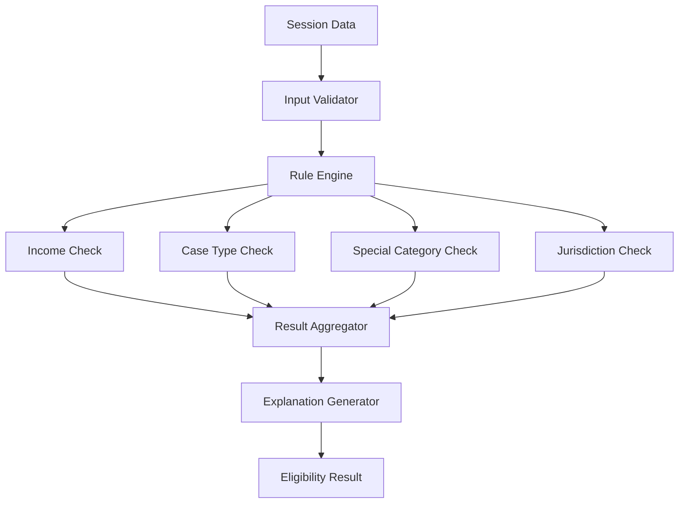

# NYAYASETU Technical Architecture
## System Design & Implementation Blueprint

**Version:** 1.0  
**Date:** September 1, 2026  
**Based on:** Approved Product Specification

---

## TABLE OF CONTENTS

1. [High-Level Architecture](#1-high-level-architecture)
2. [Frontend Architecture](#2-frontend-architecture)
3. [Backend Architecture](#3-backend-architecture)
4. [NLP Pipeline](#4-nlp-pipeline)
5. [LLM Pipeline](#5-llm-pipeline)
6. [Legal Knowledge Retrieval](#6-legal-knowledge-retrieval-architecture)
7. [RAG Architecture](#7-rag-architecture)
8. [Eligibility Rule Engine](#8-eligibility-rule-engine-architecture)
9. [Case Support Assessment](#9-preliminary-case-support-assessment-architecture)
10. [Evidence Readiness](#10-evidence-readiness-architecture)
11. [Urgency Detection](#11-urgency-detection-architecture)
12. [Resource Matching](#12-resource-matching-architecture)
13. [Authentication Architecture](#13-authentication-architecture)
14. [Authorization Architecture](#14-authorization-architecture)
15. [Privacy Architecture](#15-privacy-architecture)
16. [Complete Data Flow](#16-data-flow-from-user-message-to-final-recommendation)
17. [Error Handling](#17-error-handling-architecture)
18. [AI Failure Fallbacks](#18-ai-failure-fallback-architecture)
19. [Demo Mode](#19-demo-mode-architecture)

---


## 1. HIGH-LEVEL ARCHITECTURE

### 1.1 System Overview

NYAYASETU follows a **layered, microservice-inspired architecture** with clear separation of concerns:

```
┌─────────────────────────────────────────────────────────────┐
│                    USER INTERFACE LAYER                      │
│              (React PWA - Mobile First)                      │
└──────────────────────┬──────────────────────────────────────┘
                       │ HTTPS/REST
┌──────────────────────▼──────────────────────────────────────┐
│                  API GATEWAY LAYER                           │
│              (FastAPI - Rate Limiting, CORS)                 │
└─────┬────────────────────────────────────────────────┬──────┘
      │                                                 │
┌─────▼─────────────────────────┐   ┌─────────────────▼──────┐
│   BUSINESS LOGIC LAYER        │   │   ADMIN LAYER          │
│                               │   │                        │
│  ├─ Conversation Orchestrator │   │  ├─ Analytics Service  │
│  ├─ NLP Service              │   │  ├─ Resource CRUD      │
│  ├─ LLM Service              │   │  └─ System Monitoring  │
│  ├─ Eligibility Engine       │   │                        │
│  ├─ Case Assessment Service  │   └────────────────────────┘
│  ├─ Resource Matching        │
│  └─ Report Generator          │
└─────┬─────────────────────────┘
      │
┌─────▼──────────────────────────────────────────────────────┐
│                    DATA LAYER                               │
│                                                             │
│  ├─ Session Cache (Redis) - 24hr TTL                       │
│  ├─ Legal Knowledge DB (PostgreSQL)                        │
│  │   ├─ Providers                                          │
│  │   ├─ Eligibility Rules                                  │
│  │   ├─ Legal Categories                                   │
│  │   └─ Evidence Patterns                                  │
│  └─ Vector Store (Optional - for RAG)                      │
│      └─ Legal Document Embeddings                          │
└─────────────────────────────────────────────────────────────┘
```

### 1.2 Core Architectural Principles

#### Principle 1: **Hybrid AI Strategy**
- **LLM**: Natural language understanding, conversation, summarization
- **Rules**: Legal eligibility determination, validation
- **Rationale**: Legal decisions require determinism and auditability

#### Principle 2: **Privacy by Default**
- Session-based, no persistent user identity
- Data auto-deletion after 24 hours
- Anonymization before external API calls

#### Principle 3: **Fail-Safe Design**
- Every AI component has deterministic fallback
- Degraded service > no service
- Never block user on AI failure

#### Principle 4: **Explainability First**
- Every decision logs reasoning
- UI shows why, not just what
- Admin can audit any session

#### Principle 5: **Mobile-First, Offline-Ready**
- Progressive Web App (PWA)
- Works on 2G networks
- Graceful degradation

### 1.3 Technology Stack Summary

| Layer | Technology | Purpose |
|-------|-----------|---------|
| **Frontend** | React 18 + TypeScript | UI components |
| | TailwindCSS | Styling |
| | React Query | API state management |
| | i18next | Internationalization |
| | Workbox | Service worker/offline |
| **Backend** | FastAPI (Python 3.10+) | REST API |
| | Pydantic | Data validation |
| | SQLAlchemy | ORM |
| | Celery (optional) | Background tasks |
| **NLP** | spaCy 3.x | Entity extraction, POS |
| | IndicNLP / AI4Bharat | Indian language support |
| | fastText | Language detection |
| | Transformers (HF) | Intent classification |
| **LLM** | OpenAI GPT-3.5-turbo | Conversation, summarization |
| | (Alt: Llama 3 8B) | Self-hosted option |
| **Database** | PostgreSQL 14+ | Relational data |
| | Redis 7+ | Session cache |
| | (Optional: ChromaDB) | Vector store for RAG |
| **Infrastructure** | Docker + Docker Compose | Containerization |
| | Nginx | Reverse proxy |
| | Let's Encrypt | SSL certificates |

### 1.4 Deployment Architecture



### 1.5 Component Responsibility Matrix

| Component | Responsibilities | Does NOT Handle |
|-----------|-----------------|-----------------|
| **React Frontend** | UI rendering, user input, language switching, local state, offline support | Business logic, eligibility rules, LLM calls |
| **FastAPI Backend** | Request routing, orchestration, validation, session management | Direct UI rendering, client-side state |
| **NLP Service** | Language detection, intent classification, entity extraction, sentiment analysis | Eligibility determination, legal advice |
| **LLM Service** | Conversation, clarification questions, summarization, plain language explanation | Legal decisions, eligibility rules, predictions |
| **Rule Engine** | Eligibility determination, validation, constraint checking | Natural language understanding, conversation |
| **Legal DB** | Store legal resources, criteria, evidence patterns | AI inference, business logic |

---


## 2. FRONTEND ARCHITECTURE

### 2.1 React Application Structure

```
src/
├── components/
│   ├── common/
│   │   ├── Button.tsx
│   │   ├── Input.tsx
│   │   ├── Card.tsx
│   │   ├── LanguageSelector.tsx
│   │   └── LoadingSpinner.tsx
│   ├── chat/
│   │   ├── ChatContainer.tsx
│   │   ├── MessageBubble.tsx
│   │   ├── InputBar.tsx
│   │   ├── VoiceRecorder.tsx
│   │   └── QuickReplies.tsx
│   ├── results/
│   │   ├── EligibilityCard.tsx
│   │   ├── CaseStrengthIndicator.tsx
│   │   ├── ResourceList.tsx
│   │   ├── ResourceCard.tsx
│   │   └── SummaryReport.tsx
│   └── admin/
│       ├── Dashboard.tsx
│       ├── Analytics.tsx
│       ├── ResourceManager.tsx
│       └── SessionViewer.tsx
├── hooks/
│   ├── useConversation.ts
│   ├── useVoiceInput.ts
│   ├── useAnalysis.ts
│   └── useOfflineSync.ts
├── services/
│   ├── api.ts
│   ├── storage.ts
│   └── i18n.ts
├── types/
│   ├── conversation.ts
│   ├── analysis.ts
│   └── resources.ts
├── utils/
│   ├── validation.ts
│   ├── formatting.ts
│   └── constants.ts
├── contexts/
│   ├── SessionContext.tsx
│   └── LanguageContext.tsx
├── pages/
│   ├── Landing.tsx
│   ├── Chat.tsx
│   ├── Results.tsx
│   └── Admin.tsx
└── App.tsx
```

### 2.2 Component Architecture Diagram



### 2.3 State Management Strategy

#### Local State (useState, useReducer)
- Component-specific UI state (open/closed, loading indicators)
- Form inputs
- UI toggles

#### Context (React Context)
- Language preference (persisted to localStorage)
- Session ID (generated on session start)
- Theme settings

#### Server State (React Query)
- Conversation messages
- Analysis results
- Resource data
- Caching, refetching, optimistic updates

#### Offline State (IndexedDB via Workbox)
- Cached API responses
- Draft messages
- Session recovery data

### 2.4 Key Frontend Flows

#### Flow 1: User Message Submission



#### Flow 2: Voice Input



### 2.5 Internationalization (i18n) Strategy

```typescript
// Example i18n structure
{
  "en": {
    "landing": {
      "title": "NYAYASETU - Bridging People to Justice",
      "cta": "I need legal help"
    },
    "chat": {
      "placeholder": "Describe your legal situation...",
      "voiceButton": "Tap to speak"
    },
    "results": {
      "eligible": "You qualify for free legal aid",
      "notEligible": "You may not qualify based on income criteria"
    }
  },
  "hi": {
    "landing": {
      "title": "न्यायसेतु - न्याय तक पहुँच",
      "cta": "मुझे कानूनी सहायता चाहिए"
    },
    "chat": {
      "placeholder": "अपनी कानूनी समस्या बताएं...",
      "voiceButton": "बोलने के लिए दबाएं"
    },
    "results": {
      "eligible": "आप मुफ्त कानूनी सहायता के लिए योग्य हैं",
      "notEligible": "आय के आधार पर आप योग्य नहीं हो सकते"
    }
  }
}
```

**Strategy:**
- Use `i18next` with `react-i18next`
- Language files in JSON format
- Backend returns content in user's language (not frontend translation)
- Frontend only translates UI chrome (buttons, labels)

### 2.6 Offline-First PWA Strategy

**Service Worker Responsibilities:**
1. Cache static assets (JS, CSS, images)
2. Cache API responses (GET requests)
3. Queue failed POST requests for retry
4. Provide offline fallback page

**Implementation:**
```javascript
// workbox-config.js
module.exports = {
  globDirectory: 'build/',
  globPatterns: [
    '**/*.{html,js,css,png,svg,jpg,json}'
  ],
  swDest: 'build/service-worker.js',
  runtimeCaching: [
    {
      urlPattern: /^https:\/\/api\.nyayasetu\.org\/api\/resources/,
      handler: 'CacheFirst',
      options: {
        cacheName: 'legal-resources',
        expiration: {
          maxEntries: 50,
          maxAgeSeconds: 7 * 24 * 60 * 60 // 1 week
        }
      }
    },
    {
      urlPattern: /^https:\/\/api\.nyayasetu\.org\/api\/conversation/,
      handler: 'NetworkFirst',
      options: {
        cacheName: 'conversations',
        networkTimeoutSeconds: 5
      }
    }
  ]
};
```

### 2.7 Accessibility Features

1. **Keyboard Navigation**
   - All interactive elements accessible via Tab
   - Focus indicators (ring-2 ring-blue-500)
   - Skip to main content link

2. **Screen Reader Support**
   - Semantic HTML (nav, main, article, section)
   - ARIA labels for icon buttons
   - Live regions for chat messages

3. **Visual Accessibility**
   - High contrast mode support
   - Minimum font size: 16px
   - Color-blind friendly palette
   - Focus indicators

4. **Mobile Accessibility**
   - Touch targets: minimum 44x44px
   - Pinch to zoom enabled
   - Landscape/portrait support

---


## 3. BACKEND ARCHITECTURE

### 3.1 FastAPI Application Structure

```
backend/
├── app/
│   ├── main.py                    # FastAPI app initialization
│   ├── config.py                  # Configuration management
│   ├── dependencies.py            # Dependency injection
│   │
│   ├── api/
│   │   ├── v1/
│   │   │   ├── __init__.py
│   │   │   ├── conversation.py    # Conversation endpoints
│   │   │   ├── analysis.py        # Analysis endpoints
│   │   │   ├── resources.py       # Resource search endpoints
│   │   │   ├── report.py          # Report generation
│   │   │   └── admin.py           # Admin endpoints
│   │   └── deps.py                # Route dependencies
│   │
│   ├── core/
│   │   ├── orchestrator.py        # Main conversation orchestrator
│   │   ├── nlp_service.py         # NLP processing
│   │   ├── llm_service.py         # LLM integration
│   │   ├── eligibility_engine.py  # Rule-based eligibility
│   │   ├── case_assessor.py       # Case support assessment
│   │   ├── resource_matcher.py    # Resource matching logic
│   │   ├── report_generator.py    # PDF generation
│   │   └── urgency_detector.py    # Urgency detection
│   │
│   ├── models/
│   │   ├── database.py            # SQLAlchemy models
│   │   ├── session.py             # Session data models
│   │   ├── conversation.py        # Conversation models
│   │   └── resources.py           # Resource models
│   │
│   ├── schemas/
│   │   ├── conversation.py        # Pydantic schemas
│   │   ├── analysis.py            # Analysis request/response
│   │   ├── resources.py           # Resource schemas
│   │   └── admin.py               # Admin schemas
│   │
│   ├── db/
│   │   ├── session.py             # Database session
│   │   ├── base.py                # Base model
│   │   └── init_db.py             # Database initialization
│   │
│   ├── services/
│   │   ├── cache_service.py       # Redis cache operations
│   │   ├── session_service.py     # Session management
│   │   └── analytics_service.py   # Usage analytics
│   │
│   ├── utils/
│   │   ├── logger.py              # Logging configuration
│   │   ├── validators.py          # Input validators
│   │   ├── anonymizer.py          # PII anonymization
│   │   └── error_handlers.py      # Error handling utilities
│   │
│   └── ml/
│       ├── models/
│       │   ├── intent_classifier/  # Trained models
│       │   └── ner_model/
│       ├── prompts/
│       │   ├── conversation.txt
│       │   ├── summarization.txt
│       │   └── explanation.txt
│       └── embeddings/             # For RAG (optional)
│
├── tests/
│   ├── unit/
│   ├── integration/
│   └── fixtures/
├── alembic/                        # Database migrations
├── requirements.txt
├── Dockerfile
└── docker-compose.yml
```

### 3.2 API Endpoint Design

#### 3.2.1 Conversation Endpoints

```python
# POST /api/v1/conversation/start
Request:
{
  "language": "hi",  # en, hi, ta, te, bn
  "user_type": "citizen"  # citizen, facilitator
}

Response:
{
  "session_id": "uuid-string",
  "welcome_message": "नमस्ते! मैं आपकी कानूनी सहायता खोजने में मदद करूंगा।",
  "expires_at": "2026-09-02T12:00:00Z"
}
```

```python
# POST /api/v1/conversation/message
Request:
{
  "session_id": "uuid",
  "message": "मालिक ने 3 महीने की तनख्वाह नहीं दी",
  "is_voice": false,
  "metadata": {
    "latitude": 25.3176,  # Optional
    "longitude": 82.9739
  }
}

Response:
{
  "response": "मुझे समझ आया। क्या आप बता सकते हैं कि आप किस जिले में रहते हैं?",
  "stage": "information_gathering",  # initial, information_gathering, analysis, results
  "progress": 40,  # Percentage complete
  "quick_replies": [
    {"text": "वाराणसी", "value": "varanasi"},
    {"text": "लखनऊ", "value": "lucknow"}
  ],
  "internal_state": {
    "intent_detected": "labor_dispute",
    "entities_extracted": {
      "issue_type": "wage_theft",
      "duration": "3 months"
    },
    "confidence": 0.87,
    "missing_info": ["location", "income_bracket", "evidence"]
  }
}
```

#### 3.2.2 Analysis Endpoints

```python
# POST /api/v1/analysis/eligibility
Request:
{
  "session_id": "uuid"
}

Response:
{
  "eligible": true,
  "confidence": "high",  # high, medium, low
  "criteria_met": {
    "income_threshold": true,
    "case_type_covered": true,
    "jurisdiction_valid": true,
    "special_category": false
  },
  "explanation": {
    "primary_reason": "आपकी आय ₹3 लाख से कम है और श्रम विवाद कवर किया जाता है",
    "details": [
      "उत्तर प्रदेश में आय सीमा: ₹3,00,000",
      "आपकी आय: ₹96,000 (estimated)",
      "मामले का प्रकार: श्रम कानून - कवर किया गया"
    ]
  },
  "next_steps": ["Find legal aid providers"]
}
```

```python
# POST /api/v1/analysis/case-strength
Request:
{
  "session_id": "uuid"
}

Response:
{
  "support_level": "moderate",  # strong, moderate, needs_strengthening
  "factors": {
    "evidence_present": true,
    "timeline_clear": true,
    "documentation_available": false,
    "urgency": "medium"
  },
  "explanation": "आपके मामले में मध्यम समर्थन संकेतक हैं",
  "details": {
    "strengths": [
      "WhatsApp संदेश साक्ष्य के रूप में मौजूद हैं",
      "3 महीने की स्पष्ट समयरेखा",
      "वेतन राशि स्पष्ट है (₹8,000/माह)"
    ],
    "to_strengthen": [
      "नियुक्ति पत्र या अनुबंध प्राप्त करें",
      "बैंक विवरण जो वेतन जमा दिखाता है",
      "साथी कर्मचारियों से गवाही"
    ]
  },
  "disclaimer": "यह कानूनी सलाह नहीं है। अंतिम मूल्यांकन के लिए कानूनी सहायता वकील से मिलें।"
}
```

#### 3.2.3 Resource Endpoints

```python
# GET /api/v1/resources/search
Query Parameters:
{
  "district": "varanasi",
  "state": "uttar_pradesh",
  "case_type": "labor",
  "latitude": 25.3176,  # Optional
  "longitude": 82.9739,
  "limit": 10
}

Response:
{
  "providers": [
    {
      "id": "uuid",
      "name": "उत्तर प्रदेश राज्य विधिक सेवा प्राधिकरण",
      "type": "state_lsa",
      "address": "High Court Building, Varanasi",
      "district": "varanasi",
      "state": "uttar_pradesh",
      "phone": "+91-542-2501234",
      "email": "lsa.varanasi@up.gov.in",
      "office_hours": "Mon-Fri 10:00-17:00",
      "distance_km": 2.3,
      "case_types": ["civil", "criminal", "labor", "family"],
      "languages": ["hindi", "english"],
      "specialization": ["wage_disputes", "wrongful_termination"],
      "rating": 4.2,
      "last_verified": "2026-08-15"
    }
  ],
  "total_count": 3
}
```

#### 3.2.4 Report Endpoints

```python
# POST /api/v1/report/generate
Request:
{
  "session_id": "uuid",
  "include_sms": false,
  "phone_number": null  # Optional: for SMS notification
}

Response:
{
  "reference_number": "NYS-2026-090001",
  "pdf_url": "/api/v1/report/download/NYS-2026-090001",
  "expires_at": "2026-09-02T12:00:00Z",
  "summary": {
    "case_category": "श्रम विवाद",
    "eligibility": "योग्य",
    "recommended_providers": 3
  }
}
```

### 3.3 Backend Service Architecture



### 3.4 Conversation Orchestrator Logic

The **Conversation Orchestrator** is the central coordinator that manages the conversation flow.

```python
# Pseudocode for Orchestrator

class ConversationOrchestrator:
    def __init__(self):
        self.nlp_service = NLPService()
        self.llm_service = LLMService()
        self.eligibility_engine = EligibilityEngine()
        self.case_assessor = CaseAssessor()
        self.session_service = SessionService()
    
    async def process_message(self, session_id: str, message: str):
        # 1. Retrieve session state
        session = await self.session_service.get_session(session_id)
        
        # 2. NLP Processing
        nlp_result = await self.nlp_service.process(
            text=message,
            language=session.language,
            context=session.conversation_history
        )
        
        # 3. Update session with extracted entities
        session.update_entities(nlp_result.entities)
        
        # 4. Check if we have sufficient information
        completeness = self.assess_information_completeness(session)
        
        if completeness < 0.7:
            # 5a. Generate clarifying question via LLM
            response = await self.llm_service.generate_clarification(
                session_data=session.to_dict(),
                missing_fields=completeness.missing_fields
            )
            stage = "information_gathering"
        
        else:
            # 5b. Move to analysis
            # Run eligibility check (deterministic)
            eligibility = await self.eligibility_engine.check(session)
            
            # Run case support assessment (hybrid)
            case_support = await self.case_assessor.assess(session)
            
            # Find resources
            resources = await self.resource_matcher.find(
                district=session.location,
                case_type=session.case_category
            )
            
            # Generate summary response via LLM
            response = await self.llm_service.generate_summary(
                eligibility=eligibility,
                case_support=case_support,
                resources=resources,
                language=session.language
            )
            stage = "results"
        
        # 6. Update session
        await self.session_service.update_session(session)
        
        # 7. Return response
        return {
            "response": response,
            "stage": stage,
            "internal_state": nlp_result
        }
```

### 3.5 Session Management Strategy

**Session Data Structure (Redis):**
```python
{
  "session_id": "uuid",
  "created_at": "2026-09-01T10:00:00Z",
  "expires_at": "2026-09-02T10:00:00Z",  # 24 hours
  "language": "hi",
  "user_type": "citizen",
  
  "conversation_history": [
    {
      "role": "user",
      "message": "मालिक ने तनख्वाह नहीं दी",
      "timestamp": "2026-09-01T10:01:00Z"
    },
    {
      "role": "assistant",
      "message": "आप किस जिले में रहते हैं?",
      "timestamp": "2026-09-01T10:01:03Z"
    }
  ],
  
  "extracted_data": {
    "case_category": "labor_dispute",
    "sub_category": "wage_theft",
    "location": {
      "district": "varanasi",
      "state": "uttar_pradesh"
    },
    "income_bracket": "below_3_lakh",
    "timeline": {
      "duration": "3 months",
      "start_date": null
    },
    "evidence": {
      "whatsapp_messages": true,
      "appointment_letter": false,
      "bank_statements": false
    },
    "urgency_level": "medium",
    "parties": {
      "employer": "unnamed",
      "employee": "user"
    },
    "amounts": {
      "monthly_salary": 8000,
      "total_owed": 24000,
      "currency": "INR"
    }
  },
  
  "analysis_results": {
    "eligibility": null,  # Populated after analysis
    "case_support": null,
    "resources": null
  },
  
  "metadata": {
    "ip_address": "anonymized",
    "user_agent": "Mozilla/5.0...",
    "referrer": null
  }
}
```

**Session Lifecycle:**
1. **Creation**: User starts conversation → Generate UUID → Store in Redis with 24hr TTL
2. **Updates**: Each message updates conversation_history and extracted_data
3. **Analysis**: When complete, populate analysis_results
4. **Report**: Generate PDF, return reference number
5. **Expiration**: Auto-delete after 24 hours (Redis TTL)

**Privacy Safeguards:**
- No names stored (anonymize to "Person A", "Person B")
- No phone numbers (unless explicitly for SMS, then hashed)
- IP addresses anonymized (first 3 octets only)
- No geolocation beyond district level

---


## 4. NLP PIPELINE

### 4.1 NLP Service Architecture

The NLP Service is responsible for **structured information extraction** from unstructured user input. It does NOT make legal decisions.



### 4.2 Component Details

#### 4.2.1 Language Detection

**Purpose**: Identify input language to route to correct models

**Technology**: 
- `fastText` language identification
- `langdetect` as fallback

**Output**:
```python
{
  "language": "hi",  # ISO 639-1 code
  "confidence": 0.95,
  "is_code_mixed": false  # Hinglish, Tanglish, etc.
}
```

**Handling Code-Mixing**:
```python
# Example: "मैं payment के लिए wait कर रहा हूं"
{
  "language": "hi",
  "is_code_mixed": true,
  "primary_language": "hi",
  "secondary_language": "en",
  "confidence": 0.82
}
```

#### 4.2.2 Text Preprocessing

**Steps**:
1. **Normalization**
   - Unicode normalization (NFKC)
   - Remove extra whitespace
   - Fix common typos (optional)

2. **Transliteration** (if needed)
   - Roman script → Devanagari for Hindi
   - Uses `indic-transliteration` library

3. **Tokenization**
   - Language-specific tokenizers
   - `spaCy` for English
   - `IndicNLP` for Indian languages

**Example**:
```python
Input: "मालिक ने   3 mahine ki तनख्वाह नहीं दी"
After Normalization: "मालिक ने 3 mahine की तनख्वाह नहीं दी"
After Transliteration: "मालिक ने 3 महीने की तनख्वाह नहीं दी"
```

#### 4.2.3 Intent Classification

**Purpose**: Classify user message into legal domain categories

**Categories** (MVP - 5 categories):
1. `labor_dispute` - Wage theft, wrongful termination, workplace harassment
2. `property_dispute` - Landlord-tenant, inheritance, boundary disputes
3. `family_law` - Divorce, child custody, maintenance, domestic violence
4. `criminal_law` - FIR, bail, victim rights, false accusations
5. `consumer_dispute` - Defective products, service issues, refunds

**Technology**:
- **Model**: Fine-tuned BERT (multilingual or IndicBERT)
- **Training**: 500-1000 labeled examples per category
- **Architecture**: Classification head on top of BERT

**Input/Output**:
```python
Input: "मालिक ने 3 महीने की तनख्वाह नहीं दी"

Output:
{
  "intent": "labor_dispute",
  "sub_intent": "wage_theft",
  "confidence": 0.89,
  "alternatives": [
    {"intent": "contract_dispute", "confidence": 0.07},
    {"intent": "other", "confidence": 0.04}
  ]
}
```

**Confidence Thresholds**:
- `>= 0.75`: High confidence, proceed
- `0.50 - 0.74`: Medium confidence, ask clarifying question
- `< 0.50`: Low confidence, show options to user

**Fallback**:
If model unavailable, use keyword matching:
```python
INTENT_KEYWORDS = {
    "labor_dispute": ["वेतन", "तनख्वाह", "नौकरी", "मालिक", "wage", "salary", "employer"],
    "property_dispute": ["मकान", "किराया", "जमीन", "rent", "landlord", "property"],
    # ...
}
```

#### 4.2.4 Named Entity Recognition (NER)

**Purpose**: Extract structured information from text

**Entities to Extract**:
- **PERSON**: Names of people involved
- **ORG**: Companies, organizations
- **LOCATION**: Cities, districts, states
- **DATE**: Timeline information
- **MONEY**: Amounts involved
- **DURATION**: Time periods ("3 months", "2 years")

**Technology**:
- **Model**: `spaCy` NER (en_core_web_sm for English)
- **Indian Languages**: `IndicNLP` or custom-trained `spaCy` model
- **Multilingual**: `XLM-RoBERTa` based NER

**Example**:
```python
Input: "मालिक ने 3 महीने की तनख्वाह नहीं दी। मेरी सैलरी ₹8000 है।"

Output:
{
  "entities": [
    {
      "text": "मालिक",
      "type": "PERSON_ROLE",
      "start": 0,
      "end": 5,
      "normalized": "employer"
    },
    {
      "text": "3 महीने",
      "type": "DURATION",
      "start": 9,
      "end": 16,
      "normalized": {"value": 3, "unit": "months"}
    },
    {
      "text": "₹8000",
      "type": "MONEY",
      "start": 48,
      "end": 53,
      "normalized": {"amount": 8000, "currency": "INR"}
    }
  ]
}
```

**Post-Processing**:
- Normalize amounts: "8000 rupees" → 8000 INR
- Normalize dates: "2 साल पहले" → relative date
- Anonymize names: "राम कुमार" → "Person A"

#### 4.2.5 Sentiment & Urgency Detection

**Purpose**: Detect emotional distress and urgency signals

**Urgency Levels**:
- `critical`: Immediate danger (domestic violence, eviction today)
- `high`: Time-sensitive (court date approaching, FIR needed)
- `medium`: Important but not immediate
- `low`: General inquiry

**Signals**:
```python
URGENCY_KEYWORDS = {
    "critical": [
        "मारा", "डर", "धमकी", "आज", "अभी", "तुरंत",
        "hit", "scared", "threat", "today", "now", "urgent"
    ],
    "high": [
        "कल", "परसों", "सुनवाई", "court date", "tomorrow"
    ]
}

DISTRESS_INDICATORS = [
    "डर लग रहा है", "क्या करूं", "बहुत परेशान",
    "scared", "don't know what to do", "desperate"
]
```

**Example**:
```python
Input: "मालिक ने मुझे मारा और कहा कि अगर मैंने वेतन मांगा तो नौकरी से निकाल देगा"

Output:
{
  "urgency": "high",
  "reason": "Physical violence mentioned, implicit threat",
  "distress_level": 0.78,
  "recommended_action": "Show crisis helpline + expedite legal aid search"
}
```

### 4.3 NLP Service Implementation

```python
# core/nlp_service.py (Simplified)

class NLPService:
    def __init__(self):
        self.lang_detector = fasttext.load_model('lid.176.bin')
        self.intent_classifier = load_intent_model()
        self.ner_models = {
            'en': spacy.load('en_core_web_sm'),
            'hi': spacy.load('hi_core_news_sm')  # Or custom model
        }
        self.urgency_detector = UrgencyDetector()
    
    async def process(self, text: str, language: str = None, context: dict = None):
        # 1. Detect language if not provided
        if not language:
            lang_result = self.detect_language(text)
            language = lang_result['language']
        
        # 2. Preprocess
        clean_text = self.preprocess(text, language)
        
        # 3. Extract intent
        intent_result = await self.classify_intent(clean_text, language)
        
        # 4. Extract entities
        entities = await self.extract_entities(clean_text, language)
        
        # 5. Detect urgency
        urgency = self.urgency_detector.detect(clean_text, entities)
        
        # 6. Combine results
        return NLPResult(
            language=language,
            intent=intent_result,
            entities=entities,
            urgency=urgency,
            confidence=self.calculate_overall_confidence(intent_result, entities)
        )
    
    def detect_language(self, text: str):
        predictions = self.lang_detector.predict(text, k=2)
        return {
            'language': predictions[0][0].replace('__label__', ''),
            'confidence': float(predictions[1][0])
        }
    
    def preprocess(self, text: str, language: str):
        # Normalization
        text = unicodedata.normalize('NFKC', text)
        text = re.sub(r'\s+', ' ', text).strip()
        
        # Language-specific preprocessing
        if language == 'hi':
            # Transliteration if needed
            if self.is_romanized(text):
                text = transliterate(text, 'hi')
        
        return text
    
    async def classify_intent(self, text: str, language: str):
        # Use ML model
        try:
            result = self.intent_classifier(text)
            return {
                'intent': result['label'],
                'confidence': result['score'],
                'method': 'ml'
            }
        except Exception as e:
            # Fallback to keyword matching
            return self.keyword_based_intent(text)
    
    async def extract_entities(self, text: str, language: str):
        model = self.ner_models.get(language, self.ner_models['en'])
        doc = model(text)
        
        entities = []
        for ent in doc.ents:
            entities.append({
                'text': ent.text,
                'type': ent.label_,
                'start': ent.start_char,
                'end': ent.end_char,
                'normalized': self.normalize_entity(ent)
            })
        
        return entities
```

### 4.4 NLP Output Format

**Standardized Output**:
```python
{
  "language": {
    "detected": "hi",
    "confidence": 0.95,
    "is_code_mixed": false
  },
  "intent": {
    "primary": "labor_dispute",
    "sub_category": "wage_theft",
    "confidence": 0.89,
    "method": "ml"  # or "keyword_fallback"
  },
  "entities": {
    "persons": [
      {"role": "employer", "mention": "मालिक", "anonymized": "Person_A"}
    ],
    "money": [
      {"amount": 8000, "currency": "INR", "context": "monthly_salary"}
    ],
    "duration": [
      {"value": 3, "unit": "months", "context": "unpaid_period"}
    ],
    "location": [
      {"district": "varanasi", "state": "uttar_pradesh"}
    ]
  },
  "urgency": {
    "level": "high",
    "confidence": 0.76,
    "signals": ["physical_violence_mentioned", "threat_present"],
    "recommended_priority": "expedite"
  },
  "sentiment": {
    "polarity": -0.6,  # -1 to 1
    "distress_score": 0.78
  },
  "metadata": {
    "processing_time_ms": 245,
    "models_used": ["intent_bert_v1", "ner_spacy_hi"],
    "fallbacks_triggered": []
  }
}
```

---


## 5. LLM PIPELINE

### 5.1 LLM Service Architecture

The LLM is responsible for **natural language understanding and generation**, NOT legal decision-making.



### 5.2 LLM Responsibilities

| Task | LLM Role | NOT Allowed |
|------|----------|-------------|
| **Conversation** | Generate empathetic, clarifying questions | Make legal judgments |
| **Summarization** | Convert unstructured narrative to structured summary | Invent facts |
| **Explanation** | Explain eligibility results in plain language | Change eligibility decision |
| **Translation** | Provide vernacular responses | Legal advice |

### 5.3 Prompt Engineering Strategy

#### 5.3.1 System Prompt (Foundational)

```python
SYSTEM_PROMPT = """
You are a legal aid discovery assistant for NYAYASETU, a platform that helps Indian citizens find free legal aid services.

YOUR ROLE:
- Help citizens describe their legal situation
- Ask clarifying questions to gather complete information
- Explain legal aid eligibility in simple language
- Recommend legal resources

STRICT BOUNDARIES:
- You are NOT a lawyer and cannot provide legal advice
- You CANNOT predict case outcomes or chances of winning
- You CANNOT draft legal documents
- You CANNOT make legal decisions - only help with discovery

TONE:
- Empathetic and respectful
- Simple language (avoid legal jargon)
- Culturally appropriate for Indian context
- Non-judgmental

LANGUAGE:
- Respond in the user's language ({language})
- Use simple, clear sentences
- Explain legal terms when unavoidable

PRIVACY:
- Do not ask for full names, exact addresses, or phone numbers
- Refer to people as "you", "employer", "landlord" etc.
- Focus on case details, not personal identity
"""
```

#### 5.3.2 Prompt Templates

**Template 1: Clarifying Question Generation**

```python
CLARIFICATION_PROMPT = """
Based on the conversation so far, the user has described a {case_category} situation.

INFORMATION GATHERED:
{extracted_data}

INFORMATION STILL NEEDED:
{missing_fields}

CONTEXT:
- User language: {language}
- User type: {user_type}
- Conversation history: {history_summary}

TASK:
Generate ONE clarifying question to gather the most important missing information. 
- Ask about {priority_field} first
- Keep the question simple and direct
- Show empathy if user expressed distress
- Provide context if needed (e.g., "To find legal aid near you, I need to know your district")

RESPOND IN {language}.
"""
```

**Example**:
```
Input:
- Case: labor_dispute
- Gathered: issue_type=wage_theft, duration=3_months
- Missing: location, income_bracket, evidence
- Priority: location (needed for resource matching)

Output:
"मुझे समझ आया कि आपको 3 महीने का वेतन नहीं मिला। आपको आस-पास की कानूनी सहायता खोजने के लिए, कृपया बताएं कि आप किस जिले में रहते हैं?"
```

**Template 2: Case Summary Generation**

```python
SUMMARY_PROMPT = """
Based on the conversation, create a structured summary of the user's legal situation.

CONVERSATION HISTORY:
{conversation_messages}

EXTRACTED DATA (from NLP):
{nlp_extracted_data}

TASK:
Create a clear, factual summary covering:
1. Type of legal issue
2. Key facts and timeline
3. Parties involved (anonymized)
4. Evidence mentioned
5. Current status/urgency

RULES:
- Use bullet points
- State facts only (no opinions)
- Anonymize names
- Use user's language: {language}
- Max 200 words

OUTPUT FORMAT:
```
मामले का प्रकार: [category]
मुख्य तथ्य:
- [fact 1]
- [fact 2]
साक्ष्य: [evidence list]
स्थिति: [urgency]
```
"""
```

**Template 3: Eligibility Explanation**

```python
ELIGIBILITY_EXPLANATION_PROMPT = """
The eligibility engine has determined: {eligibility_result}

CRITERIA EVALUATION:
{criteria_details}

TASK:
Explain this result to the user in simple language.

IF ELIGIBLE:
- Congratulate them
- Explain why they qualify (income, case type, etc.)
- Mention next steps (finding resources)

IF NOT ELIGIBLE:
- Be empathetic
- Explain the specific reason (e.g., income above threshold)
- Suggest alternatives (e.g., legal clinics, pro-bono options)

LANGUAGE: {language}
TONE: Supportive, clear, non-judgmental

DO NOT:
- Use legal jargon
- Make promises about case outcomes
- Provide legal advice
"""
```

**Example Output**:
```
Eligible:
"अच्छी खबर! आप मुफ्त कानूनी सहायता के लिए योग्य हैं। 

कारण:
✓ आपकी वार्षिक आय ₹3 लाख से कम है (उत्तर प्रदेश की सीमा)
✓ श्रम विवाद के मामले कवर किए जाते हैं
✓ आपका मामला वाराणसी में है जहां कानूनी सहायता उपलब्ध है

अगला कदम: मैं आपके लिए नजदीकी कानूनी सहायता कार्यालय खोज रहा हूं।"
```

**Template 4: Case Support Assessment Explanation**

```python
CASE_SUPPORT_PROMPT = """
The case assessor has evaluated the user's case support indicators.

ASSESSMENT RESULT:
{support_level}  # strong, moderate, needs_strengthening

FACTORS ANALYZED:
{factors}

TASK:
Explain the case support level to the user.

CRITICAL RULES:
- This is NOT a prediction of winning/losing
- Frame as "preliminary indicators" or "readiness factors"
- Focus on what they HAVE (strengths) and what would HELP (improvements)
- Emphasize that final assessment is by legal aid lawyer

STRUCTURE:
1. State the support level clearly
2. List strengths (what's going well)
3. List areas to strengthen (actionable suggestions)
4. Add disclaimer
5. Encourage them to proceed with legal aid

LANGUAGE: {language}
TONE: Encouraging but realistic
"""
```

**Example Output**:
```
"आपके मामले में मध्यम समर्थन संकेतक हैं।

मजबूत पक्ष:
✓ WhatsApp संदेश साक्ष्य के रूप में हैं
✓ 3 महीने की स्पष्ट समयरेखा
✓ वेतन राशि स्पष्ट है

मजबूत करने के लिए:
→ नियुक्ति पत्र या कोई लिखित अनुबंध खोजें
→ बैंक विवरण जो पिछली वेतन जमा दिखाता है
→ साथी कर्मचारियों से संपर्क करें जो गवाही दे सकें

महत्वपूर्ण: यह कानूनी सलाह नहीं है। कानूनी सहायता वकील आपके मामले का पूर्ण मूल्यांकन करेंगे। आपके पास पहले से अच्छी जानकारी है - आगे बढ़ें!"
```

### 5.4 LLM API Integration

#### 5.4.1 OpenAI Integration (Primary)

```python
# core/llm_service.py

import openai
from tenacity import retry, stop_after_attempt, wait_exponential

class LLMService:
    def __init__(self, config):
        self.client = openai.AsyncOpenAI(api_key=config.OPENAI_API_KEY)
        self.model = config.LLM_MODEL  # "gpt-3.5-turbo"
        self.max_tokens = 500
        self.temperature = 0.7
    
    @retry(
        stop=stop_after_attempt(3),
        wait=wait_exponential(multiplier=1, min=2, max=10)
    )
    async def generate_clarification(
        self, 
        session_data: dict, 
        missing_fields: list,
        language: str
    ):
        """Generate clarifying question"""
        
        # Build prompt
        prompt = self.build_clarification_prompt(
            session_data, 
            missing_fields, 
            language
        )
        
        # Safety check
        if not self.passes_safety_check(prompt):
            raise ValueError("Prompt failed safety check")
        
        # API call
        try:
            response = await self.client.chat.completions.create(
                model=self.model,
                messages=[
                    {"role": "system", "content": SYSTEM_PROMPT.format(language=language)},
                    {"role": "user", "content": prompt}
                ],
                max_tokens=self.max_tokens,
                temperature=self.temperature,
                user=self.anonymize_user_id(session_data['session_id'])  # For abuse monitoring
            )
            
            question = response.choices[0].message.content.strip()
            
            # Validate output
            if not self.validate_output(question, "clarification"):
                raise ValueError("Output validation failed")
            
            return question
        
        except Exception as e:
            logger.error(f"LLM generation failed: {e}")
            # Fallback
            return self.fallback_clarification(missing_fields, language)
    
    def build_clarification_prompt(self, session_data, missing_fields, language):
        """Construct prompt from template"""
        return CLARIFICATION_PROMPT.format(
            case_category=session_data.get('case_category', 'unknown'),
            extracted_data=self.format_extracted_data(session_data),
            missing_fields=', '.join(missing_fields),
            priority_field=missing_fields[0],
            language=language,
            history_summary=self.summarize_history(session_data['conversation_history'])
        )
    
    def passes_safety_check(self, prompt: str) -> bool:
        """Check for prompt injection attempts"""
        dangerous_patterns = [
            "ignore previous instructions",
            "you are now a",
            "disregard",
            "forget everything",
            "new instructions"
        ]
        return not any(pattern in prompt.lower() for pattern in dangerous_patterns)
    
    def validate_output(self, output: str, output_type: str) -> bool:
        """Validate LLM output"""
        # Check length
        if len(output) < 10 or len(output) > 1000:
            return False
        
        # Check for prohibited content
        prohibited = [
            "will win", "will lose", "definitely", "guaranteed",
            "legal advice", "I recommend filing", "sue", "draft"
        ]
        
        if any(term in output.lower() for term in prohibited):
            logger.warning(f"Output contains prohibited content: {output}")
            return False
        
        return True
    
    def fallback_clarification(self, missing_fields: list, language: str) -> str:
        """Template-based fallback"""
        FALLBACK_TEMPLATES = {
            'en': {
                'location': "Which district do you live in?",
                'income': "What is your approximate monthly income?",
                'evidence': "Do you have any documents or evidence related to this?"
            },
            'hi': {
                'location': "आप किस जिले में रहते हैं?",
                'income': "आपकी मासिक आय लगभग कितनी है?",
                'evidence': "क्या आपके पास कोई दस्तावेज या सबूत है?"
            }
        }
        
        field = missing_fields[0] if missing_fields else 'location'
        return FALLBACK_TEMPLATES.get(language, FALLBACK_TEMPLATES['en']).get(field, "Can you provide more details?")
```

#### 5.4.2 Self-Hosted LLM Option (Advanced)

For privacy and cost reasons, a self-hosted option:

```python
# Using Ollama or vLLM for local inference

class LocalLLMService:
    def __init__(self, config):
        self.model = "llama3:8b"  # or mistral:7b
        self.endpoint = "http://localhost:11434"  # Ollama endpoint
    
    async def generate(self, messages: list):
        async with httpx.AsyncClient() as client:
            response = await client.post(
                f"{self.endpoint}/api/chat",
                json={
                    "model": self.model,
                    "messages": messages,
                    "stream": False
                },
                timeout=30.0
            )
            return response.json()['message']['content']
```

### 5.5 LLM Safety & Monitoring

#### 5.5.1 Input Safety

```python
def sanitize_input(text: str) -> str:
    """Prevent prompt injection"""
    # Remove potential instruction injections
    dangerous_phrases = [
        "ignore previous", "new task", "forget", "disregard",
        "you are now", "system:", "assistant:"
    ]
    
    for phrase in dangerous_phrases:
        if phrase in text.lower():
            text = text.replace(phrase, "[REDACTED]")
    
    # Limit length
    if len(text) > 2000:
        text = text[:2000]
    
    return text
```

#### 5.5.2 Output Monitoring

```python
class OutputMonitor:
    """Monitor LLM outputs for quality and safety"""
    
    PROHIBITED_CONTENT = [
        "will win", "will definitely", "guaranteed outcome",
        "I am a lawyer", "legal advice", "file a case",
        "definitely file", "you should sue"
    ]
    
    def check_output(self, output: str) -> tuple[bool, str]:
        """Returns (is_safe, reason)"""
        
        # Check for legal advice
        if any(term in output.lower() for term in self.PROHIBITED_CONTENT):
            return False, "Contains legal advice or predictions"
        
        # Check for hallucination signals
        if self.contains_specific_legal_citations(output):
            return False, "Contains specific legal citations (potential hallucination)"
        
        # Check for appropriate length
        if len(output) > 1500:
            return False, "Response too long"
        
        return True, "OK"
    
    def contains_specific_legal_citations(self, text: str) -> bool:
        """Detect specific section numbers, case names (often hallucinated)"""
        patterns = [
            r"Section \d+ of .+ Act",
            r"Article \d+",
            r"[A-Z][a-z]+ v\. [A-Z][a-z]+",  # Case names
        ]
        return any(re.search(p, text) for p in patterns)
```

### 5.6 Cost & Performance Optimization

#### 5.6.1 Caching Strategy

```python
class LLMCache:
    """Cache common LLM responses"""
    
    def __init__(self, redis_client):
        self.redis = redis_client
        self.ttl = 3600  # 1 hour
    
    async def get_cached_response(self, prompt_hash: str):
        """Check if we've seen this prompt before"""
        cached = await self.redis.get(f"llm_cache:{prompt_hash}")
        if cached:
            return json.loads(cached)
        return None
    
    async def cache_response(self, prompt_hash: str, response: str):
        """Cache response"""
        await self.redis.setex(
            f"llm_cache:{prompt_hash}",
            self.ttl,
            json.dumps(response)
        )
    
    def hash_prompt(self, prompt: str, language: str) -> str:
        """Create hash of prompt for caching"""
        # Normalize to catch similar prompts
        normalized = self.normalize_prompt(prompt)
        return hashlib.sha256(f"{normalized}:{language}".encode()).hexdigest()
    
    def normalize_prompt(self, prompt: str) -> str:
        """Normalize prompt for better cache hits"""
        # Remove specific values, keep structure
        prompt = re.sub(r'\d+', 'NUM', prompt)
        prompt = re.sub(r'[A-Z][a-z]+', 'NAME', prompt)
        return prompt.lower()
```

#### 5.6.2 Token Usage Tracking

```python
class TokenTracker:
    """Track LLM API usage and costs"""
    
    COSTS = {
        "gpt-3.5-turbo": {
            "input": 0.0015 / 1000,  # per token
            "output": 0.002 / 1000
        }
    }
    
    async def log_usage(self, session_id: str, usage: dict):
        """Log token usage"""
        cost = self.calculate_cost(usage)
        
        await db.execute(
            """
            INSERT INTO llm_usage (session_id, model, input_tokens, output_tokens, cost)
            VALUES ($1, $2, $3, $4, $5)
            """,
            session_id, usage['model'], 
            usage['prompt_tokens'], usage['completion_tokens'],
            cost
        )
    
    def calculate_cost(self, usage: dict) -> float:
        """Calculate API cost"""
        model = usage['model']
        if model not in self.COSTS:
            return 0.0
        
        input_cost = usage['prompt_tokens'] * self.COSTS[model]['input']
        output_cost = usage['completion_tokens'] * self.COSTS[model]['output']
        return input_cost + output_cost
```

---


## 6. LEGAL KNOWLEDGE RETRIEVAL ARCHITECTURE

### 6.1 Legal Database Schema

The Legal Database stores **verified, structured legal information**, not unstructured documents.

```sql
-- Legal Aid Providers
CREATE TABLE providers (
    id UUID PRIMARY KEY DEFAULT gen_random_uuid(),
    name VARCHAR(255) NOT NULL,
    type VARCHAR(50) NOT NULL,  -- 'state_lsa', 'district_lsa', 'ngo', 'pro_bono'
    
    -- Contact Information
    address TEXT,
    district VARCHAR(100) NOT NULL,
    state VARCHAR(100) NOT NULL,
    phone VARCHAR(20),
    email VARCHAR(255),
    website VARCHAR(255),
    
    -- Geographic
    latitude DECIMAL(10, 8),
    longitude DECIMAL(11, 8),
    
    -- Operational Details
    office_hours JSONB,  -- {"mon": "10:00-17:00", ...}
    languages_supported TEXT[],  -- ['hindi', 'english', 'bhojpuri']
    
    -- Specialization
    case_types TEXT[],  -- ['family', 'property', 'labor']
    special_focus TEXT[],  -- ['women', 'sc_st', 'disabled']
    
    -- Metadata
    is_active BOOLEAN DEFAULT true,
    last_verified_date DATE,
    added_date TIMESTAMP DEFAULT NOW(),
    verified_by VARCHAR(100),
    
    -- Search
    search_vector tsvector GENERATED ALWAYS AS (
        to_tsvector('english', name || ' ' || COALESCE(address, ''))
    ) STORED
);

CREATE INDEX idx_providers_location ON providers (district, state);
CREATE INDEX idx_providers_case_types ON providers USING GIN (case_types);
CREATE INDEX idx_providers_geo ON providers USING GIST (ll_to_earth(latitude, longitude));
CREATE INDEX idx_providers_search ON providers USING GIN (search_vector);
```

```sql
-- Eligibility Criteria (State-specific)
CREATE TABLE eligibility_criteria (
    id UUID PRIMARY KEY DEFAULT gen_random_uuid(),
    state VARCHAR(100) NOT NULL,
    
    -- Income Thresholds
    income_threshold_annual INTEGER,  -- In INR
    income_threshold_monthly INTEGER,
    
    -- Case Type Coverage
    covered_case_types TEXT[],
    excluded_case_types TEXT[],
    
    -- Special Categories (automatic eligibility)
    special_categories JSONB,  -- {"sc_st": true, "women": true, "senior_citizen": 60, "disabled": true}
    
    -- Documentation
    source_document VARCHAR(500),  -- Link to official gazette/notification
    effective_from DATE NOT NULL,
    effective_to DATE,
    
    is_active BOOLEAN DEFAULT true,
    created_at TIMESTAMP DEFAULT NOW()
);

CREATE UNIQUE INDEX idx_eligibility_state_active ON eligibility_criteria (state) WHERE is_active = true;
```

```sql
-- Legal Categories & Patterns
CREATE TABLE legal_categories (
    id UUID PRIMARY KEY DEFAULT gen_random_uuid(),
    name VARCHAR(100) NOT NULL UNIQUE,  -- 'labor_dispute'
    display_name_en VARCHAR(100),  -- 'Labor Dispute'
    display_name_hi VARCHAR(100),  -- 'श्रम विवाद'
    
    description TEXT,
    parent_category VARCHAR(100),  -- For hierarchy
    
    -- Classification Helpers
    keywords TEXT[],  -- For keyword matching fallback
    typical_entities TEXT[],  -- ['employer', 'salary', 'termination']
    
    -- Assessment Patterns
    evidence_patterns JSONB,  -- What evidence is typically needed
    urgency_indicators TEXT[],  -- Keywords that signal urgency
    
    -- Coverage
    commonly_covered_by_legal_aid BOOLEAN DEFAULT true,
    
    created_at TIMESTAMP DEFAULT NOW()
);
```

```sql
-- Evidence Patterns (for case support assessment)
CREATE TABLE evidence_patterns (
    id UUID PRIMARY KEY DEFAULT gen_random_uuid(),
    case_category VARCHAR(100) NOT NULL,
    
    evidence_type VARCHAR(100) NOT NULL,  -- 'appointment_letter', 'bank_statement'
    display_name_en VARCHAR(150),
    display_name_hi VARCHAR(150),
    
    importance_level VARCHAR(20),  -- 'critical', 'important', 'helpful'
    description TEXT,
    
    -- Alternatives
    alternative_evidence TEXT[],
    
    created_at TIMESTAMP DEFAULT NOW()
);
```

```sql
-- Sessions (Temporary, 24hr retention)
CREATE TABLE sessions (
    session_id UUID PRIMARY KEY DEFAULT gen_random_uuid(),
    created_at TIMESTAMP DEFAULT NOW(),
    expires_at TIMESTAMP NOT NULL,
    
    language VARCHAR(10) NOT NULL,
    user_type VARCHAR(20) NOT NULL,
    
    -- Conversation
    conversation_history JSONB,
    extracted_data JSONB,
    
    -- Analysis Results
    analysis_results JSONB,
    
    -- Metadata (anonymized)
    ip_address_hash VARCHAR(64),  -- Hashed IP
    user_agent TEXT,
    referrer VARCHAR(500),
    
    -- For analytics (aggregated only)
    district VARCHAR(100),
    state VARCHAR(100),
    case_category VARCHAR(100),
    eligibility_result VARCHAR(20),
    
    -- TTL for auto-deletion
    ttl TIMESTAMP DEFAULT NOW() + INTERVAL '24 hours'
);

CREATE INDEX idx_sessions_ttl ON sessions (ttl);
CREATE INDEX idx_sessions_analytics ON sessions (created_at, state, case_category) WHERE eligibility_result IS NOT NULL;
```

### 6.2 Knowledge Retrieval Service

```python
# core/knowledge_service.py

class KnowledgeService:
    """Retrieve verified legal information"""
    
    def __init__(self, db_session):
        self.db = db_session
    
    async def get_eligibility_criteria(self, state: str) -> dict:
        """Get current eligibility criteria for a state"""
        result = await self.db.fetch_one(
            """
            SELECT * FROM eligibility_criteria
            WHERE state = $1 AND is_active = true
            AND (effective_to IS NULL OR effective_to > CURRENT_DATE)
            ORDER BY effective_from DESC
            LIMIT 1
            """,
            state
        )
        return dict(result) if result else None
    
    async def get_category_info(self, category: str) -> dict:
        """Get information about a legal category"""
        result = await self.db.fetch_one(
            """
            SELECT * FROM legal_categories
            WHERE name = $1
            """,
            category
        )
        return dict(result) if result else None
    
    async def get_evidence_patterns(self, case_category: str) -> list:
        """Get typical evidence for a case category"""
        results = await self.db.fetch_all(
            """
            SELECT * FROM evidence_patterns
            WHERE case_category = $1
            ORDER BY 
                CASE importance_level
                    WHEN 'critical' THEN 1
                    WHEN 'important' THEN 2
                    WHEN 'helpful' THEN 3
                END
            """,
            case_category
        )
        return [dict(r) for r in results]
```

---

## 7. RAG ARCHITECTURE

### 7.1 RAG Overview

**RAG (Retrieval-Augmented Generation)** is used to ground LLM responses in verified legal knowledge. This is **optional for MVP** but important for accuracy.



### 7.2 What to Index (RAG Knowledge Base)

1. **Eligibility Criteria Documents**
   - State Legal Services Authority notifications
   - Income threshold tables
   - Case type coverage lists

2. **Common Legal Patterns**
   - Typical evidence for each case type
   - Standard procedures for legal aid application
   - Rights of citizens in various situations

3. **Resource Descriptions**
   - Detailed descriptions of what each provider does
   - Success stories (anonymized)

**What NOT to Index:**
- Full legal texts (too verbose, hallucination risk)
- Case law (requires legal expertise to interpret)
- Unverified information

### 7.3 RAG Implementation (Optional)

```python
# core/rag_service.py

from sentence_transformers import SentenceTransformer
import chromadb

class RAGService:
    def __init__(self):
        # Embedding model
        self.embedder = SentenceTransformer('paraphrase-multilingual-mpnet-base-v2')
        
        # Vector database
        self.chroma_client = chromadb.PersistentClient(path="./chroma_db")
        self.collection = self.chroma_client.get_or_create_collection(
            name="legal_knowledge",
            metadata={"hnsw:space": "cosine"}
        )
    
    async def retrieve_context(self, query: str, category: str, top_k: int = 3) -> list:
        """Retrieve relevant knowledge"""
        
        # Embed query
        query_embedding = self.embedder.encode(query).tolist()
        
        # Search
        results = self.collection.query(
            query_embeddings=[query_embedding],
            n_results=top_k,
            where={"category": category}  # Filter by case category
        )
        
        contexts = []
        for doc, metadata in zip(results['documents'][0], results['metadatas'][0]):
            contexts.append({
                'text': doc,
                'source': metadata.get('source'),
                'confidence': metadata.get('distance')
            })
        
        return contexts
    
    async def augment_prompt(self, base_prompt: str, query: str, category: str) -> str:
        """Add retrieved context to prompt"""
        
        contexts = await self.retrieve_context(query, category)
        
        if not contexts:
            return base_prompt
        
        context_text = "\n\n".join([
            f"REFERENCE {i+1} (Source: {c['source']}):\n{c['text']}"
            for i, c in enumerate(contexts)
        ])
        
        augmented = f"""
{base_prompt}

VERIFIED KNOWLEDGE BASE:
{context_text}

Use the above references to inform your response, but explain in simple language.
"""
        return augmented
```

### 7.4 RAG for Eligibility Explanation

```python
async def explain_eligibility_with_rag(
    eligibility_result: dict,
    state: str,
    case_category: str,
    language: str
) -> str:
    """Use RAG to ground eligibility explanation"""
    
    # Retrieve relevant criteria documents
    query = f"eligibility criteria for {case_category} in {state}"
    contexts = await rag_service.retrieve_context(query, category="eligibility")
    
    # Build prompt with context
    prompt = f"""
ELIGIBILITY DETERMINATION:
{json.dumps(eligibility_result, indent=2)}

VERIFIED CRITERIA (from official documents):
{contexts[0]['text']}

TASK:
Explain why the user is/is not eligible, referencing the official criteria.
Language: {language}
"""
    
    response = await llm_service.generate(prompt)
    return response
```

### 7.5 When RAG is NOT Needed

For MVP, RAG may be **overkill** because:
1. Eligibility criteria are simple rules (already in database)
2. LLM can generate explanations from structured data
3. Vector search adds complexity and latency

**Use RAG when:**
- Scaling to 13+ categories with complex nuances
- Need to reference specific legal provisions
- Handling edge cases that require detailed context

---


## 8. ELIGIBILITY RULE ENGINE ARCHITECTURE

### 8.1 Rule Engine Philosophy

**Core Principle**: Legal eligibility is determined by **deterministic rules**, NOT AI inference.

**Why?**
- Legal criteria are explicit (income thresholds, case types)
- Decisions must be auditable and explainable
- Cannot afford false positives/negatives
- Liability implications



### 8.2 Rule Engine Implementation

```python
# core/eligibility_engine.py

from enum import Enum
from dataclasses import dataclass
from typing import Optional

class EligibilityResult(Enum):
    ELIGIBLE = "eligible"
    NOT_ELIGIBLE = "not_eligible"
    PARTIAL = "partial"  # Some criteria met, needs manual review
    INSUFFICIENT_INFO = "insufficient_info"

@dataclass
class EligibilityDecision:
    result: EligibilityResult
    confidence: str  # 'high', 'medium', 'low'
    criteria_met: dict  # Which criteria passed/failed
    explanation: dict  # Detailed explanation
    next_steps: list

class EligibilityEngine:
    """Deterministic rule-based eligibility checker"""
    
    def __init__(self, knowledge_service: KnowledgeService):
        self.knowledge = knowledge_service
    
    async def check_eligibility(self, session: Session) -> EligibilityDecision:
        """
        Main eligibility check
        
        Criteria:
        1. Income threshold (state-specific)
        2. Case type coverage
        3. Special categories (SC/ST, women, disabled, senior citizen)
        4. Jurisdiction validity
        """
        
        # 1. Validate input completeness
        validation = self.validate_inputs(session)
        if not validation.is_complete:
            return EligibilityDecision(
                result=EligibilityResult.INSUFFICIENT_INFO,
                confidence='n/a',
                criteria_met={},
                explanation={
                    'reason': 'Insufficient information',
                    'missing': validation.missing_fields
                },
                next_steps=['Gather missing information']
            )
        
        # 2. Get state criteria
        criteria = await self.knowledge.get_eligibility_criteria(session.state)
        if not criteria:
            return self.handle_unknown_state(session.state)
        
        # 3. Run checks
        income_check = self.check_income(session.income_bracket, criteria)
        case_type_check = self.check_case_type(session.case_category, criteria)
        special_category_check = self.check_special_category(session.user_profile, criteria)
        jurisdiction_check = self.check_jurisdiction(session.state, session.district)
        
        # 4. Aggregate results
        criteria_met = {
            'income_threshold': income_check.passed,
            'case_type_covered': case_type_check.passed,
            'special_category': special_category_check.passed,
            'jurisdiction_valid': jurisdiction_check.passed
        }
        
        # 5. Determine overall eligibility
        # Logic: (Income OR Special Category) AND Case Type AND Jurisdiction
        if special_category_check.passed:
            # Special category overrides income
            eligible = case_type_check.passed and jurisdiction_check.passed
            confidence = 'high'
        else:
            eligible = (income_check.passed and 
                       case_type_check.passed and 
                       jurisdiction_check.passed)
            confidence = 'high' if all([income_check.passed, case_type_check.passed]) else 'medium'
        
        result = EligibilityResult.ELIGIBLE if eligible else EligibilityResult.NOT_ELIGIBLE
        
        # 6. Build explanation
        explanation = self.build_explanation(
            result=result,
            criteria_met=criteria_met,
            checks={
                'income': income_check,
                'case_type': case_type_check,
                'special': special_category_check,
                'jurisdiction': jurisdiction_check
            },
            criteria=criteria,
            session=session
        )
        
        # 7. Determine next steps
        next_steps = self.determine_next_steps(result, criteria_met)
        
        return EligibilityDecision(
            result=result,
            confidence=confidence,
            criteria_met=criteria_met,
            explanation=explanation,
            next_steps=next_steps
        )
    
    def check_income(self, income_bracket: str, criteria: dict) -> CheckResult:
        """
        Check if income is below threshold
        
        Income brackets (self-reported, approximate):
        - 'below_1_lakh': 0 - 100,000
        - 'below_2_lakh': 100,000 - 200,000
        - 'below_3_lakh': 200,000 - 300,000
        - 'above_3_lakh': 300,000+
        """
        
        threshold = criteria['income_threshold_annual']
        
        BRACKET_MAX = {
            'below_1_lakh': 100000,
            'below_2_lakh': 200000,
            'below_3_lakh': 300000,
            'above_3_lakh': float('inf')
        }
        
        user_max_income = BRACKET_MAX.get(income_bracket, float('inf'))
        passed = user_max_income <= threshold
        
        return CheckResult(
            passed=passed,
            details={
                'threshold': threshold,
                'user_bracket': income_bracket,
                'estimated_max': user_max_income
            },
            reason=f"Income bracket '{income_bracket}' is {'below' if passed else 'above'} threshold of ₹{threshold:,}"
        )
    
    def check_case_type(self, case_category: str, criteria: dict) -> CheckResult:
        """Check if case type is covered"""
        
        covered_types = criteria.get('covered_case_types', [])
        excluded_types = criteria.get('excluded_case_types', [])
        
        if case_category in excluded_types:
            return CheckResult(
                passed=False,
                details={'category': case_category, 'reason': 'explicitly_excluded'},
                reason=f"Case type '{case_category}' is not covered by legal aid in this state"
            )
        
        if case_category in covered_types:
            return CheckResult(
                passed=True,
                details={'category': case_category},
                reason=f"Case type '{case_category}' is covered by legal aid"
            )
        
        # Unknown category - be conservative
        return CheckResult(
            passed=False,
            details={'category': case_category, 'reason': 'unknown_category'},
            reason=f"Case type '{case_category}' coverage is unclear - manual review recommended"
        )
    
    def check_special_category(self, user_profile: dict, criteria: dict) -> CheckResult:
        """
        Check special categories (automatic eligibility)
        
        Special categories:
        - SC/ST
        - Women (in certain cases)
        - Senior citizens (age >= threshold)
        - Persons with disabilities
        - Children
        - Victims of trafficking/disaster
        """
        
        special_cats = criteria.get('special_categories', {})
        
        # Check each special category
        qualifies = []
        
        if user_profile.get('is_sc_st') and special_cats.get('sc_st'):
            qualifies.append('SC/ST')
        
        if user_profile.get('is_woman') and special_cats.get('women'):
            qualifies.append('Woman')
        
        age = user_profile.get('age')
        senior_threshold = special_cats.get('senior_citizen', 60)
        if age and age >= senior_threshold:
            qualifies.append(f'Senior Citizen (>={senior_threshold})')
        
        if user_profile.get('is_disabled') and special_cats.get('disabled'):
            qualifies.append('Person with Disability')
        
        if user_profile.get('is_minor'):
            qualifies.append('Minor')
        
        passed = len(qualifies) > 0
        
        return CheckResult(
            passed=passed,
            details={'categories': qualifies},
            reason=f"Qualifies under special category: {', '.join(qualifies)}" if passed else "No special category applies"
        )
    
    def check_jurisdiction(self, state: str, district: str) -> CheckResult:
        """Check if location is valid and has legal aid coverage"""
        
        # For MVP, all Indian states are valid
        # Future: Check if district has active legal aid office
        
        if not state or not district:
            return CheckResult(
                passed=False,
                details={},
                reason="Location not specified"
            )
        
        # TODO: Query providers table to confirm coverage
        # For now, assume coverage exists
        
        return CheckResult(
            passed=True,
            details={'state': state, 'district': district},
            reason=f"Legal aid available in {district}, {state}"
        )
    
    def build_explanation(
        self, 
        result: EligibilityResult,
        criteria_met: dict,
        checks: dict,
        criteria: dict,
        session: Session
    ) -> dict:
        """
        Build detailed, human-readable explanation
        
        This is what the LLM will use to generate the final message to user
        """
        
        explanation = {
            'result': result.value,
            'primary_reason': '',
            'details': [],
            'criteria_breakdown': {}
        }
        
        # Primary reason
        if result == EligibilityResult.ELIGIBLE:
            if checks['special'].passed:
                explanation['primary_reason'] = f"You qualify under special category: {', '.join(checks['special'].details['categories'])}"
            else:
                explanation['primary_reason'] = "You meet the income and case type requirements"
        else:
            # Find first failing criterion
            if not checks['income'].passed:
                explanation['primary_reason'] = checks['income'].reason
            elif not checks['case_type'].passed:
                explanation['primary_reason'] = checks['case_type'].reason
            else:
                explanation['primary_reason'] = "Some eligibility criteria are not met"
        
        # Detailed breakdown
        for check_name, check in checks.items():
            explanation['criteria_breakdown'][check_name] = {
                'passed': check.passed,
                'reason': check.reason,
                'details': check.details
            }
        
        # Specific details for explanation
        if checks['income'].passed:
            explanation['details'].append(
                f"✓ Your income is below the ₹{criteria['income_threshold_annual']:,} threshold for {session.state}"
            )
        else:
            explanation['details'].append(
                f"✗ Your income appears to be above the ₹{criteria['income_threshold_annual']:,} threshold"
            )
        
        if checks['case_type'].passed:
            explanation['details'].append(
                f"✓ {session.case_category.replace('_', ' ').title()} cases are covered by legal aid"
            )
        else:
            explanation['details'].append(
                f"✗ {session.case_category.replace('_', ' ').title()} may not be covered in this state"
            )
        
        return explanation
    
    def determine_next_steps(self, result: EligibilityResult, criteria_met: dict) -> list:
        """Determine what user should do next"""
        
        if result == EligibilityResult.ELIGIBLE:
            return [
                "Search for legal aid providers near you",
                "Prepare relevant documents",
                "Visit the recommended legal aid office"
            ]
        elif result == EligibilityResult.NOT_ELIGIBLE:
            steps = ["You may not qualify for free legal aid, but you can still explore options:"]
            
            if not criteria_met.get('income_threshold'):
                steps.append("- Check if your income calculation was accurate (some income is excluded)")
                steps.append("- Look for legal aid NGOs with different criteria")
            
            if not criteria_met.get('case_type_covered'):
                steps.append("- Some case types may be added in the future - check periodically")
            
            steps.append("- Consider legal clinics at law schools (often low-cost)")
            steps.append("- Check for pro-bono lawyers in your area")
            
            return steps
        else:
            return ["Provide more information for accurate eligibility assessment"]

@dataclass
class CheckResult:
    passed: bool
    details: dict
    reason: str
```

### 8.3 Rule Configuration (JSON-based for easy updates)

```json
{
  "uttar_pradesh": {
    "income_threshold_annual": 300000,
    "income_threshold_monthly": 25000,
    "covered_case_types": [
      "labor_dispute",
      "family_law",
      "property_dispute",
      "criminal_law",
      "consumer_dispute"
    ],
    "excluded_case_types": [
      "commercial_litigation",
      "corporate_law"
    ],
    "special_categories": {
      "sc_st": true,
      "women": true,
      "senior_citizen": 60,
      "disabled": true,
      "minor": true,
      "victim_of_crime": true
    },
    "source_document": "https://legalservices.up.gov.in/criteria.pdf",
    "effective_from": "2024-01-01"
  },
  "maharashtra": {
    "income_threshold_annual": 500000,
    "income_threshold_monthly": 41667,
    "covered_case_types": [
      "labor_dispute",
      "family_law",
      "property_dispute",
      "criminal_law",
      "consumer_dispute"
    ],
    "excluded_case_types": [],
    "special_categories": {
      "sc_st": true,
      "women": true,
      "senior_citizen": 65,
      "disabled": true,
      "minor": true
    },
    "source_document": "https://mslsa.gov.in/eligibility.html",
    "effective_from": "2023-04-01"
  }
}
```

### 8.4 Testing Strategy for Rule Engine

```python
# tests/test_eligibility_engine.py

import pytest

@pytest.mark.parametrize("test_case", [
    {
        "name": "Eligible - Low income, covered case type",
        "input": {
            "income_bracket": "below_2_lakh",
            "case_category": "labor_dispute",
            "state": "uttar_pradesh",
            "district": "varanasi"
        },
        "expected": {
            "result": EligibilityResult.ELIGIBLE,
            "criteria_met": {
                "income_threshold": True,
                "case_type_covered": True
            }
        }
    },
    {
        "name": "Not Eligible - High income",
        "input": {
            "income_bracket": "above_3_lakh",
            "case_category": "labor_dispute",
            "state": "uttar_pradesh"
        },
        "expected": {
            "result": EligibilityResult.NOT_ELIGIBLE,
            "criteria_met": {
                "income_threshold": False
            }
        }
    },
    {
        "name": "Eligible - Special category overrides income",
        "input": {
            "income_bracket": "above_3_lakh",
            "case_category": "family_law",
            "state": "uttar_pradesh",
            "user_profile": {"is_sc_st": True}
        },
        "expected": {
            "result": EligibilityResult.ELIGIBLE,
            "criteria_met": {
                "special_category": True,
                "case_type_covered": True
            }
        }
    }
])
async def test_eligibility_engine(test_case):
    engine = EligibilityEngine(knowledge_service)
    
    session = create_mock_session(test_case['input'])
    result = await engine.check_eligibility(session)
    
    assert result.result == test_case['expected']['result']
    for criterion, expected_value in test_case['expected']['criteria_met'].items():
        assert result.criteria_met[criterion] == expected_value
```

---

