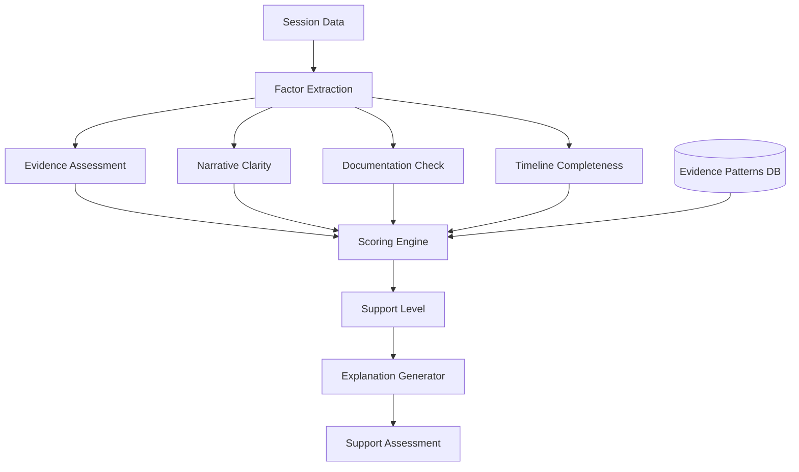
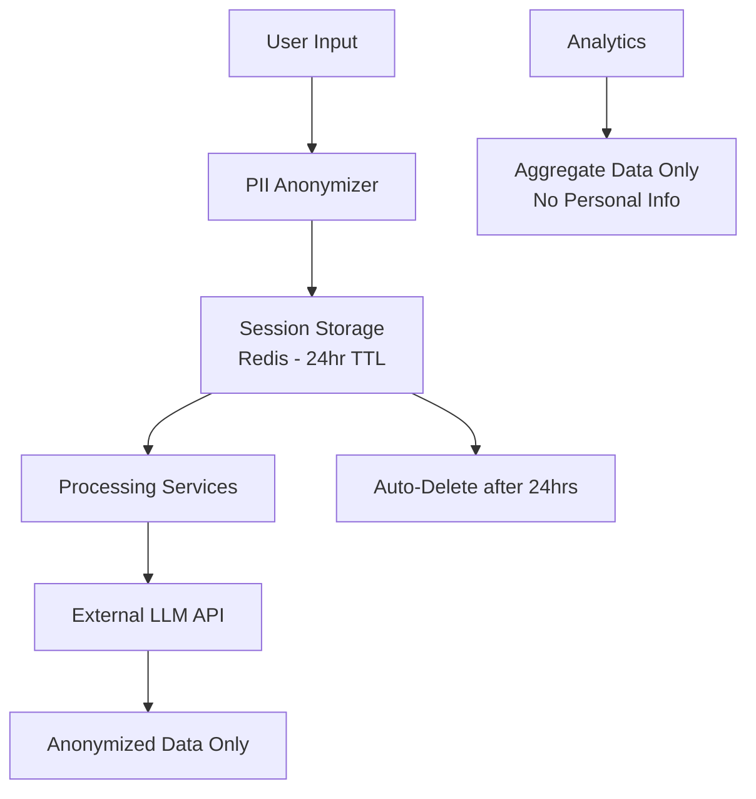

# NYAYASETU Technical Architecture - Part 2
## Continued from TECHNICAL_ARCHITECTURE.md

---

## 9. PRELIMINARY CASE SUPPORT ASSESSMENT ARCHITECTURE

### 9.1 Case Support vs. Case Prediction (Critical Distinction)

**What We're NOT Doing:**
- ❌ Predicting case outcomes ("You will win")
- ❌ Calculating win probability ("80% chance")
- ❌ Legal analysis of merits
- ❌ Providing legal opinions

**What We ARE Doing:**
- ✅ Assessing **information readiness**
- ✅ Identifying **evidence present**
- ✅ Evaluating **clarity of narrative**
- ✅ Suggesting **improvements to strengthen case presentation**

**Framework**: This is a **preliminary support/readiness assessment**, not a legal judgment.



### 9.2 Assessment Factors

```python
# core/case_assessor.py

from enum import Enum
from dataclasses import dataclass

class SupportLevel(Enum):
    STRONG_INDICATORS = "strong"
    MODERATE_INDICATORS = "moderate"
    NEEDS_STRENGTHENING = "needs_strengthening"

@dataclass
class SupportFactor:
    name: str
    present: bool
    importance: str  # 'critical', 'important', 'helpful'
    description: str

@dataclass
class CaseAssessment:
    support_level: SupportLevel
    confidence: float  # 0-1
    factors: dict  # What was evaluated
    strengths: list  # What's going well
    to_strengthen: list  # Actionable improvements
    explanation: str
    disclaimer: str

class CaseAssessor:
    """Hybrid system: Rules + LLM for case support assessment"""
    
    def __init__(self, knowledge_service, llm_service):
        self.knowledge = knowledge_service
        self.llm = llm_service
    
    async def assess(self, session: Session) -> CaseAssessment:
        """
        Assess preliminary case support indicators
        
        This is NOT a legal opinion - it's a readiness check
        """
        
        # 1. Get expected evidence patterns for this case category
        evidence_patterns = await self.knowledge.get_evidence_patterns(
            session.case_category
        )
        
        # 2. Extract factors from session data
        factors = self.extract_factors(session, evidence_patterns)
        
        # 3. Score factors
        score = self.calculate_support_score(factors)
        
        # 4. Determine support level
        support_level = self.determine_support_level(score)
        
        # 5. Identify strengths and improvements
        strengths = self.identify_strengths(factors)
        to_strengthen = self.suggest_improvements(factors, evidence_patterns)
        
        # 6. Generate explanation (with LLM)
        explanation = await self.generate_explanation(
            support_level=support_level,
            strengths=strengths,
            to_strengthen=to_strengthen,
            language=session.language
        )
        
        return CaseAssessment(
            support_level=support_level,
            confidence=score.confidence,
            factors=factors,
            strengths=strengths,
            to_strengthen=to_strengthen,
            explanation=explanation,
            disclaimer=self.get_disclaimer(session.language)
        )
    
    def extract_factors(self, session: Session, evidence_patterns: list) -> dict:
        """Extract assessment factors from session data"""
        
        factors = {
            'evidence_present': self.assess_evidence(session, evidence_patterns),
            'timeline_clarity': self.assess_timeline(session),
            'documentation': self.assess_documentation(session),
            'parties_identified': self.assess_parties(session),
            'amounts_clear': self.assess_amounts(session),
            'urgency_addressed': self.assess_urgency(session)
        }
        
        return factors
    
    def assess_evidence(self, session: Session, evidence_patterns: list) -> SupportFactor:
        """Check what evidence is mentioned"""
        
        mentioned_evidence = session.extracted_data.get('evidence', {})
        
        # Count critical evidence present
        critical_patterns = [p for p in evidence_patterns if p['importance_level'] == 'critical']
        critical_present = sum(1 for p in critical_patterns if mentioned_evidence.get(p['evidence_type']))
        critical_total = len(critical_patterns)
        
        # Count all evidence
        total_present = sum(1 for v in mentioned_evidence.values() if v)
        total_possible = len(evidence_patterns)
        
        if critical_total > 0:
            critical_ratio = critical_present / critical_total
        else:
            critical_ratio = 1.0  # No critical evidence required
        
        present = critical_ratio >= 0.5 and total_present > 0
        
        return SupportFactor(
            name='evidence_present',
            present=present,
            importance='critical',
            description=f"{total_present}/{total_possible} types of evidence mentioned"
        )
    
    def assess_timeline(self, session: Session) -> SupportFactor:
        """Check if timeline is clear"""
        
        timeline = session.extracted_data.get('timeline', {})
        
        has_duration = timeline.get('duration') is not None
        has_dates = timeline.get('start_date') or timeline.get('key_dates')
        
        clear = has_duration or has_dates
        
        return SupportFactor(
            name='timeline_clarity',
            present=clear,
            importance='important',
            description="Timeline of events is clear" if clear else "Timeline is vague"
        )
    
    def assess_documentation(self, session: Session) -> SupportFactor:
        """Check if written documentation exists"""
        
        evidence = session.extracted_data.get('evidence', {})
        
        # Look for written documentation
        written_docs = [
            'appointment_letter',
            'contract',
            'agreement',
            'emails',
            'whatsapp_messages',
            'bank_statements',
            'receipts'
        ]
        
        has_written = any(evidence.get(doc) for doc in written_docs)
        
        return SupportFactor(
            name='documentation',
            present=has_written,
            importance='important',
            description="Written documentation available" if has_written else "No written documentation mentioned"
        )
    
    def assess_parties(self, session: Session) -> SupportFactor:
        """Check if parties are clearly identified"""
        
        parties = session.extracted_data.get('parties', {})
        
        identified = len(parties) >= 2  # User + at least one other party
        
        return SupportFactor(
            name='parties_identified',
            present=identified,
            importance='helpful',
            description="All parties identified" if identified else "Some parties unclear"
        )
    
    def assess_amounts(self, session: Session) -> SupportFactor:
        """Check if monetary amounts are specific"""
        
        amounts = session.extracted_data.get('amounts', {})
        
        specific = any(amounts.values())
        
        return SupportFactor(
            name='amounts_clear',
            present=specific,
            importance='helpful',
            description="Amounts specified" if specific else "Amounts not specified"
        )
    
    def assess_urgency(self, session: Session) -> SupportFactor:
        """Check if urgency is appropriate"""
        
        urgency = session.extracted_data.get('urgency_level', 'medium')
        
        # This is more about whether user understands urgency
        addressed = urgency in ['high', 'critical', 'medium']
        
        return SupportFactor(
            name='urgency_addressed',
            present=addressed,
            importance='helpful',
            description=f"Urgency level: {urgency}"
        )
    
    def calculate_support_score(self, factors: dict) -> dict:
        """
        Calculate weighted score
        
        Weight by importance:
        - critical: 3x
        - important: 2x
        - helpful: 1x
        """
        
        WEIGHTS = {
            'critical': 3,
            'important': 2,
            'helpful': 1
        }
        
        total_weight = 0
        achieved_weight = 0
        
        for factor in factors.values():
            weight = WEIGHTS[factor.importance]
            total_weight += weight
            if factor.present:
                achieved_weight += weight
        
        score = achieved_weight / total_weight if total_weight > 0 else 0
        
        # Confidence based on number of factors evaluated
        confidence = len(factors) / 6.0  # We have 6 standard factors
        
        return {
            'score': score,
            'confidence': confidence,
            'achieved': achieved_weight,
            'total': total_weight
        }
    
    def determine_support_level(self, score: dict) -> SupportLevel:
        """Map score to support level"""
        
        score_value = score['score']
        
        if score_value >= 0.75:
            return SupportLevel.STRONG_INDICATORS
        elif score_value >= 0.50:
            return SupportLevel.MODERATE_INDICATORS
        else:
            return SupportLevel.NEEDS_STRENGTHENING
    
    def identify_strengths(self, factors: dict) -> list:
        """List what's going well"""
        
        strengths = []
        
        for factor in factors.values():
            if factor.present:
                strengths.append(factor.description)
        
        return strengths
    
    def suggest_improvements(self, factors: dict, evidence_patterns: list) -> list:
        """Actionable suggestions to strengthen case presentation"""
        
        suggestions = []
        
        for factor in factors.values():
            if not factor.present:
                if factor.name == 'evidence_present':
                    # Suggest specific evidence from patterns
                    critical_evidence = [p for p in evidence_patterns if p['importance_level'] == 'critical']
                    for pattern in critical_evidence[:2]:  # Top 2
                        suggestions.append(f"Try to obtain: {pattern['display_name_en']}")
                
                elif factor.name == 'timeline_clarity':
                    suggestions.append("Create a timeline of key events with dates")
                
                elif factor.name == 'documentation':
                    suggestions.append("Gather any written documents (emails, messages, letters)")
                
                elif factor.name == 'amounts_clear':
                    suggestions.append("Specify monetary amounts involved")
        
        # Add generic helpful suggestions
        if len(suggestions) < 3:
            suggestions.append("Note down names and contact details of any witnesses")
            suggestions.append("Keep all original documents safe")
        
        return suggestions[:5]  # Max 5 suggestions
    
    async def generate_explanation(
        self,
        support_level: SupportLevel,
        strengths: list,
        to_strengthen: list,
        language: str
    ) -> str:
        """Use LLM to generate human-friendly explanation"""
        
        prompt = f"""
Generate a supportive explanation of case readiness assessment.

SUPPORT LEVEL: {support_level.value}

STRENGTHS (what user has):
{chr(10).join(f'- {s}' for s in strengths)}

TO STRENGTHEN (suggestions):
{chr(10).join(f'- {s}' for s in to_strengthen)}

TASK:
Write an encouraging message explaining the support level.
- Start with the support level
- List strengths
- Provide actionable suggestions
- Emphasize this is NOT a prediction
- Encourage user to proceed with legal aid

LANGUAGE: {language}
TONE: Encouraging, factual, not overpromising
"""
        
        explanation = await self.llm.generate(prompt)
        return explanation
    
    def get_disclaimer(self, language: str) -> str:
        """Standard disclaimer"""
        
        DISCLAIMERS = {
            'en': "This assessment is based on the information provided and is not legal advice. A legal aid lawyer will conduct a complete evaluation of your case.",
            'hi': "यह मूल्यांकन दी गई जानकारी पर आधारित है और कानूनी सलाह नहीं है। कानूनी सहायता वकील आपके मामले का पूर्ण मूल्यांकन करेंगे।"
        }
        
        return DISCLAIMERS.get(language, DISCLAIMERS['en'])
```

### 9.3 Example Assessment Output

```python
{
  "support_level": "moderate",
  "confidence": 0.83,
  "factors": {
    "evidence_present": {
      "present": true,
      "importance": "critical",
      "description": "2/3 types of evidence mentioned"
    },
    "timeline_clarity": {
      "present": true,
      "importance": "important",
      "description": "Timeline of events is clear"
    },
    "documentation": {
      "present": true,
      "importance": "important",
      "description": "Written documentation available"
    },
    "parties_identified": {
      "present": true,
      "importance": "helpful",
      "description": "All parties identified"
    },
    "amounts_clear": {
      "present": true,
      "importance": "helpful",
      "description": "Amounts specified"
    },
    "urgency_addressed": {
      "present": false,
      "importance": "helpful",
      "description": "Urgency level: medium"
    }
  },
  "strengths": [
    "WhatsApp messages provide written evidence",
    "3-month timeline is clear",
    "Monthly salary amount (₹8,000) is specific",
    "Employer and your role are identified"
  ],
  "to_strengthen": [
    "Try to obtain: Appointment letter or employment contract",
    "Gather bank statements showing previous salary deposits",
    "Note down names of co-workers who can provide witness statements"
  ],
  "explanation": "आपके मामले में मध्यम समर्थन संकेतक हैं...",
  "disclaimer": "यह मूल्यांकन दी गई जानकारी पर आधारित है..."
}
```

---

## 10. EVIDENCE READINESS ARCHITECTURE

### 10.1 Evidence Patterns Database

This maps case categories to typical evidence needed:

```python
# Database: evidence_patterns table (populated)

EVIDENCE_PATTERNS = {
    "labor_dispute": {
        "wage_theft": [
            {
                "evidence_type": "appointment_letter",
                "importance": "critical",
                "description": "Employment appointment letter or offer letter",
                "alternatives": ["Email confirmation of job", "Oral employment (with witnesses)"]
            },
            {
                "evidence_type": "salary_slips",
                "importance": "critical",
                "description": "Salary slips or bank statements showing salary deposits",
                "alternatives": ["WhatsApp messages about salary", "Witness statements"]
            },
            {
                "evidence_type": "communication",
                "importance": "important",
                "description": "Messages, emails about unpaid wages",
                "alternatives": ["Written complaints you sent"]
            },
            {
                "evidence_type": "timesheet",
                "importance": "helpful",
                "description": "Attendance records or timesheets",
                "alternatives": []
            }
        ]
    },
    "property_dispute": {
        "landlord_tenant": [
            {
                "evidence_type": "rental_agreement",
                "importance": "critical",
                "description": "Signed rental agreement",
                "alternatives": ["Receipt of rent payments", "WhatsApp messages about rent"]
            },
            {
                "evidence_type": "rent_receipts",
                "importance": "critical",
                "description": "Rent payment receipts or bank transfers",
                "alternatives": []
            },
            {
                "evidence_type": "security_deposit_receipt",
                "importance": "important",
                "description": "Receipt for security deposit",
                "alternatives": ["Bank transfer proof"]
            },
            {
                "evidence_type": "communication",
                "importance": "important",
                "description": "Messages with landlord about issue",
                "alternatives": []
            }
        ]
    }
    # ... more categories
}
```

### 10.2 Evidence Extraction from Conversation

```python
class EvidenceExtractor:
    """Extract evidence mentions from conversation"""
    
    EVIDENCE_KEYWORDS = {
        'appointment_letter': ['appointment', 'offer letter', 'job letter', 'नियुक्ति पत्र'],
        'whatsapp_messages': ['whatsapp', 'messages', 'chat', 'मैसेज', 'चैट'],
        'bank_statements': ['bank statement', 'passbook', 'बैंक स्टेटमेंट'],
        'emails': ['email', 'mail', 'ईमेल'],
        'contract': ['contract', 'agreement', 'अनुबंध', 'करार'],
        'receipts': ['receipt', 'रसीद', 'पर्ची'],
        'photos': ['photo', 'picture', 'image', 'फोटो', 'तस्वीर'],
        'witnesses': ['witness', 'गवाह', 'साक्षी']
    }
    
    def extract_from_text(self, text: str) -> dict:
        """Extract evidence mentions"""
        
        text_lower = text.lower()
        mentioned = {}
        
        for evidence_type, keywords in self.EVIDENCE_KEYWORDS.items():
            mentioned[evidence_type] = any(kw in text_lower for kw in keywords)
        
        return mentioned
    
    def extract_from_session(self, session: Session) -> dict:
        """Extract from entire conversation"""
        
        all_text = ' '.join([msg['message'] for msg in session.conversation_history if msg['role'] == 'user'])
        
        return self.extract_from_text(all_text)
```

---

## 11. URGENCY DETECTION ARCHITECTURE

### 11.1 Urgency Levels

```python
class UrgencyLevel(Enum):
    CRITICAL = "critical"  # Immediate danger, <24 hours
    HIGH = "high"          # Time-sensitive, <7 days
    MEDIUM = "medium"      # Important, <30 days
    LOW = "low"            # General inquiry

class UrgencyDetector:
    """Detect urgency from user message"""
    
    URGENCY_PATTERNS = {
        'critical': {
            'keywords': [
                'मारा', 'hit', 'beaten', 'violence', 'हिंसा',
                'डर', 'scared', 'afraid', 'threat', 'धमकी',
                'आज', 'today', 'अभी', 'now', 'immediate',
                'eviction today', 'आज बेदखली'
            ],
            'scenarios': [
                'domestic_violence',
                'immediate_eviction',
                'physical_harm',
                'threat_to_life'
            ],
            'action': 'Show crisis helplines immediately'
        },
        'high': {
            'keywords': [
                'कल', 'tomorrow', 'परसों',
                'court date', 'सुनवाई', 'hearing',
                'deadline', 'अंतिम तिथि',
                'FIR', 'police', 'पुलिस'
            ],
            'scenarios': [
                'upcoming_court_date',
                'legal_deadline',
                'fir_needed',
                'bail_application'
            ],
            'action': 'Expedite resource matching'
        },
        'medium': {
            'keywords': [
                'इस महीने', 'this month',
                'soon', 'जल्दी',
                'pending', 'लंबित'
            ],
            'scenarios': [
                'ongoing_dispute',
                'mounting_debt',
                'delayed_payment'
            ],
            'action': 'Normal processing'
        }
    }
    
    DISTRESS_INDICATORS = [
        'क्या करूं', "don't know what to do",
        'बहुत परेशान', 'very worried', 'desperate',
        'helpless', 'असहाय', 'nowhere to go'
    ]
    
    def detect(self, text: str, entities: dict) -> dict:
        """Detect urgency level and distress"""
        
        text_lower = text.lower()
        
        # Check for critical keywords
        for level, patterns in self.URGENCY_PATTERNS.items():
            if any(kw in text_lower for kw in patterns['keywords']):
                return {
                    'level': level,
                    'confidence': 0.8,
                    'signals': self.identify_signals(text_lower, patterns['keywords']),
                    'recommended_action': patterns['action'],
                    'distress_detected': self.detect_distress(text_lower)
                }
        
        # Check entities for time signals
        if entities.get('dates'):
            # Parse dates to check proximity
            urgency_from_dates = self.check_date_urgency(entities['dates'])
            if urgency_from_dates:
                return urgency_from_dates
        
        # Default
        return {
            'level': 'medium',
            'confidence': 0.5,
            'signals': [],
            'recommended_action': 'Normal processing',
            'distress_detected': False
        }
    
    def detect_distress(self, text: str) -> bool:
        """Detect emotional distress"""
        return any(indicator in text for indicator in self.DISTRESS_INDICATORS)
    
    def identify_signals(self, text: str, keywords: list) -> list:
        """Identify which signals are present"""
        return [kw for kw in keywords if kw in text]
```

### 11.2 Crisis Response System

```python
CRISIS_HELPLINES = {
    'domestic_violence': {
        'en': {
            'name': "Women Helpline",
            'number': "181",
            'description': "24/7 support for women in distress"
        },
        'hi': {
            'name': "महिला हेल्पलाइन",
            'number': "181",
            'description': "महिलाओं के लिए 24/7 सहायता"
        }
    },
    'child_abuse': {
        'en': {
            'name': "Childline",
            'number': "1098",
            'description': "Emergency helpline for children"
        },
        'hi': {
            'name': "चाइल्डलाइन",
            'number': "1098",
            'description': "बच्चों के लिए आपातकालीन हेल्पलाइन"
        }
    },
    'general': {
        'en': {
            'name': "Police Emergency",
            'number': "100",
            'description': "For immediate danger"
        },
        'hi': {
            'name': "पुलिस आपातकाल",
            'number': "100",
            'description': "तत्काल खतरे के लिए"
        }
    }
}

def show_crisis_helplines(urgency_result: dict, session: Session):
    """Display crisis helplines if critical urgency"""
    
    if urgency_result['level'] != 'critical':
        return None
    
    # Determine which helpline
    helpline_type = 'general'
    if 'domestic_violence' in urgency_result['signals']:
        helpline_type = 'domestic_violence'
    
    helpline = CRISIS_HELPLINES[helpline_type][session.language]
    
    return {
        'type': 'crisis_helpline',
        'urgent': True,
        'helpline': helpline,
        'message': f"⚠️ If you are in immediate danger, please call {helpline['number']} ({helpline['name']})"
    }
```

---


## 12. RESOURCE MATCHING ARCHITECTURE

### 12.1 Matching Algorithm

```python
# core/resource_matcher.py

from math import radians, cos, sin, asin, sqrt
from typing import List, Optional

class ResourceMatcher:
    """Match users to appropriate legal aid providers"""
    
    def __init__(self, db_session):
        self.db = db_session
    
    async def find_providers(
        self,
        district: str,
        state: str,
        case_category: str,
        latitude: Optional[float] = None,
        longitude: Optional[float] = None,
        special_requirements: List[str] = None,
        limit: int = 10
    ) -> List[dict]:
        """
        Find and rank legal aid providers
        
        Ranking factors:
        1. Case type specialization (highest priority)
        2. Geographic proximity
        3. Special focus match (women, SC/ST, etc.)
        4. Active status
        5. Last verified date (freshness)
        """
        
        # Build query
        query = """
            SELECT 
                id, name, type, address, district, state,
                phone, email, website, office_hours,
                latitude, longitude,
                case_types, special_focus, languages_supported,
                last_verified_date
            FROM providers
            WHERE 
                is_active = true
                AND state = $1
                AND (district = $2 OR $2 IS NULL)
                AND $3 = ANY(case_types)
        """
        
        params = [state, district, case_category]
        
        # Add special requirements filter
        if special_requirements:
            query += " AND special_focus && $4"
            params.append(special_requirements)
        
        # Execute query
        providers = await self.db.fetch_all(query, *params)
        
        if not providers:
            # Fallback: Try state-level without district filter
            providers = await self.find_fallback_providers(state, case_category)
        
        # Rank providers
        ranked = self.rank_providers(
            providers=providers,
            case_category=case_category,
            user_lat=latitude,
            user_lon=longitude,
            special_requirements=special_requirements
        )
        
        return ranked[:limit]
    
    def rank_providers(
        self,
        providers: List[dict],
        case_category: str,
        user_lat: Optional[float],
        user_lon: Optional[float],
        special_requirements: List[str]
    ) -> List[dict]:
        """Rank providers by relevance"""
        
        scored_providers = []
        
        for provider in providers:
            score = 0
            
            # 1. Case type specialization (0-50 points)
            if case_category in provider.get('case_types', []):
                score += 50
            
            # 2. Geographic proximity (0-30 points)
            if user_lat and user_lon and provider['latitude'] and provider['longitude']:
                distance_km = self.haversine_distance(
                    user_lat, user_lon,
                    provider['latitude'], provider['longitude']
                )
                provider['distance_km'] = round(distance_km, 1)
                
                # Score: closer is better
                if distance_km < 5:
                    score += 30
                elif distance_km < 10:
                    score += 25
                elif distance_km < 20:
                    score += 15
                else:
                    score += max(0, 30 - int(distance_km / 10))
            else:
                provider['distance_km'] = None
                score += 10  # Base points if no geo data
            
            # 3. Special focus match (0-10 points)
            if special_requirements:
                matches = set(special_requirements) & set(provider.get('special_focus', []))
                score += len(matches) * 5
            
            # 4. Provider type preference (0-5 points)
            type_scores = {
                'district_lsa': 5,
                'state_lsa': 4,
                'ngo': 3,
                'pro_bono': 2
            }
            score += type_scores.get(provider['type'], 0)
            
            # 5. Freshness (0-5 points)
            if provider['last_verified_date']:
                days_since_verified = (datetime.now().date() - provider['last_verified_date']).days
                if days_since_verified < 30:
                    score += 5
                elif days_since_verified < 90:
                    score += 3
                elif days_since_verified < 180:
                    score += 1
            
            provider['relevance_score'] = score
            scored_providers.append(provider)
        
        # Sort by score (descending)
        scored_providers.sort(key=lambda p: p['relevance_score'], reverse=True)
        
        return scored_providers
    
    @staticmethod
    def haversine_distance(lat1: float, lon1: float, lat2: float, lon2: float) -> float:
        """Calculate distance between two points in kilometers"""
        
        # Convert to radians
        lat1, lon1, lat2, lon2 = map(radians, [lat1, lon1, lat2, lon2])
        
        # Haversine formula
        dlat = lat2 - lat1
        dlon = lon2 - lon1
        a = sin(dlat/2)**2 + cos(lat1) * cos(lat2) * sin(dlon/2)**2
        c = 2 * asin(sqrt(a))
        
        # Earth radius in kilometers
        r = 6371
        
        return c * r
    
    async def find_fallback_providers(self, state: str, case_category: str) -> List[dict]:
        """Fallback if no district-specific providers found"""
        
        query = """
            SELECT * FROM providers
            WHERE 
                is_active = true
                AND state = $1
                AND ($2 = ANY(case_types) OR 'general' = ANY(case_types))
            ORDER BY type DESC  -- Prioritize state LSA
            LIMIT 5
        """
        
        return await self.db.fetch_all(query, state, case_category)
```

### 12.2 Provider Recommendation Format

```python
{
  "providers": [
    {
      "id": "uuid",
      "name": "उत्तर प्रदेश राज्य विधिक सेवा प्राधिकरण - वाराणसी",
      "type": "district_lsa",
      "type_display": "District Legal Services Authority",
      
      "contact": {
        "address": "District Court Complex, Varanasi, UP 221001",
        "phone": "+91-542-2501234",
        "email": "dlsa.varanasi@up.gov.in",
        "website": "https://upslsa.up.gov.in/varanasi"
      },
      
      "location": {
        "district": "varanasi",
        "state": "uttar_pradesh",
        "latitude": 25.3176,
        "longitude": 82.9739,
        "distance_km": 2.3,
        "google_maps_url": "https://maps.google.com/?q=25.3176,82.9739"
      },
      
      "services": {
        "case_types": ["labor", "family", "property", "criminal", "consumer"],
        "special_focus": ["women", "sc_st", "disabled"],
        "languages": ["hindi", "english", "bhojpuri"]
      },
      
      "operational": {
        "office_hours": {
          "monday": "10:00-17:00",
          "tuesday": "10:00-17:00",
          "wednesday": "10:00-17:00",
          "thursday": "10:00-17:00",
          "friday": "10:00-17:00",
          "saturday": "10:00-13:00",
          "sunday": "Closed"
        },
        "walk_in_allowed": true,
        "appointment_required": false
      },
      
      "metadata": {
        "last_verified": "2026-08-15",
        "relevance_score": 85,
        "why_recommended": "Closest to your location, specializes in labor disputes"
      }
    }
  ],
  "total_count": 3,
  "search_params": {
    "district": "varanasi",
    "state": "uttar_pradesh",
    "case_type": "labor_dispute"
  }
}
```

---

## 13. AUTHENTICATION ARCHITECTURE

### 13.1 User Authentication (Minimal)

**For Citizens**: NO authentication required
- Anonymous by default
- Session-based identification only
- No accounts, no login

**For Admin**: Simple authentication

```python
# core/auth.py

from passlib.context import CryptContext
from jose import JWTError, jwt
from datetime import datetime, timedelta

pwd_context = CryptContext(schemes=["bcrypt"], deprecated="auto")

SECRET_KEY = os.getenv("JWT_SECRET_KEY")
ALGORITHM = "HS256"
ACCESS_TOKEN_EXPIRE_MINUTES = 60

class AuthService:
    """Simple authentication for admin only"""
    
    @staticmethod
    def verify_password(plain_password: str, hashed_password: str) -> bool:
        return pwd_context.verify(plain_password, hashed_password)
    
    @staticmethod
    def get_password_hash(password: str) -> str:
        return pwd_context.hash(password)
    
    @staticmethod
    def create_access_token(data: dict, expires_delta: Optional[timedelta] = None):
        to_encode = data.copy()
        
        if expires_delta:
            expire = datetime.utcnow() + expires_delta
        else:
            expire = datetime.utcnow() + timedelta(minutes=ACCESS_TOKEN_EXPIRE_MINUTES)
        
        to_encode.update({"exp": expire})
        encoded_jwt = jwt.encode(to_encode, SECRET_KEY, algorithm=ALGORITHM)
        
        return encoded_jwt
    
    @staticmethod
    async def authenticate_admin(username: str, password: str, db) -> Optional[dict]:
        """Authenticate admin user"""
        
        admin = await db.fetch_one(
            "SELECT * FROM admin_users WHERE username = $1 AND is_active = true",
            username
        )
        
        if not admin:
            return None
        
        if not AuthService.verify_password(password, admin['password_hash']):
            return None
        
        return dict(admin)
```

### 13.2 Admin Login Flow

```python
# api/v1/admin.py

from fastapi import APIRouter, Depends, HTTPException, status
from fastapi.security import OAuth2PasswordBearer, OAuth2PasswordRequestForm

router = APIRouter()

oauth2_scheme = OAuth2PasswordBearer(tokenUrl="/api/v1/admin/login")

@router.post("/login")
async def admin_login(
    form_data: OAuth2PasswordRequestForm = Depends(),
    db = Depends(get_db)
):
    """Admin login endpoint"""
    
    admin = await auth_service.authenticate_admin(
        form_data.username,
        form_data.password,
        db
    )
    
    if not admin:
        raise HTTPException(
            status_code=status.HTTP_401_UNAUTHORIZED,
            detail="Incorrect username or password",
            headers={"WWW-Authenticate": "Bearer"},
        )
    
    # Create access token
    access_token = auth_service.create_access_token(
        data={"sub": admin['username'], "role": "admin"}
    )
    
    return {
        "access_token": access_token,
        "token_type": "bearer"
    }

async def get_current_admin(
    token: str = Depends(oauth2_scheme),
    db = Depends(get_db)
):
    """Dependency to get current admin from token"""
    
    credentials_exception = HTTPException(
        status_code=status.HTTP_401_UNAUTHORIZED,
        detail="Could not validate credentials",
        headers={"WWW-Authenticate": "Bearer"},
    )
    
    try:
        payload = jwt.decode(token, SECRET_KEY, algorithms=[ALGORITHM])
        username: str = payload.get("sub")
        if username is None:
            raise credentials_exception
    except JWTError:
        raise credentials_exception
    
    admin = await db.fetch_one(
        "SELECT * FROM admin_users WHERE username = $1",
        username
    )
    
    if admin is None:
        raise credentials_exception
    
    return dict(admin)
```

---

## 14. AUTHORIZATION ARCHITECTURE

### 14.1 Role-Based Access Control (Simple)

```python
from enum import Enum

class Role(Enum):
    CITIZEN = "citizen"  # Anonymous users
    ADMIN = "admin"      # System administrators

class Permission(Enum):
    # Citizen permissions
    START_CONVERSATION = "start_conversation"
    SEND_MESSAGE = "send_message"
    VIEW_RESOURCES = "view_resources"
    GENERATE_REPORT = "generate_report"
    
    # Admin permissions
    VIEW_ANALYTICS = "view_analytics"
    MANAGE_PROVIDERS = "manage_providers"
    VIEW_SESSIONS = "view_sessions"
    UPDATE_CRITERIA = "update_criteria"

ROLE_PERMISSIONS = {
    Role.CITIZEN: [
        Permission.START_CONVERSATION,
        Permission.SEND_MESSAGE,
        Permission.VIEW_RESOURCES,
        Permission.GENERATE_REPORT
    ],
    Role.ADMIN: [
        # All citizen permissions plus admin permissions
        Permission.START_CONVERSATION,
        Permission.SEND_MESSAGE,
        Permission.VIEW_RESOURCES,
        Permission.GENERATE_REPORT,
        Permission.VIEW_ANALYTICS,
        Permission.MANAGE_PROVIDERS,
        Permission.VIEW_SESSIONS,
        Permission.UPDATE_CRITERIA
    ]
}

def has_permission(user_role: Role, permission: Permission) -> bool:
    """Check if role has permission"""
    return permission in ROLE_PERMISSIONS.get(user_role, [])
```

### 14.2 Authorization Middleware

```python
# dependencies.py

from fastapi import HTTPException, status

def require_permission(required_permission: Permission):
    """Dependency factory for permission checking"""
    
    async def permission_checker(
        current_user: dict = Depends(get_current_user_or_none)
    ):
        """Check if user has required permission"""
        
        # Determine user role
        if current_user and current_user.get('role') == 'admin':
            user_role = Role.ADMIN
        else:
            user_role = Role.CITIZEN
        
        # Check permission
        if not has_permission(user_role, required_permission):
            raise HTTPException(
                status_code=status.HTTP_403_FORBIDDEN,
                detail="Not enough permissions"
            )
        
        return True
    
    return permission_checker

# Usage in endpoints
@router.get("/api/v1/admin/analytics")
async def get_analytics(
    authorized: bool = Depends(require_permission(Permission.VIEW_ANALYTICS)),
    db = Depends(get_db)
):
    """Admin-only analytics endpoint"""
    # ... analytics logic
```

---

## 15. PRIVACY ARCHITECTURE

### 15.1 Privacy-by-Design Principles



### 15.2 PII Anonymization Service

```python
# utils/anonymizer.py

import re
import hashlib
from typing import Dict, Any

class PIIAnonymizer:
    """Anonymize personally identifiable information"""
    
    # Patterns for common PII
    PATTERNS = {
        'phone': re.compile(r'\b(\+91[\-\s]?)?[6-9]\d{9}\b'),
        'email': re.compile(r'\b[A-Za-z0-9._%+-]+@[A-Za-z0-9.-]+\.[A-Z|a-z]{2,}\b'),
        'aadhaar': re.compile(r'\b\d{4}\s?\d{4}\s?\d{4}\b'),
        'pan': re.compile(r'\b[A-Z]{5}\d{4}[A-Z]\b'),
        'full_name': None  # Uses NER
    }
    
    def anonymize_text(self, text: str, entities: list = None) -> str:
        """Anonymize PII in text"""
        
        anonymized = text
        
        # 1. Phone numbers
        anonymized = self.PATTERNS['phone'].sub('[PHONE]', anonymized)
        
        # 2. Email addresses
        anonymized = self.PATTERNS['email'].sub('[EMAIL]', anonymized)
        
        # 3. Aadhaar numbers
        anonymized = self.PATTERNS['aadhaar'].sub('[AADHAAR]', anonymized)
        
        # 4. PAN numbers
        anonymized = self.PATTERNS['pan'].sub('[PAN]', anonymized)
        
        # 5. Names (from NER)
        if entities:
            for entity in entities:
                if entity['type'] == 'PERSON':
                    # Replace with role if available
                    role = entity.get('normalized', 'PERSON')
                    anonymized = anonymized.replace(entity['text'], f'[{role}]')
        
        return anonymized
    
    def anonymize_session_data(self, session_data: Dict[str, Any]) -> Dict[str, Any]:
        """Anonymize sensitive fields in session data"""
        
        anonymized = session_data.copy()
        
        # Remove/hash sensitive fields
        if 'metadata' in anonymized:
            if 'ip_address' in anonymized['metadata']:
                anonymized['metadata']['ip_address_hash'] = self.hash_ip(
                    anonymized['metadata']['ip_address']
                )
                del anonymized['metadata']['ip_address']
        
        # Anonymize conversation history
        if 'conversation_history' in anonymized:
            for message in anonymized['conversation_history']:
                if message['role'] == 'user':
                    message['message'] = self.anonymize_text(
                        message['message'],
                        message.get('entities')
                    )
        
        # Remove any phone numbers from extracted data
        if 'extracted_data' in anonymized:
            if 'contact' in anonymized['extracted_data']:
                del anonymized['extracted_data']['contact']
        
        return anonymized
    
    @staticmethod
    def hash_ip(ip_address: str) -> str:
        """Hash IP address for privacy"""
        return hashlib.sha256(ip_address.encode()).hexdigest()[:16]
    
    def prepare_for_llm(self, text: str, entities: list) -> str:
        """Prepare text for LLM API (anonymize PII)"""
        
        # For external LLM APIs, anonymize all PII
        return self.anonymize_text(text, entities)
```

### 15.3 Data Retention Policy

```python
# services/retention_service.py

class RetentionService:
    """Manage data retention and deletion"""
    
    # Retention periods
    RETENTION_PERIODS = {
        'sessions': timedelta(hours=24),
        'analytics_aggregate': timedelta(days=365),
        'admin_logs': timedelta(days=90)
    }
    
    async def cleanup_expired_sessions(self, db):
        """Delete sessions older than 24 hours"""
        
        result = await db.execute(
            """
            DELETE FROM sessions
            WHERE created_at < NOW() - INTERVAL '24 hours'
            RETURNING session_id
            """
        )
        
        deleted_count = len(result)
        logger.info(f"Deleted {deleted_count} expired sessions")
        
        return deleted_count
    
    async def anonymize_analytics_data(self, db):
        """Further anonymize data used for analytics"""
        
        # After 7 days, remove even more details
        await db.execute(
            """
            UPDATE sessions
            SET 
                conversation_history = NULL,
                extracted_data = jsonb_strip_nulls(
                    jsonb_build_object(
                        'case_category', extracted_data->>'case_category',
                        'urgency_level', extracted_data->>'urgency_level'
                    )
                )
            WHERE created_at < NOW() - INTERVAL '7 days'
                AND conversation_history IS NOT NULL
            """
        )
```

### 15.4 Privacy Policy (Plain Language)

```python
PRIVACY_POLICY = {
    'en': """
Privacy Notice for NYAYASETU

What we collect:
- Your legal situation (anonymized)
- Your district/state (for resource matching)
- Approximate income bracket
- Type of legal issue

What we DON'T collect:
- Your name
- Phone number (unless you choose SMS notification)
- Exact address
- Identity documents

How long we keep it:
- 24 hours only
- Then automatically deleted

Who sees it:
- No one. We don't share your information.
- Our system processes it to help you find legal aid.

Your rights:
- You can request deletion anytime
- No account means no tracking
- You control what you share
""",
    'hi': """
न्यायसेतु के लिए गोपनीयता सूचना

हम क्या एकत्र करते हैं:
- आपकी कानूनी स्थिति (अनाम)
- आपका जिला/राज्य (संसाधन खोजने के लिए)
- लगभग आय वर्ग
- कानूनी मुद्दे का प्रकार

हम क्या नहीं एकत्र करते:
- आपका नाम
- फोन नंबर (जब तक आप एसएमएस नोटिफिकेशन नहीं चुनते)
- सटीक पता
- पहचान दस्तावेज

हम कितने समय तक रखते हैं:
- केवल 24 घंटे
- फिर स्वचालित रूप से हटा दिया जाता है

कौन देखता है:
- कोई नहीं। हम आपकी जानकारी साझा नहीं करते।
- हमारी प्रणाली इसे संसाधित करती है ताकि आपको कानूनी सहायता मिल सके।

आपके अधिकार:
- आप कभी भी हटाने का अनुरोध कर सकते हैं
- खाता नहीं है मतलब कोई ट्रैकिंग नहीं
- आप तय करते हैं कि क्या साझा करना है
"""
}
```

---

