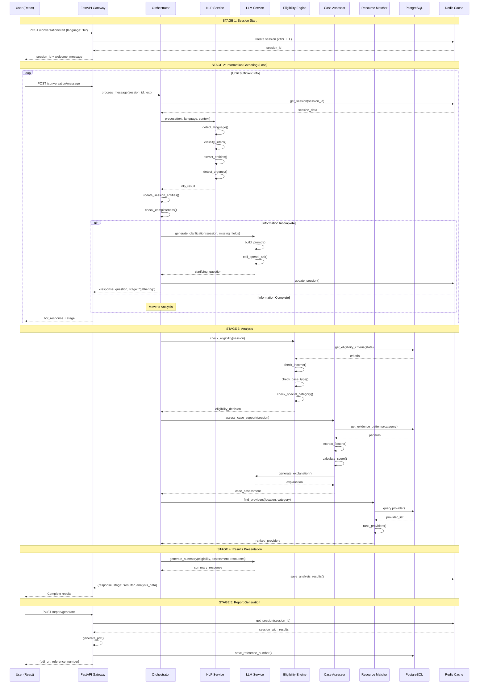
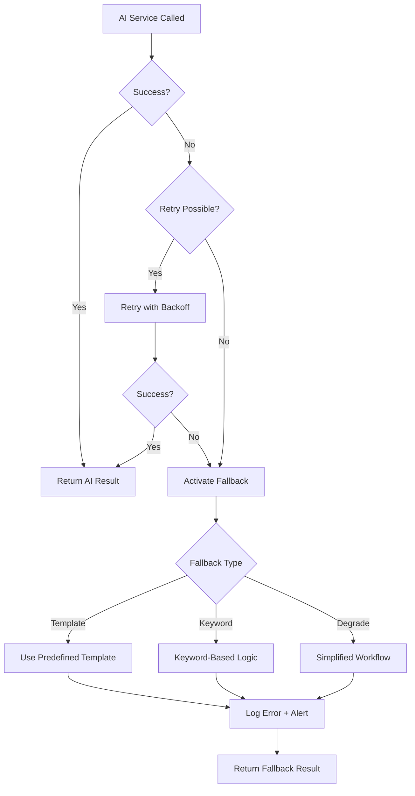

# NYAYASETU Technical Architecture - Part 3
## Final Sections: Data Flow, Error Handling, Fallbacks, Demo Mode

---

## 16. DATA FLOW FROM USER MESSAGE TO FINAL RECOMMENDATION

### 16.1 Complete End-to-End Flow Diagram



### 16.2 Detailed Step-by-Step Flow

#### Step 1: Session Initialization
```python
# Input: Language selection
request = {
    "language": "hi",
    "user_type": "citizen"
}

# Processing:
1. Generate UUID session_id
2. Store in Redis with 24hr TTL:
   {
       "session_id": "uuid",
       "created_at": "timestamp",
       "expires_at": "timestamp + 24hrs",
       "language": "hi",
       "user_type": "citizen",
       "conversation_history": [],
       "extracted_data": {},
       "stage": "initial"
   }
3. Generate welcome message (language-specific template)

# Output:
{
    "session_id": "abc-123-def",
    "welcome_message": "नमस्ते! मैं आपकी कानूनी सहायता खोजने में मदद करूंगा। कृपया अपनी समस्या बताएं।",
    "expires_at": "2026-09-02T10:00:00Z"
}
```

#### Step 2: First User Message
```python
# Input:
{
    "session_id": "abc-123-def",
    "message": "मालिक ने 3 महीने की तनख्वाह नहीं दी",
    "is_voice": false
}

# NLP Processing:
nlp_result = {
    "language": {"detected": "hi", "confidence": 0.95},
    "intent": {
        "primary": "labor_dispute",
        "sub_category": "wage_theft",
        "confidence": 0.89
    },
    "entities": [
        {"text": "मालिक", "type": "PERSON_ROLE", "normalized": "employer"},
        {"text": "3 महीने", "type": "DURATION", "normalized": {"value": 3, "unit": "months"}}
    ],
    "urgency": {"level": "medium", "confidence": 0.6}
}

# Session Update:
session.extracted_data = {
    "case_category": "labor_dispute",
    "sub_category": "wage_theft",
    "duration": "3 months",
    "parties": {"employer": "mentioned"}
}

# Completeness Check:
missing_fields = ["location", "income_bracket", "evidence"]
completeness_score = 0.3  # 3/10 fields

# LLM Clarification:
response = "मुझे समझ आया कि आपको 3 महीने का वेतन नहीं मिला। आपको नजदीकी कानूनी सहायता खोजने के लिए, कृपया बताएं कि आप किस जिले में रहते हैं?"

# Output:
{
    "response": "मुझे समझ आया...",
    "stage": "information_gathering",
    "progress": 30,
    "quick_replies": [
        {"text": "वाराणसी", "value": "varanasi"},
        {"text": "लखनऊ", "value": "lucknow"}
    ]
}
```

#### Step 3-5: Continued Information Gathering
(Similar flow, extracting more entities until completeness >= 70%)

#### Step 6: Eligibility Analysis (Once complete)
```python
# Session now has:
{
    "case_category": "labor_dispute",
    "location": {"district": "varanasi", "state": "uttar_pradesh"},
    "income_bracket": "below_2_lakh",
    "evidence": {"whatsapp_messages": true, "appointment_letter": false}
}

# Eligibility Engine:
1. Get criteria: UP threshold = ₹3,00,000
2. Check income: below_2_lakh → eligible ✓
3. Check case type: labor_dispute in covered_types ✓
4. Result: ELIGIBLE

eligibility_result = {
    "eligible": true,
    "confidence": "high",
    "criteria_met": {
        "income_threshold": true,
        "case_type_covered": true,
        "jurisdiction_valid": true
    },
    "explanation": {
        "primary_reason": "आपकी आय ₹3 लाख से कम है और श्रम विवाद कवर किया जाता है",
        "details": [...]
    }
}
```

#### Step 7: Case Support Assessment
```python
# Case Assessor:
factors = {
    "evidence_present": true,  # WhatsApp messages
    "timeline_clarity": true,  # 3 months clear
    "documentation": true,      # WhatsApp counts
    "parties_identified": true,
    "amounts_clear": false      # Salary amount not mentioned
}

score = 0.7  # 7/10
support_level = "moderate"

case_assessment = {
    "support_level": "moderate",
    "strengths": [
        "WhatsApp संदेश साक्ष्य के रूप में हैं",
        "3 महीने की स्पष्ट समयरेखा"
    ],
    "to_strengthen": [
        "नियुक्ति पत्र प्राप्त करें",
        "मासिक वेतन राशि बताएं"
    ],
    "disclaimer": "..."
}
```

#### Step 8: Resource Matching
```python
# Resource Matcher:
providers = find_providers(
    district="varanasi",
    state="uttar_pradesh",
    case_category="labor_dispute"
)

ranked_providers = [
    {
        "name": "UP State LSA - Varanasi",
        "distance_km": 2.3,
        "relevance_score": 85,
        "contact": {...}
    },
    # ... more providers
]
```

#### Step 9: Final Response Generation
```python
# LLM Summary:
prompt = f"""
User is eligible for legal aid.
Case support: moderate
Resources: 3 providers found

Generate encouraging summary in Hindi.
"""

final_response = """
अच्छी खबर! आप मुफ्त कानूनी सहायता के लिए योग्य हैं।

आपके मामले में मध्यम समर्थन संकेतक हैं:
✓ WhatsApp संदेश साक्ष्य हैं
✓ 3 महीने की समयरेखा स्पष्ट है

मजबूत करने के लिए:
→ नियुक्ति पत्र खोजें
→ वेतन राशि बताएं

मैंने आपके लिए 3 नजदीकी कानूनी सहायता कार्यालय खोजे हैं।
"""

# Complete Response:
{
    "response": final_response,
    "stage": "results",
    "eligibility": eligibility_result,
    "case_assessment": case_assessment,
    "providers": ranked_providers
}
```

---

## 17. ERROR HANDLING ARCHITECTURE

### 17.1 Error Classification

```python
from enum import Enum

class ErrorType(Enum):
    # User errors
    INVALID_INPUT = "invalid_input"
    MISSING_REQUIRED_FIELD = "missing_field"
    SESSION_EXPIRED = "session_expired"
    
    # System errors
    DATABASE_ERROR = "database_error"
    CACHE_ERROR = "cache_error"
    
    # External service errors
    NLP_SERVICE_ERROR = "nlp_error"
    LLM_API_ERROR = "llm_error"
    LLM_API_TIMEOUT = "llm_timeout"
    LLM_RATE_LIMIT = "llm_rate_limit"
    
    # Business logic errors
    INSUFFICIENT_DATA = "insufficient_data"
    UNSUPPORTED_LANGUAGE = "unsupported_language"
    
    # Critical errors
    SYSTEM_OVERLOAD = "system_overload"
    INTERNAL_ERROR = "internal_error"

class ErrorSeverity(Enum):
    LOW = "low"          # User can recover
    MEDIUM = "medium"    # Degraded service
    HIGH = "high"        # Service unavailable
    CRITICAL = "critical"  # System failure

@dataclass
class ErrorResponse:
    error_type: ErrorType
    severity: ErrorSeverity
    message: str  # User-facing message
    details: Optional[dict]  # Technical details (logged, not shown to user)
    recovery_action: Optional[str]  # What user can do
    retry_after: Optional[int]  # Seconds to wait before retry
```

### 17.2 Error Handlers

```python
# utils/error_handlers.py

class ErrorHandler:
    """Centralized error handling"""
    
    @staticmethod
    def handle_nlp_error(error: Exception, session: Session) -> ErrorResponse:
        """Handle NLP service errors"""
        
        logger.error(f"NLP error for session {session.session_id}: {error}")
        
        return ErrorResponse(
            error_type=ErrorType.NLP_SERVICE_ERROR,
            severity=ErrorSeverity.MEDIUM,
            message={
                'en': "I'm having trouble understanding right now. Please try rephrasing.",
                'hi': "मुझे अभी समझने में परेशानी हो रही है। कृपया दूसरे शब्दों में बताएं।"
            }[session.language],
            details={'error': str(error)},
            recovery_action="Use keyword-based fallback",
            retry_after=None
        )
    
    @staticmethod
    def handle_llm_timeout(session: Session) -> ErrorResponse:
        """Handle LLM API timeout"""
        
        return ErrorResponse(
            error_type=ErrorType.LLM_API_TIMEOUT,
            severity=ErrorSeverity.MEDIUM,
            message={
                'en': "Response is taking longer than expected. Let me try a simpler approach.",
                'hi': "जवाब में समय लग रहा है। मैं सरल तरीका आजमाता हूं।"
            }[session.language],
            details={'timeout_seconds': 30},
            recovery_action="Use template-based fallback",
            retry_after=5
        )
    
    @staticmethod
    def handle_session_expired() -> ErrorResponse:
        """Handle expired session"""
        
        return ErrorResponse(
            error_type=ErrorType.SESSION_EXPIRED,
            severity=ErrorSeverity.LOW,
            message="Your session has expired (24 hours). Please start a new conversation.",
            details={},
            recovery_action="Redirect to session start",
            retry_after=None
        )
    
    @staticmethod
    def handle_rate_limit(retry_after: int) -> ErrorResponse:
        """Handle rate limiting"""
        
        return ErrorResponse(
            error_type=ErrorType.LLM_RATE_LIMIT,
            severity=ErrorSeverity.HIGH,
            message=f"Service is busy. Please try again in {retry_after} seconds.",
            details={'retry_after': retry_after},
            recovery_action="Wait and retry",
            retry_after=retry_after
        )
```

### 17.3 Global Exception Handler

```python
# main.py

from fastapi import Request, status
from fastapi.responses import JSONResponse

@app.exception_handler(Exception)
async def global_exception_handler(request: Request, exc: Exception):
    """Catch-all exception handler"""
    
    # Log error with context
    logger.error(
        f"Unhandled exception: {exc}",
        extra={
            'path': request.url.path,
            'method': request.method,
            'client': request.client.host
        },
        exc_info=True
    )
    
    # Return user-friendly error
    return JSONResponse(
        status_code=status.HTTP_500_INTERNAL_SERVER_ERROR,
        content={
            "error": {
                "type": "internal_error",
                "message": "An unexpected error occurred. Please try again.",
                "message_hi": "एक अप्रत्याशित त्रुटि हुई। कृपया पुनः प्रयास करें।"
            }
        }
    )

@app.exception_handler(HTTPException)
async def http_exception_handler(request: Request, exc: HTTPException):
    """Handle HTTP exceptions"""
    
    return JSONResponse(
        status_code=exc.status_code,
        content={
            "error": {
                "type": "http_error",
                "message": exc.detail,
                "status_code": exc.status_code
            }
        }
    )
```

---

## 18. AI FAILURE FALLBACK ARCHITECTURE

### 18.1 Fallback Strategy

**Principle**: Every AI component has a deterministic fallback.



### 18.2 Component-Specific Fallbacks

#### Fallback 1: NLP Service Failure

```python
class NLPServiceWithFallback:
    
    async def process(self, text: str, language: str):
        """NLP processing with fallback"""
        
        try:
            # Primary: ML-based processing
            return await self.ml_process(text, language)
        
        except Exception as e:
            logger.warning(f"NLP ML model failed: {e}, using fallback")
            
            # Fallback: Keyword-based processing
            return self.keyword_fallback(text, language)
    
    def keyword_fallback(self, text: str, language: str):
        """Simple keyword-based classification"""
        
        text_lower = text.lower()
        
        # Intent classification via keywords
        intent = "other"
        for category, keywords in INTENT_KEYWORDS.items():
            if any(kw in text_lower for kw in keywords):
                intent = category
                break
        
        # Entity extraction via regex
        entities = self.regex_entity_extraction(text)
        
        return {
            "language": {"detected": language, "confidence": 0.5},
            "intent": {
                "primary": intent,
                "confidence": 0.6,
                "method": "keyword_fallback"
            },
            "entities": entities,
            "urgency": {"level": "medium", "confidence": 0.3}
        }
```

#### Fallback 2: LLM API Failure

```python
class LLMServiceWithFallback:
    
    async def generate_clarification(self, session_data, missing_fields, language):
        """Generate clarification with fallback"""
        
        try:
            # Primary: LLM API
            return await self.llm_generate(session_data, missing_fields, language)
        
        except TimeoutError:
            logger.warning("LLM timeout, using template fallback")
            return self.template_fallback(missing_fields, language)
        
        except RateLimitError as e:
            logger.error(f"LLM rate limit: {e}")
            raise  # Propagate to show user to wait
        
        except Exception as e:
            logger.error(f"LLM error: {e}, using template fallback")
            return self.template_fallback(missing_fields, language)
    
    def template_fallback(self, missing_fields, language):
        """Predefined question templates"""
        
        TEMPLATES = {
            'en': {
                'location': "Which district do you live in?",
                'income': "What is your approximate monthly income? (Below ₹25,000 / Above ₹25,000)",
                'evidence': "Do you have any documents or messages related to this issue?"
            },
            'hi': {
                'location': "आप किस जिले में रहते हैं?",
                'income': "आपकी मासिक आय लगभग कितनी है? (₹25,000 से कम / ₹25,000 से अधिक)",
                'evidence': "क्या आपके पास इस मुद्दे से संबंधित कोई दस्तावेज या मैसेज है?"
            }
        }
        
        field = missing_fields[0] if missing_fields else 'location'
        template = TEMPLATES.get(language, TEMPLATES['en'])
        
        return template.get(field, "Can you provide more details?")
```

#### Fallback 3: Database Query Failure

```python
class ResourceMatcherWithFallback:
    
    async def find_providers(self, district, state, case_category):
        """Find providers with fallback"""
        
        try:
            # Primary: Database query
            return await self.db_query_providers(district, state, case_category)
        
        except DatabaseError as e:
            logger.error(f"Database error: {e}, using cached fallback")
            
            # Fallback: Return cached generic providers for state
            return await self.get_cached_state_providers(state)
    
    async def get_cached_state_providers(self, state):
        """Cached fallback providers (updated daily)"""
        
        # This could be a static JSON file or Redis cache
        FALLBACK_PROVIDERS = {
            'uttar_pradesh': [
                {
                    'name': 'Uttar Pradesh State Legal Services Authority',
                    'phone': '0522-2239520',
                    'address': 'High Court, Lucknow',
                    'type': 'state_lsa',
                    'note': 'Generic state-level contact (DB unavailable)'
                }
            ]
            # ... other states
        }
        
        return FALLBACK_PROVIDERS.get(state, [])
```

### 18.3 Degraded Service Mode

```python
class SystemHealthMonitor:
    """Monitor system health and activate degraded mode"""
    
    def __init__(self):
        self.health_status = {
            'database': True,
            'redis': True,
            'nlp': True,
            'llm': True
        }
        self.degraded_mode = False
    
    async def check_health(self):
        """Periodic health check"""
        
        # Check each service
        for service, status in self.health_status.items():
            self.health_status[service] = await self.ping_service(service)
        
        # Activate degraded mode if critical services down
        critical_services = ['database', 'redis']
        if not all(self.health_status[s] for s in critical_services):
            self.activate_degraded_mode()
        else:
            self.deactivate_degraded_mode()
    
    def activate_degraded_mode(self):
        """Switch to minimal functionality"""
        
        self.degraded_mode = True
        logger.critical("System in DEGRADED MODE")
        
        # In degraded mode:
        # - Use static data files instead of DB
        # - Disable LLM calls, use templates only
        # - Show maintenance notice to users
    
    async def handle_request_in_degraded_mode(self, request):
        """Simplified request handling"""
        
        return {
            "error": {
                "type": "degraded_service",
                "message": "Service is experiencing issues. Limited functionality available.",
                "message_hi": "सेवा में समस्या है। सीमित कार्यक्षमता उपलब्ध है।"
            },
            "fallback_data": {
                "generic_resources": [
                    # Static list of major legal aid offices
                ]
            }
        }
```

---

## 19. DEMO MODE ARCHITECTURE

### 19.1 Demo Mode Purpose

For final-year project demonstration:
- **Predictable Responses**: No dependency on external APIs
- **Fast**: No network latency
- **Showcase Features**: Predetermined flow showing all features
- **No Costs**: No API charges during demo

### 19.2 Demo Mode Implementation

```python
# config.py

class Settings:
    DEMO_MODE: bool = os.getenv("DEMO_MODE", "false").lower() == "true"
    
settings = Settings()

# core/demo_service.py

class DemoService:
    """Provide canned responses for demonstration"""
    
    DEMO_FLOWS = {
        'labor_dispute_hindi': {
            'messages': [
                {
                    'user': "मालिक ने 3 महीने की तनख्वाह नहीं दी",
                    'bot': "मुझे समझ आया कि आपको 3 महीने का वेतन नहीं मिला। आपको नजदीकी कानूनी सहायता खोजने के लिए, कृपया बताएं कि आप किस जिले में रहते हैं?",
                    'nlp_result': {
                        'intent': 'labor_dispute',
                        'entities': [{'text': '3 महीने', 'type': 'DURATION'}]
                    }
                },
                {
                    'user': "वाराणसी, उत्तर प्रदेश",
                    'bot': "धन्यवाद। आपकी मासिक आय लगभग कितनी है?",
                    'nlp_result': {
                        'entities': [{'text': 'वाराणसी', 'type': 'LOCATION'}]
                    }
                },
                {
                    'user': "₹8000 महीने की",
                    'bot': "क्या आपके पास कोई सबूत है? जैसे WhatsApp मैसेज या कोई दस्तावेज?",
                    'nlp_result': {
                        'entities': [{'text': '₹8000', 'type': 'MONEY'}]
                    }
                },
                {
                    'user': "हां, WhatsApp के मैसेज हैं",
                    'bot': "बहुत अच्छा। मैं आपके लिए जानकारी तैयार कर रहा हूं...",
                    'nlp_result': {
                        'entities': [{'text': 'WhatsApp', 'type': 'EVIDENCE'}]
                    },
                    'trigger_analysis': True
                }
            ],
            'analysis_results': {
                'eligibility': {
                    'eligible': True,
                    'confidence': 'high',
                    'explanation': "आप मुफ्त कानूनी सहायता के लिए योग्य हैं..."
                },
                'case_assessment': {
                    'support_level': 'moderate',
                    'strengths': ["WhatsApp संदेश", "स्पष्ट समयरेखा"],
                    'to_strengthen': ["नियुक्ति पत्र", "बैंक स्टेटमेंट"]
                },
                'providers': [
                    {
                        'name': 'UP State LSA - Varanasi',
                        'distance_km': 2.3,
                        'phone': '+91-542-2501234'
                    }
                ]
            }
        }
    }
    
    def __init__(self):
        self.current_flow = None
        self.current_step = 0
    
    def start_demo_flow(self, flow_name: str):
        """Initialize demo flow"""
        self.current_flow = self.DEMO_FLOWS.get(flow_name)
        self.current_step = 0
    
    def get_next_demo_response(self, user_message: str):
        """Get canned response for demo"""
        
        if not self.current_flow:
            return None
        
        messages = self.current_flow['messages']
        
        if self.current_step >= len(messages):
            # End of demo flow, return analysis
            return {
                'stage': 'results',
                'analysis': self.current_flow['analysis_results']
            }
        
        step = messages[self.current_step]
        self.current_step += 1
        
        return {
            'response': step['bot'],
            'stage': 'information_gathering' if not step.get('trigger_analysis') else 'analyzing',
            'nlp_result': step.get('nlp_result')
        }

# Integration in orchestrator

class ConversationOrchestrator:
    
    async def process_message(self, session_id, message):
        
        if settings.DEMO_MODE:
            # Use demo service
            return self.demo_service.get_next_demo_response(message)
        
        # Normal processing
        return await self.normal_process_message(session_id, message)
```

### 19.3 Demo Mode Toggle

```python
# Frontend: Demo mode selector

function App() {
    const [demoMode, setDemoMode] = useState(false);
    
    if (demoMode) {
        return <DemoFlow />;
    }
    
    return <NormalApp />;
}

// Demo component with scripted flow
function DemoFlow() {
    const [step, setStep] = useState(0);
    const demoSteps = [
        { user: "मालिक ने 3 महीने की तनख्वाह नहीं दी", bot: "..." },
        // ... predefined steps
    ];
    
    return (
        <div>
            <div className="demo-banner">
                Demo Mode - Predefined Flow
            </div>
            <Chat messages={demoSteps.slice(0, step + 1)} />
            <button onClick={() => setStep(step + 1)}>
                Next Step
            </button>
        </div>
    );
}
```

---

## 20. SYSTEM MONITORING & OBSERVABILITY

### 20.1 Logging Strategy

```python
# utils/logger.py

import logging
from logging.handlers import RotatingFileHandler
import json

class StructuredLogger:
    """Structured JSON logging"""
    
    def __init__(self, name: str):
        self.logger = logging.getLogger(name)
        self.logger.setLevel(logging.INFO)
        
        # Console handler
        console_handler = logging.StreamHandler()
        console_handler.setFormatter(self.get_formatter())
        self.logger.addHandler(console_handler)
        
        # File handler
        file_handler = RotatingFileHandler(
            'logs/nyayasetu.log',
            maxBytes=10485760,  # 10MB
            backupCount=5
        )
        file_handler.setFormatter(self.get_formatter())
        self.logger.addHandler(file_handler)
    
    def get_formatter(self):
        return logging.Formatter(
            json.dumps({
                'timestamp': '%(asctime)s',
                'level': '%(levelname)s',
                'module': '%(module)s',
                'message': '%(message)s'
            })
        )
    
    def log_conversation_event(self, event_type: str, session_id: str, details: dict):
        """Log conversation events"""
        self.logger.info(
            json.dumps({
                'event_type': event_type,
                'session_id': session_id,
                'details': details,
                'timestamp': datetime.now().isoformat()
            })
        )
```

### 20.2 Key Metrics to Track

```python
# services/metrics_service.py

class MetricsCollector:
    """Collect and expose metrics"""
    
    def __init__(self):
        # Counters
        self.session_starts = 0
        self.sessions_completed = 0
        self.eligibility_checks = 0
        self.eligible_count = 0
        self.reports_generated = 0
        
        # Timers (averages)
        self.avg_session_duration = 0
        self.avg_response_time = 0
        
        # Errors
        self.llm_failures = 0
        self.nlp_failures = 0
        self.db_failures = 0
    
    def record_session_start(self):
        self.session_starts += 1
    
    def record_eligibility_check(self, eligible: bool):
        self.eligibility_checks += 1
        if eligible:
            self.eligible_count += 1
    
    def get_metrics(self) -> dict:
        """Return current metrics"""
        return {
            'sessions': {
                'started': self.session_starts,
                'completed': self.sessions_completed,
                'completion_rate': self.sessions_completed / self.session_starts if self.session_starts > 0 else 0
            },
            'eligibility': {
                'total_checks': self.eligibility_checks,
                'eligible_count': self.eligible_count,
                'eligibility_rate': self.eligible_count / self.eligibility_checks if self.eligibility_checks > 0 else 0
            },
            'performance': {
                'avg_session_duration_seconds': self.avg_session_duration,
                'avg_response_time_ms': self.avg_response_time
            },
            'errors': {
                'llm_failures': self.llm_failures,
                'nlp_failures': self.nlp_failures,
                'db_failures': self.db_failures
            }
        }
```

---

## ARCHITECTURE SUMMARY & DECISION LOG

### Key Architectural Decisions

1. **Hybrid AI Strategy**: LLM for conversation + Rules for legal decisions
   - **Rationale**: Legal decisions require determinism and auditability
   - **Trade-off**: More complex but legally defensible

2. **Session-Based, No Accounts**: 24-hour TTL, anonymous
   - **Rationale**: Privacy-first, reduce barriers to access
   - **Trade-off**: No user history, but acceptable for use case

3. **NLP + LLM Pipeline**: Separate concerns
   - **Rationale**: NLP extracts structure, LLM generates language
   - **Trade-off**: Two inference steps, but better control

4. **PostgreSQL + Redis**: Relational DB + Cache
   - **Rationale**: Structured legal data suits relational model
   - **Trade-off**: Not NoSQL, but data is structured anyway

5. **Fallback for Every AI Component**: Template-based fallbacks
   - **Rationale**: Service continuity > feature richness
   - **Trade-off**: Degraded experience, but better than failure

6. **RAG Optional for MVP**: Can add later
   - **Rationale**: Simple eligibility rules don't need vector search yet
   - **Trade-off**: Less grounding, but faster to build

### Technology Choices Justification

| Technology | Why Chosen | Alternative Considered | Reason for Rejection |
|------------|-----------|----------------------|---------------------|
| **FastAPI** | Modern, async, auto-docs | Flask | FastAPI has better async support |
| **React** | Component-based, ecosystem | Vue | More familiar to developers |
| **PostgreSQL** | Relational, proven | MongoDB | Legal data is structured |
| **Redis** | Fast, TTL support | Memcached | Redis has richer data structures |
| **OpenAI API** | High quality, fast to integrate | Self-hosted Llama | OpenAI for MVP, Llama for production |
| **spaCy** | Production-ready NLP | CoreNLP | Better Python integration |
| **Docker** | Portability, consistency | Native install | Easier deployment |

---

## NEXT STEPS FOR IMPLEMENTATION

1. **Week 1-2**: Set up infrastructure
   - Initialize Git repo
   - Set up Docker Compose (FastAPI + PostgreSQL + Redis)
   - Create database schema
   - Implement basic FastAPI skeleton

2. **Week 3-4**: Core backend services
   - Conversation orchestrator
   - Session management
   - NLP service (basic intent classification)
   - Eligibility engine (2-3 states)

3. **Week 5-6**: LLM integration & frontend
   - OpenAI API integration
   - React app with chat interface
   - Connect frontend to backend APIs

4. **Week 7-8**: Advanced features
   - Case support assessment
   - Resource matching with ranking
   - Report generation (PDF)

5. **Week 9-10**: Polish & testing
   - Error handling & fallbacks
   - Admin dashboard
   - Demo mode
   - End-to-end testing

6. **Week 11-12**: Deployment & documentation
   - Deploy to cloud (AWS/GCP/Azure)
   - Write deployment docs
   - Prepare demo presentation
   - Practice viva answers

---

**End of Technical Architecture Document**
